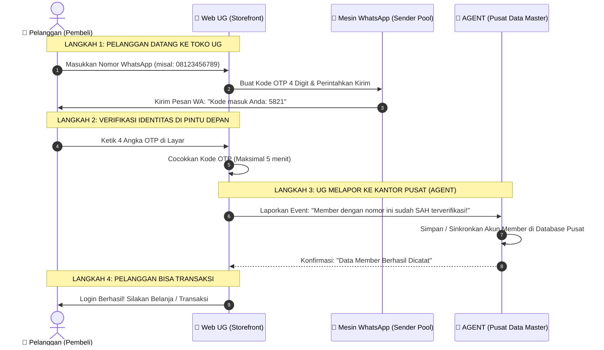

# 👔 PANDUAN LOGIKA BISNIS & ALUR KERJA SISTEM (UNTUK MANAJEMEN / BOS)

> **Tujuan Dokumen:**  
> Dokumen ini menjelaskan **konsep, alur logika, dan strategi bisnis** integrasi WhatsApp Gateway pada **Web UG (User Gateway)** dan **Sistem AGENT (Master Back-Office)** secara mudah, lugas, dan bebas dari istilah teknis koding yang rumit.

---

## 🏢 1. ANALOGI DASAR: RESEPSIONIS TOKO vs KANTOR PUSAT

Untuk memahami sistem ini dengan mudah, bayangkan sebuah perusahaan ritel besar:

```
+-------------------------------------------------------------+
|               UG (User Gateway / Web Toko)                  |
|               "Ibarat Resepsionis Toko Cabang"              |
|                                                             |
|  * Berada di pintu depan menyambut pengunjung / pembeli.    |
|  * Menanyakan nomor WhatsApp & memberikan stiker tiket masuk.|
|  * Memastikan orang yang datang membawa HP yang sah.        |
|  * TIDAK MENYIMPAN brankas uang atau data induk nasabah.    |
+-------------------------------------------------------------+
                                │
                                │ (Melapor setiap ada tamu sah)
                                ▼
+-------------------------------------------------------------+
|                AGENT (Master Back-Office)                   |
|                "Ibarat Kantor Pusat & Brankas Bank"          |
|                                                             |
|  * Menyimpan seluruh DATA MASTER MEMBER secara terpusat.    |
|  * Mengelola saldo, dompet digital, deposit, dan penarikan. |
|  * Mengatur status akun (Aktif, VIP, Banned, Limit).        |
|  * Pusat kendali utama untuk semua cabang toko UG.          |
+-------------------------------------------------------------+
```

### Mengapa Pembagian Ini Sangat Penting Bagi Bisnis Kita?
1. **Web UG Tetap Ringan & Cepat:**  
   Web UG adalah etalase belanja. Beban kerjanya difokuskan untuk melayani transaksi dan pengunjung secepat mungkin tanpa dibebani memori database raksasa.
2. **Data Member Terlindungi di AGENT:**  
   Jika data member disimpan tersebar di banyak web toko, data akan berantakan dan rawan bocor. Dengan menyatukan data di **AGENT**, seluruh data aset pelanggan berada dalam satu brankas pusat yang aman.
3. **Bisa Membuka Banyak Toko Sekaligus (Skalabilitas):**  
   Besok lusa jika bos ingin membuka 5 website baru (UG-1, UG-2, UG-3...), semua pelanggan dari toko mana pun tetap tercatat di **SATU SISTEM AGENT PUSAT**.

---

## 🔄 2. BAGAIMANA ALUR KERJA LOGIKANYA DARI AWAL SAMPAI AKHIR?

Berikut adalah perjalanan dari saat pelanggan datang hingga data masuk ke sistem Agent:



---

## 🛡️ 3. SISTEM "ANTI-MACET" & "ANTI-BANNED" (MULTI-SENDER POOL)

Salah satu ketakutan terbesar dalam bisnis berbasis WhatsApp adalah:  
> *"Bagaimana kalau nomor WhatsApp kita diblokir, kuota habis, atau server WhatsApp-nya bermasalah? Apakah transaksi toko langsung lumpuh?"*

**Jawabannya: TIDAK AKAN LUMPUH.**

Sistem ini telah dilengkapi fitur cerdas bernama **Multi-Sender Pool & Auto-Failover**:

```
                              [ PERMINTAAN KIRIM OTP ]
                                         │
                                         ▼
                     +---------------------------------------+
                     |    Sistem Pemilih Nomor Otomatis      |
                     |  (Memilih nomor yang paling santai)   |
                     +---------------------------------------+
                                   /           \
                                  /             \
                   (Prioritas 1) /               \ (Cadangan Otomatis)
                                ▼                 ▼
                    [ NOMOR WA PENGIRIM 1 ]     [ NOMOR WA PENGIRIM 2 ]
                                │                         │
                                │ (Misal: Limit / Putus)   │ (Langsung Ambil Alih)
                                ❌                        ▼
                      Sistem Otomatis Ganti      Pesan Tetap Terkirim
                      Detik Itu Juga!            ke HP Pelanggan!
```

### Keunggulan untuk Manajemen:
1. **Rotasi Beban Kerja (Load Balancing):**  
   Jika ada 1.000 pelanggan login sehari, sistem tidak membebani 1 nomor saja, melainkan membagi beban secara merata ke Nomor 1, Nomor 2, dan Nomor 3. Nomor WA kita jadi awet dan bebas risiko dicurigai spam oleh WhatsApp.
2. **Penyelamat Transaksi Otomatis (Failover):**  
   Jika Nomor 1 mendadak bermasalah, sistem langsung mengalihkan pengiriman ke Nomor 2 dalam hitungan milidetik. Pembeli tidak akan merasakan error apa pun.

---

## 💡 4. RANGKUMAN NILAI BISNIS UNTUK MANAJEMEN

| Aspek | Solusi Kami Saat Ini | Solusi Vendor Luar (SaaS Pihak Ketiga) |
|---|---|---|
| **Biaya Bulanan** | **Rp 0,-** (Memanfaatkan server sendiri & nomor kantor sendiri). | Bayar Rp 500.000 - Rp 3.000.000 / bulan + biaya per pesan. |
| **Keamanan Data** | **100% Aman di tangan sendiri.** Nomor HP nasabah tidak pernah bocor ke pihak luar. | Nomor nasabah terekam di server pihak ketiga yang rawan disalahgunakan. |
| **Kenyamanan Pelanggan** | Cukup 4 digit angka, tidak perlu mengingat password rumit yang sering bikin pelanggan batal belanja. | Sering gagal kirim atau antre panjang jika server vendor luar sedang down. |
| **Kepemilikan Aset** | Infrastruktur ini menjadi **aset teknologi milik perusahaan kita sendiri**. | Hanya sewa, jika berhenti bayar semua sistem mati. |

---

## 🎯 KESIMPULAN UNTUK BOS:
- **UG** adalah pintu gerbang operasional transaksi di depan pelanggan.
- **AGENT** adalah penguasa data member dan pusat kendali bisnis di belakang.
- **WhatsApp Gateway** adalah jembatan penghubung yang cepat, hemat, dan memiliki pengaman anti-gagal otomatis (*failover*).
