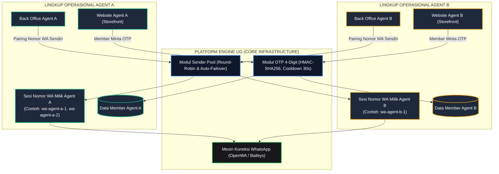

# 🛠️ PANDUAN TEKNIS IMPLEMENTASI: MODUL WHATSAPP PADA ENGINE UG

> **Dokumen Riset & Usulan Teknis R&D**  
> **Target Pembaca:** Tim Developer Backend & Frontend Engine UG.  
> **Fokus Utama:** Implementasi modul WhatsApp Gateway multi-sender pada Engine UG dengan jaminan **isolasi data per-Agent** (Multi-Tenant / Agent Scoping).

---

## 📌 1. PRINSIP DASAR ARSITEKTUR ENGINE UG

Sesuai model bisnis UG Company sebagai penyedia platform:
1. **Isolasi Lingkup Agent:**  
   Setiap Agent (misal Agent A, Agent B) memiliki pengaturannya sendiri. Nomor pengirim WhatsApp milik Agent A **hanya** melayani permintaan dari website Agent A, dan data membernya terikat pada lingkup Agent tersebut.
2. **Netralitas Arsitektur Database:**  
   Modul ini dirancang fleksibel agar kompatibel baik jika sistem menggunakan **Single Database Multi-Tenant** (berdasarkan identifier Agent / `tenant_key`) maupun **Separate Database** per Agent.
3. **Modular & Siap Tanam:**  
   Modul terdiri atas dua bagian besar:
   - **Frontend Template**: Komponen form login OTP 4 digit untuk website member & panel manajemen nomor di back office agent.
   - **Backend Engine**: Service pemroses OTP, rotasi pengirim (*sender pool*), dan penghubung mesin WhatsApp lokal.

---

## 🏗️ 2. DIAGRAM ARSITEKTUR MULTI-AGENT



---

## 💻 3. KOMPONEN BACKEND ENGINE (LARAVEL)

### A. Struktur File Modul (`reference-laravel-client/`):
```
app/
├── Http/
│   └── Controllers/
│       ├── Api/
│       │   └── WhatsAppOtpController.php           # Endpoint login OTP member website
│       └── BackOffice/
│           └── WhatsAppGatewayBackOfficeController.php # Endpoint panel kontrol Agent (Pairing & Pool)
└── Services/
    └── WhatsAppOtp/
        ├── OtpService.php                          # Logic OTP 4 digit & verifier
        ├── SenderPoolService.php                   # Pengatur nomor pengirim per-Agent
        ├── OpenWaSessionClient.php                 # Driver komunikasi ke socket OpenWA
        ├── PhoneNumber.php                         # Normalisasi format E.164 (+62)
        └── Transport/
            ├── OpenWaTransport.php                 # HTTP Client pengirim pesan
            └── PooledTransport.php                 # Auto-Failover & rotasi nomor
```

---

### B. Isolasi Lingkup Agent pada Database (`sender_pool`)
Tabel `sender_pool` wajib memiliki kolom identitas Agent (`tenant_key` / `agent_id`) agar nomor milik Agent A tidak pernah digunakan oleh Agent B:

```php
Schema::create('sender_pool', function (Blueprint $table) {
    $table->id();
    $table->string('tenant_key', 64)->default('default')->comment('ID / Identitas Agent Pemilik');
    $table->string('session_id', 128)->comment('ID Sesi unik di engine WA, misal: agent-a-sender-1');
    $table->string('label', 128)->nullable()->comment('Label pengenal nomor, misal: CS Utama');
    $table->string('status', 24)->default('active')->comment('active | suspended | disconnected');
    $table->string('phone_e164', 20)->nullable()->comment('Nomor HP WA yang tersambung');
    $table->string('push_name', 128)->nullable();
    $table->timestamp('last_used_at')->nullable();
    $table->timestamp('suspended_at')->nullable();
    $table->string('suspend_reason', 255)->nullable();
    $table->unsignedInteger('fail_count')->default(0);
    $table->timestamps();

    // Isolasi unik per Agent
    $table->unique(['tenant_key', 'session_id']);
    $table->index(['tenant_key', 'status', 'last_used_at']);
});
```

---

### C. Alur Kerja Logika Auto-Failover di `PooledTransport.php`
Ketika member website Agent A meminta OTP:
1. `PooledTransport` memfilter nomor pengirim **hanya** yang bertanda `tenant_key = Agent A` dan berstatus `active`.
2. Nomor diurutkan berdasarkan `last_used_at ASC` (yang paling lama istirahat).
3. Jika Nomor 1 gagal kirim (koneksi terputus/limit):
   - Sistem mencatat kegagalan pada Nomor 1 dan mengaktifkan masa jeda (*cooldown*).
   - Sistem **seketika mengalihkan pengiriman ke Nomor 2 milik Agent A** tanpa menggagalkan proses login member.

---

### D. Kontrak Rute API Engine UG

```php
// 1. ENDPOINT MEMBER (DIGUNAKAN OLEH WEBSITE AGENT)
Route::prefix('auth/whatsapp')->middleware('throttle:60,1')->group(function () {
    Route::post('request-otp', [WhatsAppOtpController::class, 'requestOtp']);
    Route::post('verify-otp', [WhatsAppOtpController::class, 'verifyOtp']);
    Route::post('resend-otp', [WhatsAppOtpController::class, 'resendOtp']);
});

// 2. ENDPOINT BACK OFFICE (DIGUNAKAN OLEH PENGELOLA AGENT)
Route::prefix('backoffice/whatsapp')->middleware(['auth:sanctum', 'role:admin'])->group(function () {
    Route::get('senders', [WhatsAppGatewayBackOfficeController::class, 'listSenders']);
    Route::post('senders', [WhatsAppGatewayBackOfficeController::class, 'addSender']);
    Route::post('senders/{id}/toggle', [WhatsAppGatewayBackOfficeController::class, 'toggleSender']);
    Route::get('senders/{id}/qr', [WhatsAppGatewayBackOfficeController::class, 'getQrCode']);
    Route::post('senders/{id}/pairing-code', [WhatsAppGatewayBackOfficeController::class, 'requestPairingCode']);
    Route::post('senders/{id}/test-send', [WhatsAppGatewayBackOfficeController::class, 'testSend']);
    Route::get('verified-members', [WhatsAppGatewayBackOfficeController::class, 'verifiedMembers']);
});
```

---

## 🎨 4. KOMPONEN FRONTEND ENGINE (TEMPLATE WEB & BACK OFFICE)

### A. Template Form Login Member (Website Agent)
- **Input Nomor HP**: Input nomor dengan validasi awal (format ID `08...` atau `+62...`).
- **Input 4 Digit OTP**:
  - 4 kotak input terpisah dengan fitur auto-focus ke kotak berikutnya saat 1 digit diketik.
  - Begitu digit ke-4 terisi, form **otomatis mengeksekusi verifikasi** tanpa perlu klik tombol submit.
- **Timer Cooldown**: Tombol *Kirim Ulang* terkunci dengan hitungan mundur 30 detik (`resend_after: 30`).

### B. Panel Pengaturan WhatsApp di Back Office Agent
- Pengelola Agent dapat melihat daftar nomor WA miliknya.
- **Dua Metode Pairing**:
  1. *Scan QR Code*: Muncul gambar QR di layar untuk discan via HP operasional Agent.
  2. *8-Digit Pairing Code*: Agent mengetik nomor HP operasionalnya, lalu muncul kode 8 karakter untuk dimasukkan ke WhatsApp di HP (tanpa kamera).
- **Auto-Close Modal**: Panel otomatis mendeteksi ketika HP selesai dipairing (`status: ready/working`) dan menutup pop-up modal secara otomatis.

---

## 📌 5. REKOMENDASI IMPLEMENTASI TAHAP BERIKUTNYA UNTUK TIM UG

1. **Review Source Asli Engine UG**:  
   Ketika akses ke repository engine utama diberikan oleh manajemen, pastikan cara penentuan identitas Agent (`tenant_resolver`) disesuaikan dengan standar yang ada di engine (apakah melalui subdomain, header domain, atau session token).
2. **Uji Coba Multi-Nomor per Agent**:  
   Lakukan pengujian skenario rotasi dengan minimal 2 nomor WhatsApp pada satu akun Agent untuk memvalidasi fungsi auto-failover.
3. **Dokumentasi Panduan Pemakaian untuk Agent**:  
   Siapkan materi panduan ringkas (PDF/Panduan Layar) yang bisa dibagikan kepada para Agent mengenai cara pairing nomor WA kantor mereka sendiri.
