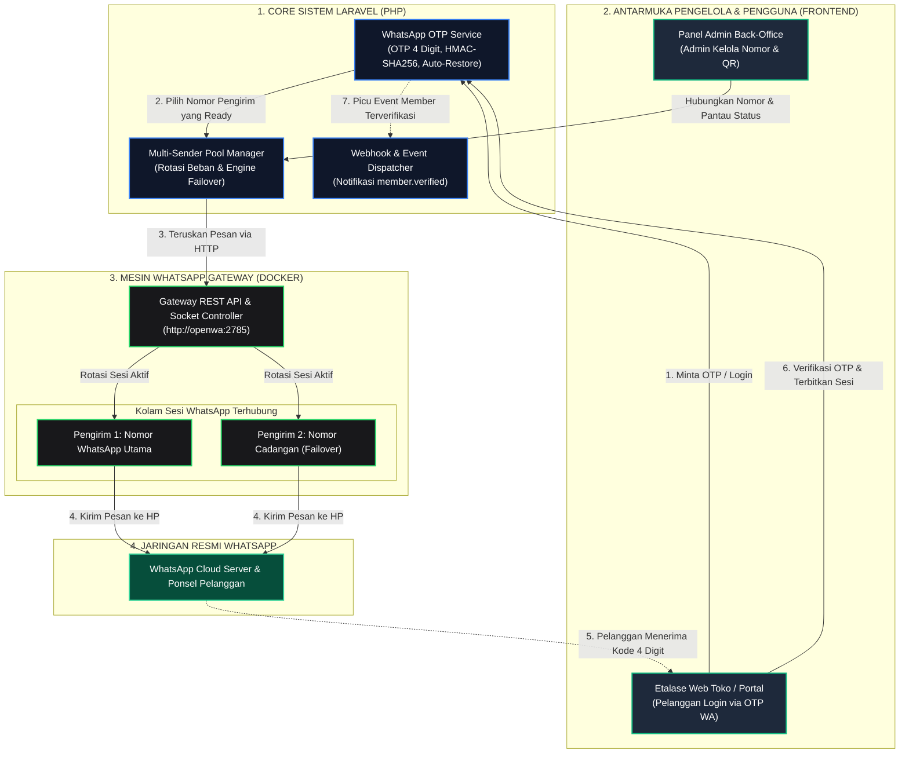
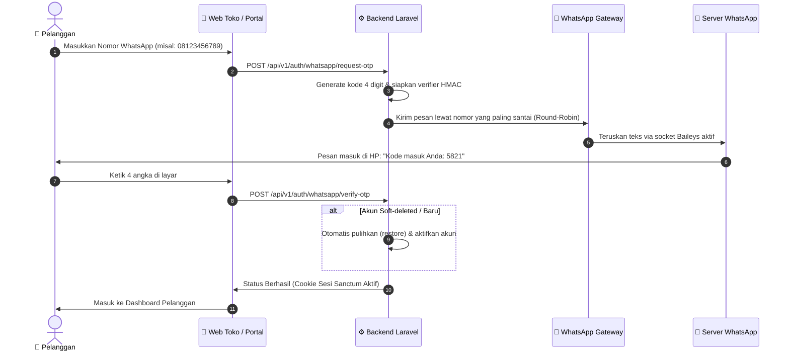
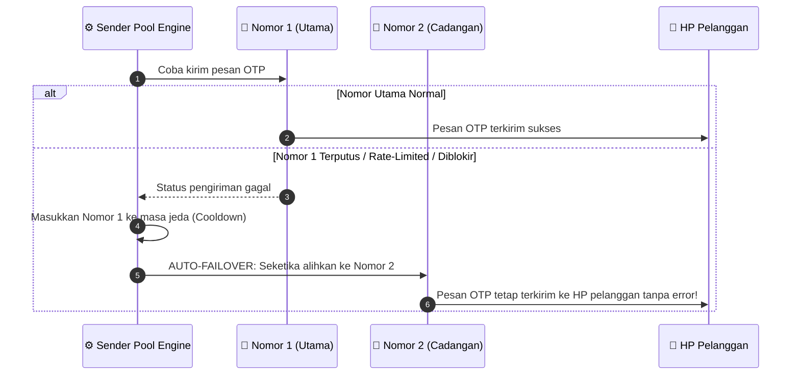
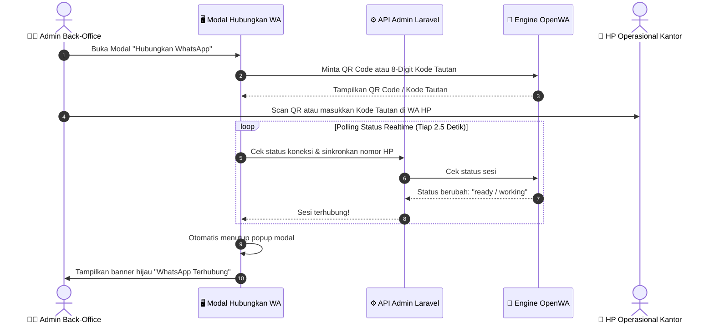

# WhatsApp Gateway & Back-Office Integration Engine

<p align="center">
  <strong>Infrastruktur WhatsApp Gateway Ringan dengan Multi-Sender Pool, Auto-Failover, dan Integrasi Native Laravel Admin</strong>
</p>

<p align="center">
  <a href="README.md"><strong>English</strong></a> •
  <a href="README.id.md"><strong>Bahasa Indonesia</strong></a>
</p>

<p align="center">
  
  
  
  
</p>

---

## 📌 Ringkasan Proyek

Repository ini menyediakan **WhatsApp Gateway Engine & Paket Integrasi Laravel** siap pakai yang dioptimalkan khusus untuk **operasional Back-Office dan alur transaksi** (Autentikasi Member, OTP 4 Digit, Notifikasi Pesanan, dan Portal Pelanggan).

Berbeda dari tumpukan kode yang rumit dan membutuhkan kompilasi JavaScript, repositori ini telah disederhanakan murni menjadi dua bagian:
1. **Engine Docker Zero-Config** (`docker-compose.yml`): Satu file Docker Compose yang langsung menjalankan engine socket WhatsApp (Baileys) dari image resmi siap pakai tanpa perlu kompilasi Node.js lokal.
2. **Paket Native Laravel** (`reference-laravel-client/`): Berkas service, controller, migration, dan konfigurasi yang siap disalin langsung ke dalam aplikasi Laravel perusahaan Anda tanpa perlu token API eksternal atau URL `.env`.

---

## 🏗️ 1. Diagram Arsitektur & Ekosistem Sistem

Memahami bagaimana lapisan engine, pengelola, dan pengguna saling terhubung secara terstruktur:



---

## 🔄 2. Diagram Alur Kerja Operasional (Step-by-Step)

### A. Alur Login & Verifikasi OTP 4 Digit
Bagaimana pelanggan masuk ke sistem dengan mudah tanpa perlu mengingat kata sandi rumit:



---

### B. Alur Multi-Sender Auto-Failover (Anti-Macet)
Bagaimana transaksi pelanggan diselamatkan jika ada nomor pengirim yang bermasalah:



---

### C. Alur Pairing Nomor WhatsApp dengan Auto-Dismiss Modal
Kemudahan pengelola dalam menyambungkan nomor WhatsApp tanpa perlu me-refresh layar:



---

## ⚡ 3. Fitur Utama & Keunggulan Arsitektur

### 1. 🔄 Multi-Sender Pool & Failover
* **Rotasi Beban (Round-Robin)**: Membagi volume pengiriman pesan ke seluruh nomor aktif berdasarkan `last_used_at` agar nomor awet dan terhindar dari pemblokiran.
* **Auto-Failover Cerdas**: Jika salah satu nomor mengalami limit atau gangguan jaringan, sistem otomatis mengalihkan pengiriman ke nomor cadangan berikutnya di pool.
* **Pemulihan Otomatis (Self-Healing)**: Nomor yang sempat gagal akan masuk masa jeda (*cooldown*) dan otomatis aktif kembali setelah periode pemulihan.

### 2. 🔢 OTP WhatsApp 4 Digit (Zero-Leak)
* **Format**: 4 digit angka acak (`0000`–`9999`) yang ringkas dan ramah pengguna di ponsel.
* **Keamanan Tanpa Kebocoran**: Diverifikasi melalui tanda tangan HMAC-SHA256 stateless; kode OTP mentah tidak pernah disimpan di database.
* **Auto-Restore Akun**: Memulihkan akun yang sebelumnya di-soft-delete dalam masa pengujian (*testing*) begitu verifikasi nomor berhasil.
* **Kirim Ulang Terproteksi**: Cooldown kirim ulang 30 detik yang ditegakkan dari sisi server.

### 3. 📲 Pilihan Dua Metode Pairing
* **Scan Kode QR**: Alur pairing standar seperti WhatsApp Web.
* **Kode Tautan 8 Karakter**: Menghubungkan nomor via notifikasi WhatsApp di HP tanpa kamera.
* **Auto-Dismiss UI**: Modal pairing otomatis mendeteksi koneksi aktif dan menutup sendiri.

---

## 📂 4. Struktur Direktori Proyek yang Bersih

```
wa-gateway/
├── docker-compose.yml            # 🐳 Zero-config Docker stack untuk menjalankan Engine WhatsApp
├── reference-laravel-client/     # 🌟 Paket integrasi lengkap siap pakai untuk Laravel
│   ├── config/
│   │   └── whatsapp_otp.php      # File konfigurasi Laravel
│   ├── database/migrations/      # Migration database (sender_pool & otp_challenges)
│   ├── src/
│   │   ├── Controllers/          # Controller WhatsAppOtpController, SenderPoolController, dll
│   │   └── Services/WhatsAppOtp/ # Service OtpService, SenderPoolService, PooledTransport, dll
│   └── README.md                 # Panduan instalasi ke Laravel
├── README.md                     # Dokumentasi utama (Bahasa Inggris)
├── README.id.md                  # Dokumentasi utama (Bahasa Indonesia)
└── LICENSE                       # Lisensi MIT
```

---

## 💻 5. Integrasi Native Laravel (Zero-Config / Tanpa .env)

Modul ini dirancang untuk **Integrasi Native Zero-Config** langsung di dalam backend Laravel Anda. Anda **TIDAK PERLU** token API tambahan, kunci rahasia manual, atau URL `.env` eksternal.

### 1. Salin Berkas Paket ke Laravel Anda
```bash
# 1. Salin Konfigurasi
cp reference-laravel-client/config/whatsapp_otp.php config/

# 2. Salin Migration Database
cp reference-laravel-client/database/migrations/* database/migrations/

# 3. Salin Services
cp -r reference-laravel-client/src/Services/WhatsAppOtp app/Services/

# 4. Salin Controllers
cp reference-laravel-client/src/Controllers/WhatsAppOtpController.php app/Http/Controllers/Api/
cp reference-laravel-client/src/Controllers/SenderPoolController.php app/Http/Controllers/Api/Admin/
cp reference-laravel-client/src/Controllers/VerifiedMembersController.php app/Http/Controllers/Api/Admin/
cp reference-laravel-client/src/Controllers/WhatsAppMemberWebhookController.php app/Http/Controllers/Api/
```

### 2. Jalankan Migration Database
```bash
php artisan migrate
```

### 3. Daftarkan Rute di `routes/api.php`
```php
use App\Http\Controllers\Api\WhatsAppOtpController;
use App\Http\Controllers\Api\Admin\SenderPoolController;
use App\Http\Controllers\Api\Admin\VerifiedMembersController;
use App\Http\Controllers\Api\WhatsAppMemberWebhookController;

// 1. Endpoint Login / OTP Pelanggan
Route::prefix('auth/whatsapp')->middleware('throttle:60,1')->group(function () {
    Route::post('request-otp', [WhatsAppOtpController::class, 'requestOtp']);
    Route::post('verify-otp', [WhatsAppOtpController::class, 'verifyOtp']);
    Route::post('resend-otp', [WhatsAppOtpController::class, 'resendOtp']);
});

// 2. Endpoint Panel Admin Pengelola Nomor WhatsApp
Route::prefix('admin/sender-pool')
    ->middleware(['auth:sanctum', 'role:super-admin|admin'])
    ->controller(SenderPoolController::class)
    ->group(function () {
        Route::get('/', 'index');
        Route::post('/', 'store');
        Route::get('{id}', 'show');
        Route::post('{id}/toggle', 'toggle');
        Route::post('{id}/sync', 'sync');
        Route::get('{id}/qr', 'qr');
        Route::post('{id}/pairing-code', 'pairingCode');
        Route::post('{id}/test-send', 'testSend');
        Route::delete('{id}', 'destroy');
    });

// 3. Daftar Member Terverifikasi
Route::prefix('admin/verified-members')
    ->middleware(['auth:sanctum', 'role:super-admin|admin'])
    ->controller(VerifiedMembersController::class)
    ->group(function () {
        Route::get('/', 'index');
        Route::get('{id}', 'show');
    });

// 4. Webhook Realtime Member Terverifikasi
Route::post('webhooks/whatsapp/member-verified', WhatsAppMemberWebhookController::class)
    ->withoutMiddleware([\App\Http\Middleware\VerifyCsrfToken::class]);
```

---

## 🐳 6. Menjalankan Engine WhatsApp (Docker)

Untuk menjalankan mesin background WhatsApp Baileys di server, cukup ketik:

```bash
docker compose up -d
```

* Selesai! Tanpa setup `.env` dan tanpa perlu compile Node.js.
* Engine akan berjalan otomatis di latar belakang dan melayani komunikasi privat di port `18091` (dan `http://openwa:2785` di jaringan bridge Docker).

---

## 🔒 7. Kebijakan Keamanan & Data Pribadi

1. **Kredensial Terenkripsi**: API key pada tabel pool disimpan terenkripsi menggunakan AES-256 (`Crypt::encryptString`) dan tidak pernah diekspos dalam format plaintext di respons API.
2. **Verifier Stateless HMAC**: Kode OTP diverifikasi melalui tanda tangan HMAC-SHA256 acak sekali pakai (*single-use*); kode OTP mentah tidak disimpan di database.
3. **Isolasi Jaringan Internal**: Engine WhatsApp berkomunikasi secara privat di dalam jaringan bridge Docker internal (`http://openwa:2785`), tidak dapat diakses dari internet publik.

---

## 👤 Pengembang & Hak Cipta

Dikembangkan dan disesuaikan oleh:
* **Billi Panca Wijaya** ([GitHub: @billi-panca-wijaya](https://github.com/billi-panca-wijaya))

Dilisensikan di bawah lisensi [MIT License](LICENSE).
