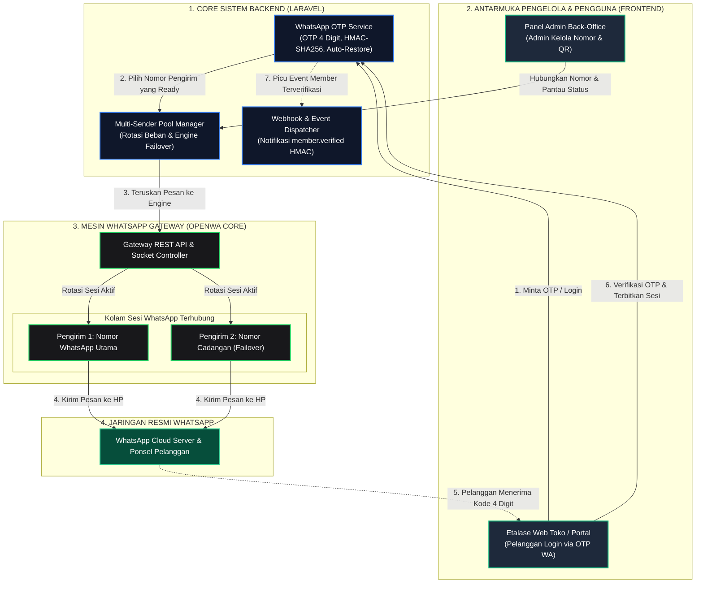
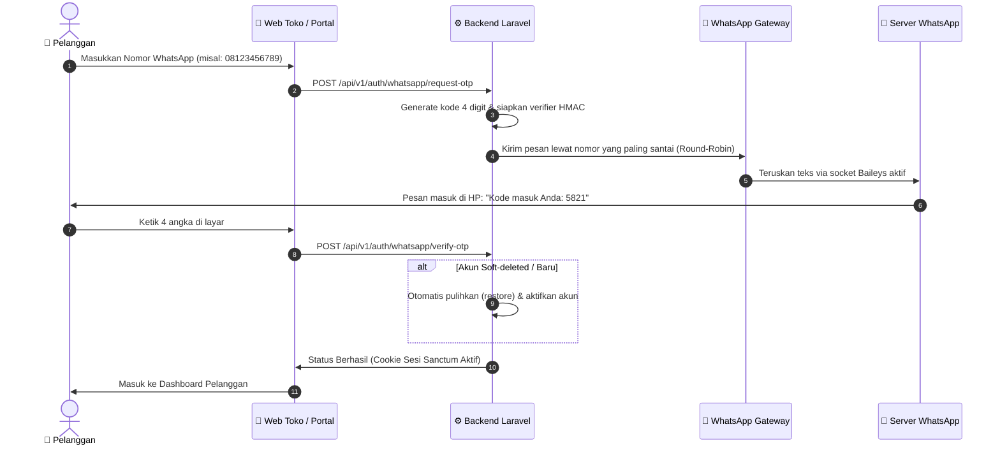
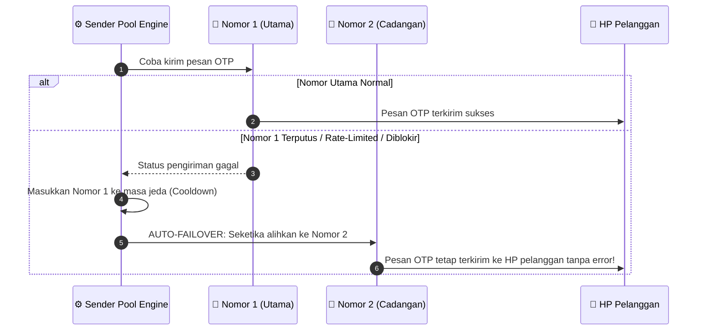
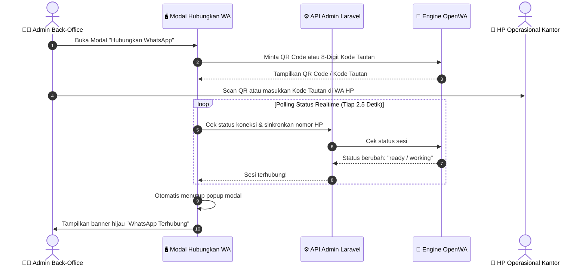

# WhatsApp Gateway & Back-Office Integration Engine

<p align="center">
  <strong>Infrastruktur WhatsApp Gateway Performa Tinggi dengan Multi-Sender Pool, Auto-Failover, dan Integrasi Native Laravel Admin</strong>
</p>

<p align="center">
  <a href="README.md"><strong>English</strong></a> •
  <a href="README.id.md"><strong>Bahasa Indonesia</strong></a>
</p>

<p align="center">
  
  
  
  
  
</p>

---

## 📌 Ringkasan Proyek

Repository ini merupakan **WhatsApp Gateway Engine** kelas enterprise yang telah dirombak, dioptimasi, dan disesuaikan secara khusus untuk kebutuhan **integrasi Back-Office dan sistem transaksi online** (Autentikasi Member, OTP 4 Digit, Notifikasi Pesanan, dan Portal Pelanggan).

Berbeda dari gateway mandiri standar yang berjalan sebagai panel terpisah (*isolated standalone panel*), arsitektur pada repositori ini dirancang sebagai **fondasi infrastruktur *headless*** yang menyatu langsung ke sistem Laravel Admin:
* **Zero-Config Integrasi Native**: Modul controller dan service (`reference-laravel-client/`) langsung ditempatkan di dalam struktur Laravel Anda. Tidak perlu konfigurasi token API manual atau URL `.env` eksternal.
* **Multi-Sender Pool & Auto-Failover**: Mendukung banyak nomor WhatsApp sekaligus. Sistem membagi beban pengiriman (*Round-Robin*) dan seketika beralih ke nomor cadangan jika nomor utama mengalami limit atau gangguan.
* **OTP WhatsApp 4 Digit Aman (Zero-Leak)**: Verifikasi 4 digit angka yang cepat dan ramah pengguna dengan verifier stateless HMAC-SHA256 (tanpa menyimpan kode OTP mentah di database) serta pemulihan otomatis (*auto-restore*) untuk akun yang terhapus saat pengujian.
* **Pairing Realtime dengan Auto-Close Modal**: Menghubungkan nomor WhatsApp melalui Scan QR Code atau 8-digit Kode Tautan. Tampilan popup secara otomatis mendeteksi koneksi aktif (`ready/working`) dan menutup sendiri seketika.

---

## 🏗️ 1. Diagram Arsitektur & Ekosistem Sistem

Memahami bagaimana lapisan engine, pengelola, dan pengguna saling terhubung secara terstruktur:



---

## 🔄 2. Diagram Alur Kerja Operasional (Step-by-Step)

### A. Alur Login & Verifikasi OTP 4 Digit
Bagaimana pelanggan masuk ke sistem dengan mudah tanpa perlu mengingat kata sandi rumit:



---

### B. Alur Multi-Sender Auto-Failover (Anti-Macet)
Bagaimana transaksi pelanggan diselamatkan jika ada nomor pengirim yang bermasalah:



---

### C. Alur Pairing Nomor WhatsApp dengan Auto-Dismiss Modal
Kemudahan pengelola dalam menyambungkan nomor WhatsApp tanpa perlu me-refresh layar:



---

## ⚡ 3. Fitur Utama & Keunggulan Arsitektur

### 1. 🔄 Multi-Sender Pool & Failover
* **Rotasi Beban (Round-Robin)**: Membagi volume pengiriman pesan ke seluruh nomor aktif berdasarkan `last_used_at` agar nomor awet dan terhindar dari pemblokiran.
* **Auto-Failover Cerdas**: Jika salah satu nomor mengalami limit atau gangguan jaringan, sistem otomatis mengalihkan pengiriman ke nomor cadangan berikutnya di pool.
* **Pemulihan Otomatis (Self-Healing)**: Nomor yang sempat gagal akan masuk masa jeda (*cooldown*) dan otomatis aktif kembali setelah periode pemulihan.

### 2. 🔢 OTP WhatsApp 4 Digit (Zero-Leak)
* **Format**: 4 digit angka acak (`0000`–`9999`) yang ringkas dan ramah pengguna di ponsel.
* **Keamanan Tanpa Kebocoran**: Diverifikasi melalui tanda tangan HMAC-SHA256 stateless; kode OTP mentah tidak pernah disimpan di database.
* **Auto-Restore Akun**: Memulihkan akun yang sebelumnya di-soft-delete dalam masa pengujian (*testing*) begitu verifikasi nomor berhasil.
* **Kirim Ulang Terproteksi**: Cooldown kirim ulang 30 detik yang ditegakkan dari sisi server.

### 3. 📲 Pilihan Dua Metode Pairing
* **Scan Kode QR**: Alur pairing standar seperti WhatsApp Web.
* **Kode Tautan 8 Karakter**: Menghubungkan nomor via notifikasi WhatsApp di HP tanpa kamera.
* **Auto-Dismiss UI**: Modal pairing otomatis mendeteksi koneksi aktif dan menutup sendiri.

### 4. 🎨 Tampilan Terpadu Bergaya OpenWA
* Dirancang dengan estetika *sleek dark mode*, aksen hijau WhatsApp (`#25d366`), dan scrollbar kustom *ultra-thin* (6px).
* Menu terpadu **"Sesi & Nomor Pengirim WA"**, menjaga pengaturan internal server tersembunyi di latar belakang.

---

## 📂 4. Struktur Direktori Proyek

```
wa-gateway/
├── reference-laravel-client/     # 🌟 Modul referensi siap pakai untuk Laravel Admin
│   ├── src/
│   │   ├── Services/             # WhatsAppGatewayClient.php (Internal Caller & Failover)
│   │   └── Controllers/          # BackOffice & Webhook Controllers
│   └── README.md                 # Panduan cepat Laravel client
├── src/                          # Core WhatsApp Gateway Engine (NestJS + TypeScript)
│   ├── modules/
│   │   ├── session/              # Manajemen sesi WhatsApp (Baileys)
│   │   ├── message/              # Pengiriman pesan teks, media, dan template
│   │   ├── webhook/              # Pengolahan webhook & antrean outbox
│   │   └── auth/                 # Autentikasi API key & tenant routing
├── deploy/                       # Skrip deployment Docker produksi
│   ├── compose.yaml              # Docker Compose multi-session stack
│   └── nginx.conf                # Konfigurasi proxy Nginx
├── dashboard/                    # Source UI panel kontrol OpenWA (React)
├── docs/                         # Dokumentasi arsitektur & spesifikasi API
└── README.md                     # Dokumentasi utama proyek
```

---

## 💻 5. Integrasi Native Laravel (Zero-Config / Tanpa .env)

Modul ini dirancang untuk **Integrasi Native Zero-Config** langsung di dalam backend Laravel Anda. Anda **TIDAK PERLU** token API tambahan, kunci rahasia manual, atau URL `.env` eksternal.

### 1. Struktur Penempatan Berkas di Laravel
Tempatkan file controller dan service ke dalam direktori aplikasi Laravel Anda:
```
app/
├── Http/
│   └── Controllers/
│       └── BackOffice/
│           ├── WhatsAppGatewayBackOfficeController.php  # Controller panel admin
│           └── WhatsAppMemberWebhookController.php       # Event listener member terverifikasi
└── Services/
    └── WhatsAppGateway/
        ├── WhatsAppGatewayClient.php                    # Service pemanggil internal & failover
        └── SenderPoolService.php                        # Service rotasi pool nomor WhatsApp
```

### 2. Salin Berkas Modul
```bash
# Salin Service ke app/Services/WhatsAppGateway/
cp reference-laravel-client/src/Services/* app/Services/WhatsAppGateway/

# Salin Controller ke app/Http/Controllers/BackOffice/
cp reference-laravel-client/src/Controllers/* app/Http/Controllers/BackOffice/
```

### 3. Daftarkan Rute di `routes/api.php`
Memanfaatkan autentikasi sesi admin yang sudah aktif:
```php
use App\Http\Controllers\BackOffice\WhatsAppGatewayBackOfficeController;
use App\Http\Controllers\BackOffice\WhatsAppMemberWebhookController;

// Rute Kontrol Pengirim & Member Terverifikasi (Admin Only)
Route::prefix('backoffice/whatsapp')->middleware(['auth:sanctum', 'role:admin'])->group(function () {
    Route::get('senders', [WhatsAppGatewayBackOfficeController::class, 'listSenders']);
    Route::post('senders', [WhatsAppGatewayBackOfficeController::class, 'addSender']);
    Route::post('senders/{id}/toggle', [WhatsAppGatewayBackOfficeController::class, 'toggleSender']);
    Route::get('senders/{id}/qr', [WhatsAppGatewayBackOfficeController::class, 'getQrCode']);
    Route::post('senders/{id}/pairing-code', [WhatsAppGatewayBackOfficeController::class, 'requestPairingCode']);
    Route::post('senders/{id}/test-send', [WhatsAppGatewayBackOfficeController::class, 'testSend']);
    Route::get('verified-members', [WhatsAppGatewayBackOfficeController::class, 'verifiedMembers']);
});

// Listener Event Saat Pelanggan Berhasil Verifikasi OTP
Route::post('webhooks/whatsapp/member-verified', WhatsAppMemberWebhookController::class)
    ->withoutMiddleware([\App\Http\Middleware\VerifyCsrfToken::class]);
```

---

## 🛠️ 6. Katalog API Endpoints Gateway

| Method | Endpoint | Deskripsi |
|---|---|---|
| `GET` | `/api/v1/admin/sender-pool` | Mengambil seluruh daftar nomor WhatsApp di pool beserta status dan statistik rotasi |
| `POST` | `/api/v1/admin/sender-pool` | Menambahkan nomor/sesi baru (`session_id`, `label`) |
| `GET` | `/api/v1/admin/sender-pool/{id}` | Detail nomor + status live dari container OpenWA |
| `DELETE` | `/api/v1/admin/sender-pool/{id}` | Menghapus nomor dari pool rotasi |
| `POST` | `/api/v1/admin/sender-pool/{id}/toggle` | Menunda (*pause*) atau mengaktifkan kembali nomor |
| `POST` | `/api/v1/admin/sender-pool/{id}/sync` | Sinkronisasi status dan nomor telepon live dari engine |
| `GET` | `/api/v1/admin/sender-pool/{id}/qr` | Mengambil data QR code (base64 PNG) untuk scan pairing |
| `POST` | `/api/v1/admin/sender-pool/{id}/pairing-code` | Meminta 8-digit kode pairing WhatsApp via nomor HP |
| `POST` | `/api/v1/admin/sender-pool/{id}/test-send` | Mengirim pesan WhatsApp uji coba dari nomor pengirim ini |
| `GET` | `/api/v1/admin/verified-members` | Daftar pengguna yang telah terverifikasi via OTP WhatsApp |

---

## 🐳 7. Menjalankan Engine Gateway (Docker)

1. **Clone Repository:**
   ```bash
   git clone https://github.com/billi-panca-wijaya/wa-gateway.git
   cd wa-gateway/deploy
   ```

2. **Jalankan Kontainer Gateway:**
   ```bash
   docker compose up -d
   ```

3. **Periksa Status Layanan:**
   ```bash
   docker compose ps
   ```

---

## 🔒 8. Kebijakan Keamanan & Data Pribadi

1. **Kredensial Terenkripsi**: API key pada tabel pool disimpan terenkripsi menggunakan AES-256 (`Crypt::encryptString`) dan tidak pernah diekspos dalam format plaintext di respons API.
2. **Verifier Stateless HMAC**: Kode OTP diverifikasi melalui tanda tangan HMAC-SHA256 acak sekali pakai (*single-use*); kode OTP mentah tidak disimpan di database.
3. **Isolasi Jaringan Internal**: Engine WhatsApp berkomunikasi secara privat di dalam jaringan bridge Docker internal (`http://openwa:2785`), tidak dapat diakses dari internet publik.

---

## 👤 Pengembang & Hak Cipta

Dikembangkan dan disesuaikan oleh:
* **Billi Panca Wijaya** ([GitHub: @billi-panca-wijaya](https://github.com/billi-panca-wijaya))

Dilisensikan di bawah lisensi [MIT License](LICENSE).
