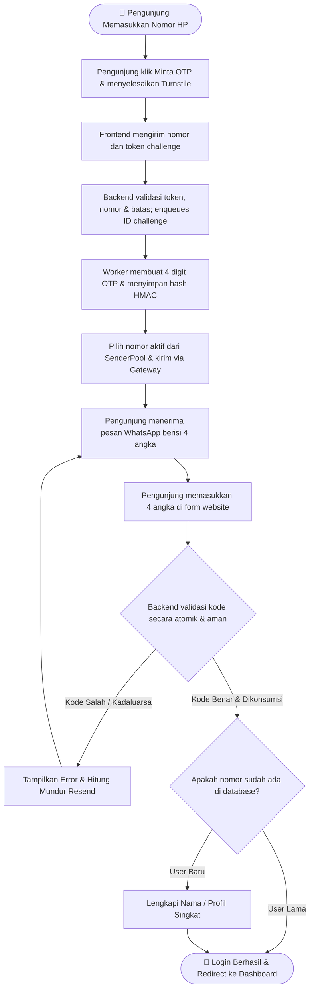

> **Arsitektur Sistem & PRD:** Untuk arsitektur teknis mendalam, diagram sekuens lengkap, skema API lengkap, kriptografi verifier, dan siklus otentikasi, lihat [WA_LOGIN_SYSTEM.md](WA_LOGIN_SYSTEM.md) dan [QUEUED_LOGIN.md](docs/QUEUED_LOGIN.md).

# 🚀 Enterprise WhatsApp Gateway & Paket Laravel (Standar Spatie)

[English](README.md) | [Bahasa Indonesia](README.id.md)

Sebuah ekosistem siap produksi: **WhatsApp API Gateway (Self-Hosted)** dan **Paket Laravel berstandar Spatie**. Tambahkan fitur **Login Pelanggan via WhatsApp OTP (4 digit)**, **Multi-Sender Device Pool (Rotasi Otomatis)**, serta **Back-Office Operasional** ke **aplikasi Laravel Anda** dengan konvensi Composer modern, auto-discovery paket, aset yang dapat di-publish, dan jaminan keamanan zero-overwrite.

---

## 📑 Daftar Isi
1. [Tujuan & Mengapa Menggunakan Ini](#-1-tujuan--mengapa-menggunakan-ini)
2. [Jaminan Zero-Overwrite & Desain Spatie](#-2-jaminan-zero-overwrite--desain-spatie)
3. [Arsitektur Sistem & Topologi Database](#-3-arsitektur-sistem--topologi-database)
   - [WhatsApp Gateway Engine (OpenWA Docker)](#a-whatsapp-gateway-engine-openwa-docker)
   - [Peran Database Backend (PostgreSQL, MySQL, MongoDB, Redis)](#b-peran-database-backend-postgresql-mysql-mongodb-redis)
4. [Diagram Alur & Siklus Hidup Login Pelanggan](#-4-diagram-alur--siklus-hidup-login-pelanggan)
5. [Struktur Direktori Proyek](#-5-struktur-direktori-proyek)
6. [Panduan Instalasi Langkah demi Langkah](#-6-panduan-instalasi-langkah-demi-langkah)
   - [Langkah 1: Jalankan Gateway Engine](#langkah-1-jalankan-whatsapp-gateway-engine)
   - [Langkah 2: Instal Paket via Composer](#langkah-2-instal-paket-via-composer)
   - [Langkah 3: Jalankan Installer Paket](#langkah-3-jalankan-installer-paket)
   - [Langkah 4: Tambahkan Trait ke Model User](#langkah-4-tambahkan-trait-ke-model-user)
   - [Langkah 5: Konfigurasi Database (SQL vs MongoDB)](#langkah-5-konfigurasi-database-sql-vs-mongodb)
   - [Langkah 6: Konfigurasi Environment (.env)](#langkah-6-konfigurasi-environment-env)
7. [Penggunaan Programatik & Facade API](#-7-penggunaan-programatik--facade-api)
8. [Setup Pertahanan Bot Cloudflare Turnstile](#-8-setup-pertahanan-bot-cloudflare-turnstile)
9. [Antrean Asinkron Redis & Supervisor](#-9-antrean-asinkron-redis--supervisor)
10. [Portal Admin Back-Office (9 Menu)](#-10-portal-admin-back-office-9-menu)
11. [Pairing Nomor Pengirim WhatsApp](#-11-pairing-nomor-pengirim-whatsapp)
12. [Panduan Operasional & Deployment Produksi](#-12-panduan-operasional--deployment-produksi)

---

## 🎯 1. Tujuan & Mengapa Menggunakan Ini

### Masalah yang Sering Dihadapi
- **Biaya API Cloud Sangat Mahal**: Layanan seperti Twilio atau Meta Cloud API mengenakan biaya langganan bulanan dan biaya per pesan yang mahal.
- **Add-on Copy-Paste yang Berantakan**: Menyalin file secara manual ke dalam folder `app/` mengotori codebase proyek Anda, rawan bentrok nama kelas, dan sulit di-update.
- **Single Point of Failure**: Bergantung pada satu nomor WhatsApp pengirim berisiko mematikan sistem jika nomor tersebut diblokir atau terputus.
- **Serangan Bot & OTP Pumping**: Endpoint publik login sering diserang spam bot otomatis yang menguras antrean dan membebani nomor pengirim.

### Solusi yang Disediakan
Repositori ini menyediakan dua komponen terpadu:
1. **Self-Hosted WhatsApp Gateway Engine**: Berjalan via Docker (OpenWA) menggunakan engine Baileys yang stabil. **Bebas biaya per pesan**, mandiri di server sendiri, dan mendukung multi-sesi socket pada port `18091`.
2. **Paket Laravel Berstandar Spatie (`billi-panca-wijaya/laravel-whatsapp-gateway`)**:
   - **Composer Auto-Discovery**: Terinstal rapi via Composer; service provider dan facade terdaftar otomatis tanpa perlu konfigurasi manual.
   - **Login Pelanggan WhatsApp OTP 4 Digit**: Passwordless, cepat, dan angka nol di awal tetap terjaga (`08xx` / `+628xx`).
   - **Perlindungan Cloudflare Turnstile**: Menangkal serangan bot sebelum kode OTP dikeluarkan atau dikirim.
   - **Antrean Asinkron Redis**: Memisahkan respon API dari latensi jaringan WhatsApp; respon frontend secepat kilat (<50ms).
   - **Multi-Device Sender Pool**: Hubungkan beberapa nomor WhatsApp sekaligus. Sistem membagikan pengiriman dengan rotasi **Round-Robin** dan otomatis beralih ke nomor lain jika ada nomor yang terputus (auto-failover).
   - **Aset Publishable**: Konfigurasi, migrasi, dan komponen antarmuka React dapat dipublikasikan dengan mudah via Artisan.

---

## 🛡️ 2. Jaminan Zero-Overwrite & Desain Spatie

**Aplikasi Laravel Anda yang sudah berjalan tidak akan tertimpa sama sekali.**  
Mengikuti filosofi paket open-source Spatie (seperti `spatie/laravel-permission`), seluruh kode berada di bawah namespace vendor `BilliPancaWijaya\WhatsAppGateway\` dan terhubung menggunakan kontrak serta traits.

| File / Folder Bawaan Laravel Anda | Implementasi Paket Kami | Risiko Tertimpa |
| :--- | :--- | :---: |
| `app/Models/User.php` | Trait `HasWhatsAppLogin` (`use HasWhatsAppLogin;`) | ❌ **TIDAK PERNAH** |
| `config/` | Dipublikasikan sebagai `config/whatsapp-gateway.php` | ❌ **TIDAK PERNAH** |
| `database/migrations/` | Migrasi defensif yang mengecek keberadaan kolom | ❌ **TIDAK PERNAH** |
| `routes/api.php` | Didaftarkan otomatis oleh ServiceProvider dengan prefix fleksibel | ❌ **TIDAK PERNAH** |
| `app/Http/Controllers/` | Controller ber-namespace mandiri di dalam `src/Http/Controllers/` | ❌ **TIDAK PERNAH** |

---

## 🔄 3. Arsitektur Sistem & Topologi Database

### A. WhatsApp Gateway Engine (OpenWA Docker)
WhatsApp Gateway adalah microservice independen di dalam container (`wa-gateway-openwa`, Port `18091`). Engine ini **sepenuhnya database-agnostik**:
- Menyimpan sesi socket internal di dalam Docker volume (`openwa-data`).
- **Tidak terhubung langsung** ke database PostgreSQL, MySQL, atau MongoDB Anda.
- Berkomunikasi secara eksklusif melalui **HTTP REST API** (backend mengirim instruksi kirim pesan) dan **Webhooks** (gateway mengirim update status pesan masuk/terkirim).

```text
┌────────────────────────────────────────────────────────────────────────┐
│                        BACKEND LARAVEL ANDA                            │
│                                                                        │
│   ┌──────────────┐       ┌──────────────┐       ┌──────────────────┐   │
│   │  PostgreSQL  │       │    Redis     │       │     MongoDB      │   │
│   │   / MySQL    │  ATAU │   (Antrean   │  ATAU │  (Dokumen User   │   │
│   │ (Relasional) │       │   & Cache)   │       │   & Log Chat)    │   │
│   └──────▲───────┘       └──────▲───────┘       └────────▲─────────┘   │
│          │                      │                        │             │
│          └──────────────────────┼────────────────────────┘             │
│                                 │                                      │
│                        Logika Aplikasi Laravel                         │
│               (WhatsAppGateway Facade / Controllers)                   │
└─────────────────────────────────┬──────────────────────────────────────┘
                                  │
                  1. Kirim Pesan (HTTP POST JSON)
                  2. Webhook Event (HTTP POST JSON)
                                  │
                                  ▼
┌────────────────────────────────────────────────────────────────────────┐
│             WhatsApp Gateway Container (wa-gateway-openwa)             │
│                       Port 18091 (Internal/LAN)                        │
└─────────────────────────────────┬──────────────────────────────────────┘
                                  │
                         WebSocket (Baileys)
                                  │
                                  ▼
                     ┌─────────────────────────┐
                     │ Jaringan WhatsApp Dunia │
                     └─────────────────────────┘
```

### B. Peran Database Backend (PostgreSQL, MySQL, MongoDB, Redis)

| Database | Didukung? | Rekomendasi Peran dalam Sistem |
| :--- | :---: | :--- |
| **PostgreSQL / MySQL** | ✅ Native | **Database Utama**: Menyimpan akun pengguna, kolom verifikasi nomor, hash verifier OTP, dan daftar pool nomor pengirim. |
| **MongoDB** | ✅ Didukung | **Dokumen NoSQL**: Didukung melalui `mongodb/laravel-mongodb`. Menyimpan data pengguna dan OTP sebagai dokumen BSON. Cukup atur `user_model` di `config/whatsapp-gateway.php`. |
| **Redis** | ✅ Wajib di Produksi | **Antrean Asinkron & Cache**: Bertindak sebagai broker memori cepat untuk antrean `whatsapp-otp`, lock atomik (`Cache::lock`), dan penghitung batas rate limit. Redis tidak menggantikan database utama Anda. |

---

## 📊 4. Diagram Alur & Siklus Hidup Login Pelanggan



---

## 📁 5. Struktur Direktori Proyek

```text
wa-gateway/
├── composer.json                       # Definisi Paket Composer & Autoloading PSR-4
├── phpunit.xml.dist                    # Konfigurasi Pengujian PHPUnit
├── docker-compose.yml                  # Container WhatsApp Gateway Engine (OpenWA)
├── .env.example                        # Contoh Variabel Lingkungan Lengkap
├── LICENSE                             # Lisensi MIT
├── README.md / README.id.md            # Dokumentasi Bilingual (Inggris & Indonesia)
├── WA_LOGIN_SYSTEM.md                  # Spesifikasi Teknis & PRD Lengkap
│
├── config/
│   └── whatsapp-gateway.php            # Konfigurasi Publishable (`whatsapp-gateway-config`)
│
├── database/
│   └── migrations/                     # Migrasi Defensif Publishable
│       ├── 0001_create_whatsapp_user_columns.php
│       ├── 0002_create_whatsapp_otp_tables.php
│       └── 0003_create_whatsapp_sender_pools_table.php
│
├── routes/
│   └── api.php                         # Rute API, Admin Back-Office, dan Webhook
│
├── resources/
│   └── frontend/                       # Komponen UI React & SPA Back-Office
│
├── deploy/
│   ├── gateway-reverse-proxy.conf      # Konfigurasi Nginx reverse proxy
│   └── whatsapp-otp-worker.conf        # Template worker Supervisor
│
├── src/                                # Source Code PSR-4 (`BilliPancaWijaya\WhatsAppGateway\`)
│   ├── WhatsAppGateway.php             # Service Manager & Akses Facade
│   ├── WhatsAppGatewayServiceProvider.php # Service Provider Auto-Discovered
│   ├── Facades/
│   │   └── WhatsAppGateway.php         # Facade untuk Developer
│   ├── Commands/
│   │   ├── InstallWhatsAppGatewayCommand.php # `php artisan whatsapp-gateway:install`
│   │   ├── CheckGatewayStatusCommand.php     # `php artisan whatsapp-gateway:status`
│   │   └── PruneOtpChallengesCommand.php     # `php artisan whatsapp-gateway:prune`
│   ├── Exceptions/
│   │   └── OtpException.php            # Exception Domain dengan Render HTTP
│   ├── Http/Controllers/
│   │   ├── WhatsAppOtpController.php
│   │   ├── Admin/WhatsAppGatewayController.php
│   │   ├── Admin/WhatsAppSenderPoolController.php
│   │   ├── Admin/WhatsAppVerifiedMembersController.php
│   │   └── BackOffice/WhatsAppMemberWebhookController.php
│   ├── Jobs/
│   │   └── WhatsAppSendOtp.php         # Job Asinkron Antrean OTP
│   ├── Models/
│   │   ├── WhatsAppOtpChallenge.php
│   │   ├── WhatsAppOtpDelivery.php
│   │   └── WhatsAppSenderPool.php
│   ├── Services/
│   │   ├── OtpService.php              # Logika Utama Permintaan & Verifikasi OTP
│   │   ├── SenderPoolService.php       # Rotasi Multi-Nomor & Failover Otomatis
│   │   ├── OpenWaSessionClient.php     # Klien HTTP REST OpenWA
│   │   ├── PhoneNumber.php             # Normalisasi E.164 & Masking Nomor
│   │   ├── TenantResolver.php          # Resolusi Multi-Tenant
│   │   ├── WhatsAppBotChallenge.php    # Validasi Cloudflare Turnstile
│   │   └── Transport/                  # Driver Transport (Pooled, OpenWA, Mock)
│   └── Traits/
│       └── HasWhatsAppLogin.php        # Trait untuk Model User Eloquent
│
└── tests/                              # Pengujian Unit & Feature
    ├── TestCase.php                    # Base Test Orchestra Testbench
    └── Feature/WhatsAppOtpTest.php
```

---

## 🛠️ 6. Panduan Instalasi Langkah demi Langkah

### Langkah 1: Jalankan WhatsApp Gateway Engine
Dari direktori root repositori ini:
```bash
docker compose up -d
```
Pastikan container gateway aktif pada port `18091`:
```bash
curl http://127.0.0.1:18091/api/health/ready
# Output: {"status":"ok", ...}
```

### Langkah 2: Instal Paket via Composer
Di dalam proyek Laravel Anda, tambahkan repositori ke file `composer.json`:
```json
"repositories": [
    {
        "type": "vcs",
        "url": "https://github.com/billi-panca-wijaya/wa-gateway.git"
    }
]
```
Kemudian jalankan instalasi:
```bash
composer require billi-panca-wijaya/laravel-whatsapp-gateway:dev-main
```
*(Jika ingin menggunakan path lokal dalam pengembangan, gunakan `"type": "path", "url": "../wa-gateway"`).*

Sistem Package Auto-Discovery Laravel akan langsung mendaftarkan `WhatsAppGatewayServiceProvider` dan Facade `WhatsAppGateway`.

### Langkah 3: Jalankan Installer Paket
Jalankan perintah instalasi interaktif dari Artisan:
```bash
php artisan whatsapp-gateway:install
```
Perintah ini akan mempublikasikan file konfigurasi `config/whatsapp-gateway.php`, menyalin file migrasi, dan menawarkan opsi untuk langsung menjalankan migrasi database.

*Atau publikasikan tag secara manual:*
```bash
php artisan vendor:publish --tag="whatsapp-gateway-config"
php artisan vendor:publish --tag="whatsapp-gateway-migrations"
php artisan vendor:publish --tag="whatsapp-gateway-frontend"
```

### Langkah 4: Tambahkan Trait ke Model User
Buka model User Anda (misalnya `app/Models/User.php`) dan tambahkan trait `HasWhatsAppLogin`:

```php
namespace App\Models;

use BilliPancaWijaya\WhatsAppGateway\Traits\HasWhatsAppLogin;
use Illuminate\Foundation\Auth\User as Authenticatable;

class User extends Authenticatable
{
    use HasWhatsAppLogin;

    // ... seluruh properti dan fungsi lama Anda tetap aman
}
```

### Langkah 5: Konfigurasi Database (SQL vs MongoDB)

#### Opsi 5A: PostgreSQL / MySQL
Jalankan migrasi bawaan paket:
```bash
php artisan migrate
```
Ini akan mengeksekusi:
1. `0001_create_whatsapp_user_columns.php` (menambah `tenant_key`, `phone_e164`, `phone_verified_at`, dll.)
2. `0002_create_whatsapp_otp_tables.php` (membuat tabel `otp_challenges` dan `otp_deliveries`)
3. `0003_create_whatsapp_sender_pools_table.php` (membuat tabel `sender_pool`)

#### Opsi 5B: MongoDB
Jika aplikasi Laravel Anda menggunakan MongoDB (`mongodb/laravel-mongodb`):
1. Di file `config/whatsapp-gateway.php`, sesuaikan opsi `user_model` agar mengarah ke model Mongo User Anda.
2. Pasang trait `HasWhatsAppLogin` di model Mongo User tersebut.
3. Buat indeks unik untuk `phone_e164` di koleksi `users`.

### Langkah 6: Konfigurasi Environment (`.env`)
Tambahkan variabel berikut ke file `.env` Laravel Anda:
```dotenv
# WhatsApp Gateway Engine (Container OpenWA)
OPENWA_BASE_URL=http://127.0.0.1:18091
OPENWA_SESSION_ID=default
OPENWA_API_KEY=

# Rahasia HMAC & Pepper OTP (Wajib diisi pada server produksi)
WA_OTP_HMAC_SECRET=buat-string-rahasia-acak-sepanjang-64-karakter-di-sini
WA_OTP_TRANSPORT=openwa
WA_OTP_DEFAULT_REGION=ID

# Pertahanan Bot Cloudflare Turnstile
WA_OTP_TURNSTILE_ENABLED=true
WA_OTP_TURNSTILE_SITE_KEY=<site-key-turnstile-anda>
WA_OTP_TURNSTILE_SECRET_KEY=<secret-key-turnstile-anda>
WA_OTP_TURNSTILE_HOSTNAMES=domain-anda.com,login.domain-anda.com,localhost,127.0.0.1

# Antrean Asinkron Redis untuk OTP
QUEUE_CONNECTION=redis
CACHE_STORE=redis
WA_OTP_QUEUE_ENABLED=true
WA_OTP_QUEUE_CONNECTION=redis
WA_OTP_QUEUE_NAME=whatsapp-otp
REDIS_QUEUE_RETRY_AFTER=90

# Batas Rate Limit (Jendela 900 detik)
WA_OTP_SEND_PER_PHONE=5
WA_OTP_SEND_PER_IP=20
WA_OTP_SEND_SYSTEM=2000
WA_OTP_SEND_GLOBAL=500
WA_OTP_SEND_WINDOW_SECONDS=900
WA_OTP_VERIFY_PER_IP=60
WA_OTP_VERIFY_WINDOW_SECONDS=900
WA_OTP_MAX_ATTEMPTS=5
```

---

## 💻 7. Penggunaan Programatik & Facade API

Anda dapat menggunakan fungsi paket ini langsung di controller, service, atau job Laravel Anda:

```php
use BilliPancaWijaya\WhatsAppGateway\Facades\WhatsAppGateway;

// 1. Mengirim permintaan kode OTP ke nomor pengguna
$challenge = WhatsAppGateway::requestOtp('+6281234567890');
// Menghasilkan: ['challenge_id' => '...', 'state' => 'queued', 'masked_phone' => '+6281****7890', ...]

// 2. Memverifikasi kode OTP yang diinput oleh pengguna
$result = WhatsAppGateway::verifyOtp($challenge['challenge_id'], '1234');
// Menghasilkan: ['user' => $userInstance, 'created' => true/false]

// 3. Mengirim ulang kode OTP
$resend = WhatsAppGateway::resendOtp($challenge['challenge_id']);

// 4. Mengirim pesan teks kustom melalui nomor pengirim aktif di pool
$delivery = WhatsAppGateway::sendMessage('+6281234567890', 'Halo dari aplikasi Laravel saya!');
```

---

## 🛡️ 8. Setup Pertahanan Bot Cloudflare Turnstile

Cloudflare Turnstile menghentikan bot spam dan serangan OTP pumping tanpa menyulitkan pengguna asli dengan teka-teki gambar yang membosankan.

### Langkah Setup:
1. Buka [Cloudflare Dashboard](https://dash.cloudflare.com) → **Turnstile**.
2. Klik **Add widget**:
   - **Widget Name**: misal `Login WhatsApp OTP`
   - **Widget Mode**: **Managed** (Direkomendasikan)
3. **Konfigurasi Domain**: Masukkan domain produksi Anda (misal `domain-anda.com`), serta `localhost` dan `127.0.0.1` untuk pengujian lokal.
4. **Salin Kunci**:
   - Salin **Site Key** ke `WA_OTP_TURNSTILE_SITE_KEY`.
   - Salin **Secret Key** ke `WA_OTP_TURNSTILE_SECRET_KEY`.
5. **Bersihkan Cache Konfigurasi**:
   ```bash
   php artisan config:clear
   php artisan config:cache
   ```

---

## ⚡ 9. Antrean Asinkron Redis & Supervisor

Di lingkungan produksi, pengiriman pesan OTP diproses di background melalui antrean Redis agar waktu respon HTTP ke pengunjung selalu di bawah 50ms.

### Konfigurasi Supervisor
Buat file `/etc/supervisor/conf.d/whatsapp-otp-worker.conf` (template ada di `deploy/whatsapp-otp-worker.conf`):
```ini
[program:whatsapp-otp-worker]
process_name=%(program_name)s_%(process_num)02d
command=php /var/www/html/artisan queue:work redis --queue=whatsapp-otp --sleep=1 --tries=20 --timeout=60 --max-time=3600
autostart=true
autorestart=true
user=www-data
numprocs=2
redirect_stderr=true
stdout_logfile=/var/log/supervisor/whatsapp-otp.log
stopwaitsecs=90
```

Nyalakan worker:
```bash
supervisorctl reread
supervisorctl update
supervisorctl start whatsapp-otp-worker:*
```

---

## 🖥️ 10. Portal Admin Back-Office (9 Menu)

Frontend yang dipublikasikan (`resources/frontend/`) mencakup komponen siap pakai untuk tim operasional:

1. **WhatsApp Sessions & Senders** (Panel Native: Pairing QR & rotasi multi-device)
2. **Verified Members** (Panel Native: Tabel anggota yang terverifikasi via WhatsApp)
3. **Dashboard** (Konsol Embedded Gateway: Status socket, penggunaan memori, ringkasan)
4. **Chats** (Konsol Embedded Gateway: Riwayat chat langsung & pembaca pesan)
5. **Webhooks** (Konsol Embedded Gateway: Manajemen langganan webhook keluar)
6. **Templates** (Konsol Embedded Gateway: Editor template pesan)
7. **Message Tester** (Konsol Embedded Gateway: Kotak pasir interaktif uji coba pesan)
8. **Plugins** (Konsol Embedded Gateway: Pengelola plugin gateway)
9. **Logs** (Konsol Embedded Gateway: Log operasional engine WhatsApp)

---

## 📱 11. Pairing Nomor Pengirim WhatsApp

Hubungkan nomor pengirim baru melalui menu **WhatsApp Sessions & Senders**:
1. **Pairing dengan Scan QR Code**: Klik "Link / Start Session", buka aplikasi WhatsApp di ponsel → Perangkat Tertaut → Pindai QR code pada layar.
2. **Pairing dengan Kode 8 Karakter (Tanpa Kamera)**: Masukkan nomor pengirim → Klik "Minta Kode Pairing 8 Karakter" → Masukkan kode yang muncul ke notifikasi WhatsApp di ponsel Anda.

Setelah terhubung, status akan berubah menjadi **`WORKING`** atau **`READY`**, dan pengiriman kode OTP akan otomatis berputar melalui nomor tersebut!

---

## 🌐 12. Panduan Operasional & Deployment Produksi

### Perintah Artisan Bermanfaat:
```bash
# Mengecek konektivitas ke engine WhatsApp Gateway:
php artisan whatsapp-gateway:status

# Membersihkan data challenge OTP kadaluarsa lebih dari 30 hari:
php artisan whatsapp-gateway:prune

# Memperbarui file konfigurasi jika ada perubahan upstream:
php artisan vendor:publish --tag="whatsapp-gateway-config" --force
```

### Mengelola Container WhatsApp Gateway:
```bash
# Menjalankan Gateway di latar belakang:
docker compose up -d

# Mengecek Kesehatan Gateway (Port 18091):
curl -fsS http://127.0.0.1:18091/api/health/ready && echo ""

# Memantau Log Container Gateway:
docker logs -f --tail 100 wa-gateway-openwa

# Me-restart Gateway:
docker compose restart
```

---

*Dikembangkan untuk integrasi enterprise Laravel yang bersih, modular, dan mengikuti standar open-source Spatie.*
