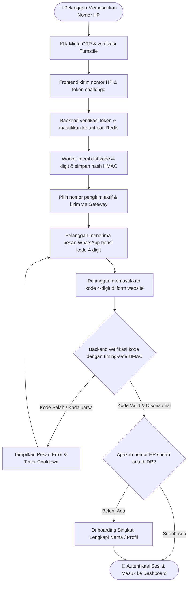

> **Arsitektur Sistem & PRD:** Untuk arsitektur teknis mendalam, diagram sekuens lengkap, skema API lengkap, kriptografi verifier, dan siklus otentikasi, lihat [WA_LOGIN_SYSTEM.md](WA_LOGIN_SYSTEM.md) dan [QUEUED_LOGIN.md](whatsapp-addon/QUEUED_LOGIN.md).

# 🚀 WhatsApp API Gateway & Drop-in Laravel Add-on

[English](README.md) | [Bahasa Indonesia](README.id.md)

Sebuah **WhatsApp API Gateway** mandiri (self-hosted) siap produksi dan **Add-on Drop-in Non-Intrusif untuk Laravel**. Tambahkan fitur **Login Pelanggan WhatsApp OTP (4-digit)** dan **Back-Office Multi-Sender Device Pool** ke **website Laravel Anda yang sudah berjalan** menggunakan file add-on terisolasi dan integrasi host yang aman.

---

## 📑 Daftar Isi
1. [Apa Ini & Mengapa Menggunakannya? (Tujuan)](#-1-apa-ini--mengapa-menggunakannya-tujuan)
2. [Garansi Zero-Overwrite (Tanpa Timpa File)](#-2-garansi-zero-overwrite-tanpa-timpa-file)
3. [Alur Kerja & Arsitektur Sistem](#-3-alur-kerja--arsitektur-sistem)
4. [Diagram Alur Login Pelanggan](#-4-diagram-alur-login-pelanggan)
5. [Struktur Direktori & Isi Paket](#-5-struktur-direktori--isi-paket)
6. [Panduan Langkah Demi Langkah (Cara Pakai)](#-6-panduan-langkah-demi-langkah-cara-pakai)
7. [Panduan Setup Cloudflare Turnstile Bot Defense](#-7-panduan-setup-cloudflare-turnstile-bot-defense)
8. [Antrean Asinkron Redis & Supervisor Worker](#-8-antrean-asinkron-redis--supervisor-worker)
9. [Portal Admin Back-Office (9 Menu)](#-9-portal-admin-back-office-9-menu)
10. [Menghubungkan Nomor WhatsApp Pengirim (Pairing)](#-10-menghubungkan-nomor-whatsapp-pengirim-pairing)
11. [Panduan Deployment VPS & Operasional](#-11-panduan-deployment-vps--operasional)
12. [Batasan Integrasi & Keamanan](#-12-batasan-integrasi--keamanan)

---

## 🎯 1. Apa Ini & Mengapa Menggunakannya? (Tujuan)

### Masalah yang Dihadapi
- **Biaya API Cloud Sangat Mahal**: Layanan seperti Twilio atau Meta WhatsApp Business API resmi mengenakan biaya langganan bulanan dan tarif per pesan yang membebani operasional.
- **Paket Auth yang Merusak**: Sebagian besar pustaka autentikasi mengharuskan membuat aplikasi Laravel baru dari awal atau menimpa controller, model user, dan route yang sudah ada.
- **Single Point of Failure**: Bergantung pada satu nomor WhatsApp saja berisiko menghentikan operasional bisnis jika nomor tersebut terkena pembatasan sementara atau logout.
- **Serangan Bot & OTP Pumping**: Endpoint login publik rawan diserang bot spam SMS/OTP yang dapat membebani antrean dan merugikan sistem.

### Solusi yang Disediakan
Repositori ini menghadirkan ekosistem dua tingkat:
1. **Mesin WhatsApp Gateway Mandiri**: Berjalan via Docker (OpenWA) menggunakan Baileys engine yang stabil. **Tanpa biaya per pesan**, 100% self-hosted, mendukung koneksi multi-sesi socket WhatsApp Web.
2. **Add-on Drop-in Laravel (`whatsapp-addon/`)**: Paket modular terisolasi yang tinggal disalin ke aplikasi Laravel Anda. Menyediakan:
   - **Login Pelanggan via WhatsApp OTP 4-digit**: Tanpa kata sandi, cepat, dan mempertahankan angka nol di depan (misal `0123`).
   - **Perlindungan Cloudflare Turnstile**: Menghentikan bot dan spam secara otomatis via Managed challenge.
   - **Antrean Redis Asinkron**: Memisahkan respons API dari latensi jaringan WhatsApp sehingga respons HTTP instan (<50ms).
   - **Multi-Device Sender Pool**: Hubungkan beberapa nomor staf/CS. Sistem mendistribusikan pengiriman OTP secara **Round-Robin** dan otomatis beralih ke nomor lain jika satu nomor terputus.
   - **9 Menu Portal Back-Office**: UI admin lengkap untuk manajemen perangkat, log, webhook, template, dan daftar member terverifikasi.

---

## 🛡️ 2. Garansi Zero-Overwrite (Tanpa Timpa File)

**Menjaga keutuhan aplikasi Laravel Anda dan alur autentikasi bawaan yang sudah ada.**  
Semua controller dan model inti menggunakan awalan `WhatsApp*`; service berada di namespace `WhatsAppOtp`. Jangan pernah menimpa file host.

| File Default Laravel di Project Anda | Apa yang Digunakan Add-on Ini | Apakah Menimpa File Anda? |
| :--- | :--- | :--- |
| `app/Http/Controllers/Controller.php` | `app/Http/Controllers/WhatsAppOtpController.php` | ❌ **TIDAK PERNAH** |
| `app/Models/User.php` | `app/Models/WhatsAppOtpChallenge.php`, `WhatsAppSenderPool.php` | ❌ **TIDAK PERNAH** |
| `routes/api.php` & `routes/web.php` | `routes/whatsapp.php` | ❌ **TIDAK PERNAH** |
| Migrasi User yang Sudah Ada | `database/migrations/0001_wa_users.php` (hanya menambah kolom) | ❌ **TIDAK PERNAH** |
| Layout Frontend Bawaan | `frontend/components/WhatsAppOtpForm.tsx`, `frontend/backoffice/*` | ❌ **TIDAK PERNAH** |

---

## 🔄 3. Alur Kerja & Arsitektur Sistem

```text
┌─────────────────────────────────┐
│     Browser Pelanggan           │
│  (Modal React WhatsAppOtpForm)  │
└────────────────┬────────────────┘
                 │ 1. Minta OTP (contoh: 08123456789)
                 ▼
┌────────────────────────────────────────────────────────┐
│             Backend Laravel Anda                       │
│  - Verifikasi token bot Turnstile di server            │
│  - Masukkan ID challenge ke antrean Redis              │
│  - Balas HTTP 202 Accepted (respons cepat <50ms)       │
└────────────────┬───────────────────────────────────────┘
                 │ 2. Diambil oleh worker background
                 ▼
┌────────────────────────────────────────────────────────┐
│             Supervised Queue Worker                    │
│  - Generate kode 4-digit acak aman                     │
│  - Simpan hash SHA-256 HMAC di database                │
│  - Pilih perangkat aktif dari SenderPool (Round-Robin) │
└────────────────┬───────────────────────────────────────┘
                 │ 3. POST /api/sessions/{session}/messages/send-text
                 ▼
┌────────────────────────────────────────────────────────┐
│         Kontainer WhatsApp Gateway OpenWA              │
│                 (Port: 18091)                          │
└────────────────┬───────────────────────────────────────┘
                 │ 4. Baileys Multi-Session Socket
                 ▼
┌─────────────────────────────────┐       ┌───────────────────────────────┐
│        Server WhatsApp          │ ────> │ HP WhatsApp Pelanggan         │
│                                 │       │ (Menerima pesan kode 4-digit) │
└─────────────────────────────────┘       └───────────────────────────────┘
```

---

## 📊 4. Diagram Alur Login Pelanggan



### Penjelasan Alur:
1. **Minta OTP**: Pelanggan memasukkan nomor HP pada form login.
2. **Challenge & Antrean**: Setelah tombol diklik, Turnstile memverifikasi pengunjung. Laravel memasukkan ID challenge ke antrean Redis; worker menghasilkan kode 4-digit, menyimpan hash HMAC ber-pepper, lalu mengirimkannya melalui nomor WhatsApp yang siap.
3. **Terima**: Pelanggan menerima notifikasi kode di WhatsApp HP mereka.
4. **Verifikasi**: Pelanggan mengetik 4 digit di form website. Verifikasi terpicu otomatis pada digit ke-4.
5. **Sesi Dibuat**: Backend memverifikasi kode secara atomik (`WHERE state = 'pending'`), menandai kode telah dikonsumsi, login via sesi Laravel Sanctum, dan mengarahkan ke dashboard.

---

## 📁 5. Struktur Direktori & Isi Paket

```text
wa-gateway/
├── docker-compose.yml              # Definisi kontainer OpenWA Gateway Engine
├── WA_LOGIN_SYSTEM.md              # Spesifikasi Arsitektur Sistem Lengkap (PRD)
├── README.md / README.id.md        # Dokumentasi (English & Bahasa Indonesia)
├── .env.example                    # Template konfigurasi environment lengkap
└── whatsapp-addon/                 # Paket Add-on Drop-in Laravel
    ├── app/
    │   ├── Http/Controllers/
    │   │   ├── WhatsAppOtpController.php
    │   │   ├── Admin/WhatsApp*Controller.php
    │   │   └── BackOffice/WhatsAppMemberWebhookController.php
    │   ├── Jobs/WhatsAppSendOtp.php
    │   ├── Models/WhatsApp*.php
    │   ├── Providers/WhatsAppOtpServiceProvider.php
    │   └── Services/WhatsAppOtp/
    ├── config/whatsapp_otp.php
    ├── database/migrations/
    │   ├── 0001_wa_users.php
    │   ├── 0002_wa_otp.php
    │   └── 0003_wa_senders.php
    ├── routes/whatsapp.php
    ├── routes/whatsapp_otp_delivery.php
    ├── QUEUED_LOGIN.md
    ├── deploy/whatsapp-otp-worker.conf
    ├── tests/
    ├── nginx/gateway-reverse-proxy.conf
    └── frontend/
        ├── components/
        ├── contexts/AuthContext.tsx
        ├── hooks/useReveal.ts
        ├── hooks/useWhatsAppChallenge.ts
        ├── lib/axios.ts
        ├── backoffice/
        └── examples/AdminDashboardSidebarExample.tsx
```

---

## 🛠️ 6. Panduan Langkah Demi Langkah (Cara Pakai)

### Langkah 1: Jalankan Mesin WhatsApp Gateway
Dari direktori root repositori ini:
```bash
docker compose up -d
```
Pastikan mesin berjalan:
```bash
curl http://127.0.0.1:18091/api/health/ready
# Output: {"status":"ok", ...}
```

### Langkah 2: Salin File Add-on ke Aplikasi Laravel Anda
Salin file add-on ke aplikasi Laravel Anda:
- `whatsapp-addon/app/` -> `app/`
- `whatsapp-addon/config/` -> `config/`
- `whatsapp-addon/database/migrations/` -> `database/migrations/`
- `whatsapp-addon/routes/` -> `routes/`

> **Catatan**: Jangan pernah menimpa file bawaan host (`User.php`, `Controller.php`, `api.php`, `web.php`). Semua file dalam add-on ini menggunakan nama khusus (`WhatsApp*`).

### Langkah 3: Jalankan Migrasi Database
```bash
php artisan migrate
```
Ini akan mengeksekusi 3 migrasi yang aman:
1. `0001_wa_users.php` (menambah kolom `phone_e164`, `phone_verified_at` di tabel `users`)
2. `0002_wa_otp.php` (membuat tabel `otp_challenges` dan `otp_deliveries`)
3. `0003_wa_senders.php` (membuat tabel `sender_pool`)

### Langkah 4: Daftarkan Routes & Service Provider
Di file `routes/api.php` aplikasi Anda, tambahkan:
```php
require __DIR__ . '/whatsapp.php';
```

Di file `bootstrap/providers.php` (Laravel 11+) atau `config/app.php` (Laravel 10), daftarkan:
```php
App\Providers\WhatsAppOtpServiceProvider::class,
```

### Langkah 5: Konfigurasi Environment Variables (`.env`)
Tambahkan variabel berikut ke file `.env` Laravel host Anda:
```dotenv
# WhatsApp Gateway Engine
OPENWA_BASE_URL=http://127.0.0.1:18091
OPENWA_SESSION_ID=otp-sender-1
OPENWA_API_KEY=

# Kriptografi OTP & Pepper Secret
WA_OTP_HMAC_SECRET=buat-string-hex-acak-64-karakter-disini
WA_OTP_TRANSPORT=openwa
WA_OTP_DEFAULT_REGION=ID

# Cloudflare Turnstile Bot Protection (Wajib di Production)
WA_OTP_TURNSTILE_ENABLED=true
WA_OTP_TURNSTILE_SITE_KEY=<site-key-turnstile-anda>
WA_OTP_TURNSTILE_SECRET_KEY=<secret-key-turnstile-anda>
WA_OTP_TURNSTILE_HOSTNAMES=domain-anda.com,login.domain-anda.com,localhost,127.0.0.1

# Antrean Asinkron Redis untuk OTP
WA_OTP_QUEUE_ENABLED=true
WA_OTP_QUEUE_CONNECTION=redis
WA_OTP_QUEUE_NAME=whatsapp-otp
REDIS_QUEUE_RETRY_AFTER=90

# Batas Rate Limit (Jendela 900 detik / 15 menit)
WA_OTP_SEND_PER_PHONE=5
WA_OTP_SEND_PER_IP=20
WA_OTP_SEND_SYSTEM=2000
WA_OTP_SEND_GLOBAL=500
WA_OTP_SEND_WINDOW_SECONDS=900
WA_OTP_VERIFY_PER_IP=60
WA_OTP_VERIFY_WINDOW_SECONDS=900
WA_OTP_MAX_ATTEMPTS=5
```

---

## 🛡️ 7. Panduan Setup Cloudflare Turnstile Bot Defense

Cloudflare Turnstile menghentikan bot spam tanpa merepotkan pengguna asli dengan teka-teki visual.

### Langkah Pengaturan:
1. **Buka Dashboard Cloudflare**: Masuk ke [Cloudflare Dashboard](https://dash.cloudflare.com) lalu klik **Turnstile** pada bilah sisi kiri.
2. **Tambah Widget**: Klik **Add site / Add widget**.
   - **Nama Widget**: misal `Login WhatsApp OTP`
   - **Mode Widget**: **Managed** (Disarankan)
3. **Konfigurasi Domain**: Masukkan domain produksi Anda (misal `domain-anda.com`), serta `localhost` dan `127.0.0.1` untuk pengujian lokal.
4. **Dapatkan Kunci**:
   - **Site Key**: Salin ke `WA_OTP_TURNSTILE_SITE_KEY`.
   - **Secret Key**: Salin ke `WA_OTP_TURNSTILE_SECRET_KEY`. *(Jika lupa atau tersembunyi, klik "Rotate Secret Key" pada tab Settings widget).*
5. **Segarkan Cache Konfigurasi**:
   ```bash
   php artisan config:clear
   php artisan config:cache
   ```

---

## ⚡ 8. Antrean Asinkron Redis & Supervisor Worker

Di lingkungan produksi, pengiriman OTP ditangani secara asinkron oleh Redis agar waktu respons HTTP di bawah 50ms.

### Konfigurasi Supervisor
Buat file `/etc/supervisor/conf.d/whatsapp-otp-worker.conf`:
```ini
[program:whatsapp-otp-worker]
process_name=%(program_name)s_%(process_num)02d
command=php /var/www/html/artisan queue:work redis --queue=whatsapp-otp --sleep=1 --tries=20 --timeout=60 --max-time=3600
autostart=true
autorestart=true
user=www-data
numprocs=2
redirect_stderr=true
stdout_logfile=/var/log/supervisor/whatsapp-otp.log
stopwaitsecs=90
```

Jalankan worker:
```bash
supervisorctl reread
supervisorctl update
supervisorctl start whatsapp-otp-worker:*
```

---

## 🖥️ 9. Portal Admin Back-Office (9 Menu)

Untuk memberikan staf operasional dan tim dukungan kendali penuh atas sesi WhatsApp, gunakan layout dari `frontend/examples/AdminDashboardSidebarExample.tsx`.

Daftar 9 Menu:
1. **WhatsApp Sessions & Senders** (Panel React Asli: Pairing QR & rotasi multi-perangkat)
2. **Verified Members** (Panel React Asli: Tabel pelanggan yang login via WhatsApp)
3. **Dashboard** (Konsol Gateway Tersemat: Penggunaan memori, soket aktif, statistik)
4. **Chats** (Konsol Gateway Tersemat: Riwayat percakapan dan status pesan)
5. **Webhooks** (Konsol Gateway Tersemat: Berlangganan event webhook keluar)
6. **Templates** (Konsol Gateway Tersemat: Editor template pesan)
7. **Message Tester** (Konsol Gateway Tersemat: Kotak pasir uji coba kirim pesan)
8. **Plugins** (Konsol Gateway Tersemat: Pengelola ekstensi gateway)
9. **Logs** (Konsol Gateway Tersemat: Log operasional mesin Baileys)

---

## 📱 10. Menghubungkan Nomor WhatsApp Pengirim (Pairing)

Anda dapat menghubungkan nomor WhatsApp pengirim dengan dua cara dari panel **WhatsApp Sessions & Senders**:
1. **Pairing via QR Code**: Klik "Link / Start Session", buka WhatsApp di HP → Perangkat Tertaut → Pindai kode QR di layar.
2. **Pairing Code (Tanpa Kamera)**: Masukkan nomor HP pengirim → Klik "Request 8-character Pairing Code" → Masukkan kode 8 karakter di notifikasi WhatsApp pada HP Anda.

Setelah terhubung, status akan berubah menjadi **`WORKING`** atau **`READY`**, dan OTP keluar akan otomatis bergilir melalui nomor tersebut!

---

## 🌐 11. Panduan Deployment VPS & Operasional

### Cara Masuk SSH ke VPS Anda
```bash
ssh user@<ip-vps-anda>
```

### Perintah Cepat Operasional VPS:
```bash
# 1. Periksa status semua kontainer:
docker ps --format "table {{.Names}}\t{{.Status}}\t{{.Ports}}"

# 2. Uji Health Check:
curl -fsS http://127.0.0.1:18090/api/v1/health && echo ""
curl -fsS http://127.0.0.1:18091/api/health/ready && echo ""

# 3. Pantau Log Worker Antrean:
docker logs -f --tail 100 wa-login-web-otp-worker-1

# 4. Segarkan Konfigurasi Setelah Update .env:
php artisan config:clear && php artisan config:cache
php artisan queue:restart
```

---

## 🔒 12. Batasan Integrasi & Keamanan

- Daftarkan `routes/whatsapp.php` sekali di bawah prefix `/api` dengan middleware API.
- Aktifkan middleware sesi stateful Sanctum dan alias Spatie `role` pada host.
- Sender pool dan daftar anggota terverifikasi dibatasi berdasarkan tenant admin yang terautentikasi.
- Database hanya menyimpan hash verifier HMAC-SHA256 ber-pepper. Plaintext kode OTP tidak pernah disimpan.
- Untuk dokumentasi arsitektur lengkap, diagram sekuens, dan skema database, baca [WA_LOGIN_SYSTEM.md](WA_LOGIN_SYSTEM.md).

---

*Dikelola untuk integrasi Laravel enterprise yang bersih, aman, dan tanpa merusak kode bawaan.*
