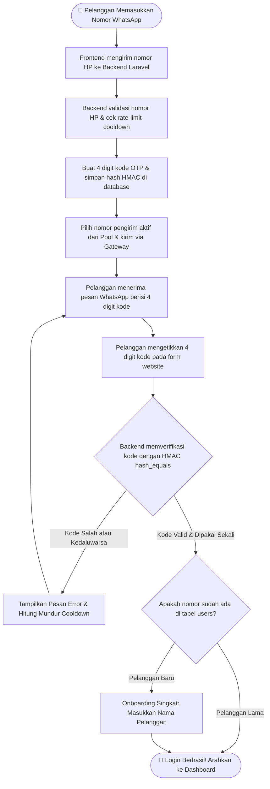

> **Queued login update:** Turnstile now runs after Request/Resend OTP is clicked. Laravel verifies it before enqueueing an ID-only Redis job. Configure the Turnstile keys, shared Redis cache, and a supervised `whatsapp-otp` worker before enabling live login. See [setup, API states, limits, and recovery](whatsapp-addon/QUEUED_LOGIN.md). Member OTP is fixed at 4 digits, 300-second validity from worker generation, and a 30-second resend cooldown. Sender pairing remains separate.

> Login member website menggunakan tepat **4 digit angka**, termasuk nol di depan (contoh `0123`). Pairing nomor pengirim adalah alur gateway terpisah; jangan memendekkan kode pairing. `WA_OTP_CODE_LENGTH` tidak digunakan lagi karena panjang OTP member ditetapkan dalam kode. Saat deploy, build ulang frontend dan perbarui cache konfigurasi Laravel. Challenge lama harus kedaluwarsa sebelum mencoba lagi.

# 🚀 WhatsApp API Gateway & Paket Add-on Siap Pakai untuk Laravel

[English](README.md) | [Bahasa Indonesia](README.id.md)

Solusi lengkap **WhatsApp API Gateway mandiri (*self-hosted*)** dan **paket Add-on non-intrusif untuk framework Laravel**.
Tambahkan fitur **Login Pelanggan via WhatsApp OTP** dan **Manajemen Pool Multi-Nomor Pengirim (*Back-Office*)** ke website Laravel Anda yang **sudah berjalan** melalui file add-on terpisah dan integrasi host yang ditinjau terlebih dahulu.

---

## 📑 Daftar Isi
1. [Apa Kegunaannya & Masalah yang Diselesaikan?](#-1-apa-kegunaannya--masalah-yang-diselesaikan)
2. [Jaminan Anti-Bentrok (Zero-Overwrite Guarantee)](#-2-jaminan-anti-bentrok-zero-overwrite-guarantee)
3. [Arsitektur & Alur Kerja Sistem (Workflow)](#-3-arsitektur--alur-kerja-sistem-workflow)
4. [Flowchart Alur Login Pelanggan (Mudah Dipahami)](#-4-flowchart-alur-login-pelanggan-mudah-dipahami)
5. [Apa Saja Isinya & Struktur Folder](#-5-apa-saja-isinya--struktur-folder)
6. [Panduan Langkah Demi Langkah Cara Pasang & Pakai](#-6-panduan-langkah-demi-langkah-cara-pasang--pakai)
7. [9 Menu Portal Admin Back-Office](#-7-9-menu-portal-admin-back-office)
8. [Cara Menautkan (Pairing) Nomor WhatsApp Pengirim](#-8-cara-menautkan-pairing-nomor-whatsapp-pengirim)
9. [Panduan Akses & Pengoperasian Server VPS](#-9-panduan-akses--pengoperasian-server-vps)

---

## 🎯 1. Apa Kegunaannya & Masalah yang Diselesaikan?

### Masalah yang Sering Dihadapi
- **Biaya API Pihak Ketiga Sangat Mahal**: Layanan seperti Twilio atau API Resmi Meta mengenakan biaya langganan bulanan dan tarif per pesan WhatsApp yang terus membengkak.
- **Paket Auth Sering Merusak Proyek Lama**: Kebanyakan package auth menuntut Anda merombak total website, menimpa model `User.php`, atau menata ulang seluruh controller dan routing yang sudah ada.
- **Risiko Nomor Tunggal Terblokir**: Mengandalkan 1 nomor WhatsApp saja sangat berisiko. Jika nomor tersebut terkena limit atau logout, pelanggan tidak bisa login sama sekali.

### Solusi dari Paket Ini
Repositori ini menyediakan solusi 2 bagian yang saling terintegrasi:
1. **Engine Gateway WhatsApp Mandiri**: Berjalan di dalam Docker (OpenWA v0.24.0 berbasis Baileys). **Bebas biaya per-pesan (Gratis)**, self-hosted, mendukung banyak nomor/sesi WhatsApp sekaligus.
2. **Paket Add-on Laravel (`whatsapp-addon/`)**: Modul siap salin (*drop-in*) untuk website Laravel Anda. Menyediakan:
   - **Login Pelanggan berbasis OTP 4 digit**: Cepat, aman, tanpa perlu mengingat password.
   - **Pool Multi-Nomor Pengirim**: Pasang banyak nomor WhatsApp staf/CS sekaligus. Sistem otomatis merotasi pengiriman pesan (**Round-Robin**) dan berpindah ke nomor lain jika ada nomor yang terputus.
   - **9 Menu Portal Back-Office**: Panel admin lengkap untuk memantau status perangkat, pesan, webhook, template, dan daftar member terverifikasi.

---

## 🛡️ 2. Jaminan Anti-Bentrok (Zero-Overwrite Guarantee)

**Pertahankan website Laravel dan alur autentikasi yang sudah berjalan.**
Controller dan model inti memakai nama `WhatsApp*`; service memakai namespace `WhatsAppOtp`. Jangan menimpa file host. Alias generik lama bersifat opsional. Tinjau kontrak model User, route, dan migrasi sebelum integrasi.

| File Default Laravel Milik Anda | File yang Digunakan Add-on Ini | Risiko Menimpa File Anda? |
| :--- | :--- | :--- |
| `app/Http/Controllers/Controller.php` | `app/Http/Controllers/WhatsAppOtpController.php` | ❌ **TIDAK MUNGKIN** |
| `app/Models/User.php` | `app/Models/WhatsAppOtpChallenge.php`, `WhatsAppSenderPool.php` | ❌ **TIDAK MUNGKIN** |
| `routes/api.php` & `routes/web.php` | `routes/whatsapp.php` | ❌ **TIDAK MUNGKIN** |
| Migrasi User Lama Anda | `database/migrations/0001_wa_users.php` (hanya menambah kolom) | ❌ **TIDAK MUNGKIN** |
| Layout Frontend Bawaan Anda | `frontend/components/WhatsAppOtpForm.tsx`, `frontend/backoffice/*` | ❌ **TIDAK MUNGKIN** |

---

## 🔄 3. Arsitektur & Alur Kerja Sistem (Workflow)

Alur komunikasi antara Pelanggan, Website Laravel Anda, Engine Gateway, dan Jaringan WhatsApp:

```text
┌─────────────────────────────────┐
│        Browser Pelanggan        │
│  (Form Login WhatsAppOtpForm)   │
└────────────────┬────────────────┘
                 │ 1. Pelanggan minta OTP (+628123456789)
                 ▼
┌────────────────────────────────────────────────────────┐
│             Backend Laravel Milik Anda                 │
│  - Membuat 4 digit kode OTP acak                       │
│  - Menyimpan hash HMAC SHA-256 di DB (otp_challenges)  │
│  - Memilih nomor pengirim aktif dari SenderPool        │
└────────────────┬───────────────────────────────────────┘
                 │ 2. Panggil API Gateway (POST /messages/send)
                 ▼
┌────────────────────────────────────────────────────────┐
│         Engine Gateway WhatsApp (OpenWA Docker)        │
│                     (Port: 18091)                      │
└────────────────┬───────────────────────────────────────┘
                 │ 3. Kirim via Baileys Multi-Session Socket
                 ▼
┌─────────────────────────────────┐       ┌───────────────────────────────┐
│        Server WhatsApp          │ ────> │  Aplikasi WhatsApp Pelanggan  │
│                                 │       │ (Menerima pesan 4 digit OTP)  │
└─────────────────────────────────┘       └───────────────────────────────┘
```

---

## 📊 4. Flowchart Alur Login Pelanggan (Mudah Dipahami)

Alur verifikasi login dibuat sangat jelas, aman, dan tanpa celah:



### Penjelasan 5 Langkah Sederhana:
1. **Minta OTP**: Pelanggan memasukkan nomor HP pada form login.
2. **Kirim Pesan**: Backend membuat kode 4 digit, menyimpan hash rahasianya di tabel `otp_challenges`, lalu memanggil gateway untuk mengirim pesan WA.
3. **Terima Pesan**: Pelanggan menerima notifikasi WA di HP-nya.
4. **Verifikasi**: Pelanggan memasukkan 4 digit kode ke website.
5. **Masuk Akun**: Backend memverifikasi kode secara atomik (`WHERE state = 'pending'`), menandai kode telah dipakai, lalu otomatis menerbitkan sesi login pengguna.

---

## 📁 5. Apa Saja Isinya & Struktur Folder

```text
wa-gateway/
├── docker-compose.yml
├── README.md / README.id.md
└── whatsapp-addon/
    ├── app/
    │   ├── Http/Controllers/
    │   │   ├── WhatsAppOtpController.php
    │   │   ├── Admin/WhatsApp*Controller.php
    │   │   └── BackOffice/WhatsAppMemberWebhookController.php
    │   ├── Jobs/WhatsAppSendOtp.php
    │   ├── Models/WhatsApp*.php
    │   ├── Providers/WhatsAppOtpServiceProvider.php
    │   └── Services/WhatsAppOtp/
    ├── config/whatsapp_otp.php
    ├── database/migrations/
    │   ├── 0001_wa_users.php
    │   ├── 0002_wa_otp.php
    │   └── 0003_wa_senders.php
    ├── routes/whatsapp.php
    ├── routes/whatsapp_otp_delivery.php
    ├── QUEUED_LOGIN.md
    ├── deploy/whatsapp-otp-worker.conf
    ├── tests/
    ├── nginx/gateway-reverse-proxy.conf
    └── frontend/
        ├── components/
        ├── contexts/AuthContext.tsx
        ├── hooks/useReveal.ts
        ├── hooks/useWhatsAppChallenge.ts
        ├── lib/axios.ts
        ├── backoffice/
        └── examples/AdminDashboardSidebarExample.tsx
```

---

## 🛠️ 6. Panduan Langkah Demi Langkah Cara Pasang & Pakai

### Langkah 1: Jalankan Engine WhatsApp Gateway
Di terminal repositori ini:
```bash
docker compose up -d
```
Pastikan engine aktif di port `18091`:
```bash
curl http://127.0.0.1:18091/api/health/ready
# Respon: {"status":"ok", ...}
```

### Langkah 2: Integrasikan Tanpa Menimpa File Host
Periksa tujuan sebelum menyalin. Salin direktori `app/Services/WhatsAppOtp`, controller/model/provider `WhatsApp*`, `config/whatsapp_otp.php`, dan `routes/whatsapp.php` hanya jika file tujuan belum ada. Saat upgrade, tinjau perbedaan secara manual. Alias model/controller dengan nama generik tersedia untuk kompatibilitas lama dan tidak diperlukan add-on.

Jangan mengganti `User.php`, `Controller.php`, `api.php`, atau `web.php`. Tempatkan frontend di direktori tersendiri `whatsapp/` dengan struktur internal tetap utuh. Jangan menyalin seluruh paket secara rekursif dengan opsi overwrite.

Prasyarat host: session stateful Sanctum, role Spatie, serta model/skema User yang mendukung `uuid`, `is_active`, `last_login_at`, soft delete, field/cast WhatsApp, dan accessor `login_id` / `onboarding_required`. Akun berbasis nomor memerlukan name, email, dan password nullable. Migrasi contoh mengubah nullability name/email; cocokkan dengan skema lama dan cadangkan database sebelum migrasi. Isolasi file tidak menjamin perubahan skema aman untuk setiap aplikasi.

### Langkah 3: Jalankan Migrasi Database
```bash
php artisan migrate
```
Perintah ini mengeksekusi 3 migrasi yang terisolasi:
1. `0001_wa_users.php` (menambah kolom `phone_e164`, `phone_verified_at` ke `users`)
2. `0002_wa_otp.php` (membuat tabel `otp_challenges` dan `otp_deliveries`)
3. `0003_wa_senders.php` (membuat tabel `sender_pool`)

### Langkah 4: Daftarkan Route & Service Provider
Di file `routes/api.php` proyek Anda, tambahkan di baris paling bawah:
```php
require __DIR__ . '/whatsapp.php';
```

Di file `bootstrap/providers.php` (Laravel 11+) atau `config/app.php` (Laravel 10), daftarkan:
```php
App\Providers\WhatsAppOtpServiceProvider::class,
```

### Langkah 5: Atur Environment Variable (`.env`)
Tambahkan variabel berikut ke file `.env` Laravel Anda:
```env
# Engine Gateway WhatsApp
OPENWA_BASE_URL=http://127.0.0.1:18091
OPENWA_SESSION_ID=otp-sender-1
OPENWA_API_KEY=

# Kriptografi OTP & Pengaturan Cooldown
WA_OTP_HMAC_SECRET=kunci-rahasia-acak-minimal-32-karakter-di-sini
WA_OTP_TRANSPORT=openwa
WA_OTP_SEND_PER_PHONE=5
WA_OTP_SEND_WINDOW_SECONDS=900
# Member OTP TTL/cooldown are fixed at 300/30 seconds in code.
WA_OTP_MAX_ATTEMPTS=5
```

### Langkah 6: Pasang Form Login Pelanggan di Halaman Depan
Gunakan komponen React `<WhatsAppAuthProvider checkAuth={refreshSession}>
                <WhatsAppOtpForm />
            </WhatsAppAuthProvider>` pada halaman login Anda:
```tsx
import WhatsAppOtpForm from './whatsapp/components/WhatsAppOtpForm';
import { WhatsAppAuthProvider } from './whatsapp/contexts/AuthContext';

// Render inside the host BrowserRouter. Refresh the host session after login.
export default function LoginPage({ refreshSession }: { refreshSession: () => Promise<void> }) {
    return (
        <div className="login-card">
            <h2>Masuk dengan WhatsApp</h2>
            <WhatsAppAuthProvider checkAuth={refreshSession}>
                <WhatsAppOtpForm />
            </WhatsAppAuthProvider>
        </div>
    );
}
```

---

## 🖥️ 7. 9 Menu Portal Admin Back-Office

Untuk memberikan kendali penuh kepada tim admin/CS terhadap nomor pengirim WhatsApp, ikuti contoh layout pada:
`frontend/examples/AdminDashboardSidebarExample.tsx`.

Daftar 9 Menu:
1. **WhatsApp Sessions & Senders** (Kelola pairing QR & multi-nomor pengirim)
2. **Verified Members** (Daftar pelanggan yang terverifikasi nomor WA-nya)
3. **Dashboard** (Konsol utama gateway: memori, socket, status sesi)
4. **Chats** (Riwayat pesan WhatsApp yang keluar-masuk)
5. **Webhooks** (Pengaturan webhook keluar)
6. **Templates** (Manajemen template pesan WA)
7. **Message Tester** (Uji coba kirim pesan manual)
8. **Plugins** (Manajemen plugin gateway)
9. **Logs** (Log aktivitas dan event server)

---

## 📱 8. Cara Menautkan (Pairing) Nomor WhatsApp Pengirim

Pada menu **WhatsApp Sessions & Senders**, Anda dapat menautkan nomor pengirim melalui 2 cara:
1. **Scan QR Code**: Klik tombol "Tautkan Sesi", buka WhatsApp di HP staf → Perangkat Tertaut → Scan QR Code di layar.
2. **Kode Tautan 8 Karakter (Tanpa Kamera)**: Masukkan nomor HP staf → Klik "Minta Kode 8 Karakter" → Masukkan kode tersebut pada notifikasi WhatsApp di HP.

Setelah terhubung, status sesi berubah menjadi **`WORKING`** atau **`READY`**, dan kode OTP otomatis dikirimkan lewat nomor tersebut!

---

## 🌐 9. Panduan Akses & Pengoperasian Server VPS

### Cara Masuk ke Server VPS via SSH:
```bash
ssh root@84.247.148.115
```
- **IP Server:** `84.247.148.115` (User: `root`)
- **Autentikasi:** Otomatis via SSH Key (tanpa password).

### Lokasi Folder di VPS:
- `/www/docker/wa-login-web`: Aplikasi Web Tester Laravel 13 API + React 19 SPA (Port `18090`).
- `/www/docker/wa-gateway`: Engine Gateway WhatsApp OpenWA (Port `18091`) dan dokumen master.

### Perintah Cepat Pengoperasian di VPS:
```bash
# 1. Cek status semua kontainer:
docker ps | grep -E "wa-"

# 2. Cek kesehatan sistem:
curl -fsS http://127.0.0.1:18090/api/v1/health && echo ""
curl -fsS http://127.0.0.1:18091/api/health/ready && echo ""

# 3. Melihat log aplikasi secara live:
docker logs -f --tail 100 wa-login-web-app-1
docker logs -f --tail 100 wa-gateway-openwa

# 4. Cek status migrasi Laravel di kontainer:
cd /www/docker/wa-login-web
docker compose -f deploy/compose.yaml --env-file deploy/.env exec -T app php artisan migrate:status

# 5. Akses database PostgreSQL di server:
docker exec -it wa-login-web-postgres-1 psql -U wa_login -d wa_login
```

---
*Dibuat untuk integrasi enterprise Laravel yang aman, elegan, dan non-intrusif.*

### Batas integrasi

Daftarkan `routes/whatsapp.php` satu kali di bawah `/api` dengan middleware API; provider mendaftarkan service serta memuat `routes/whatsapp_otp_delivery.php` untuk konfigurasi challenge dan status pengiriman. Saat upgrade, salin file tersebut dan `app/Jobs/WhatsAppSendOtp.php`. Aktifkan middleware API stateful Sanctum dan alias `role` Spatie pada host. Endpoint member: `/api/v1/auth/whatsapp/{request-otp,verify-otp,resend-otp}`. Frontend juga memerlukan alur CSRF/session, onboarding, dan dashboard milik host.

Sender pool dan daftar member dibatasi ke tenant admin yang login. Konsol gateway tertanam mengelola seluruh engine dan hanya boleh diberikan kepada operator engine tepercaya; konsol tersebut belum terisolasi per tenant. Gunakan engine terpisah bagi operator pelanggan yang independen.

File nginx adalah template: ganti `${OPENWA_DASHBOARD_API_KEY}` di server, misalnya dengan `envsubst '${OPENWA_DASHBOARD_API_KEY}'`, tanpa mengganti variabel nginx lainnya. Resolver Docker hanya berlaku di dalam Docker; sesuaikan upstream dengan jaringan. Jangan memasukkan kunci ini ke environment frontend.

Database verifier Laravel hanya menyimpan hash HMAC ber-pepper. Outbox mock menyimpan plaintext hanya untuk local/testing. Retensi isi pesan di gateway merupakan pengaturan operasional terpisah; jangan mengklaim tidak ada sistem lain yang menyimpan isi pesan. Koneksi produksi dan pengiriman WhatsApp nyata perlu divalidasi saat deployment.
