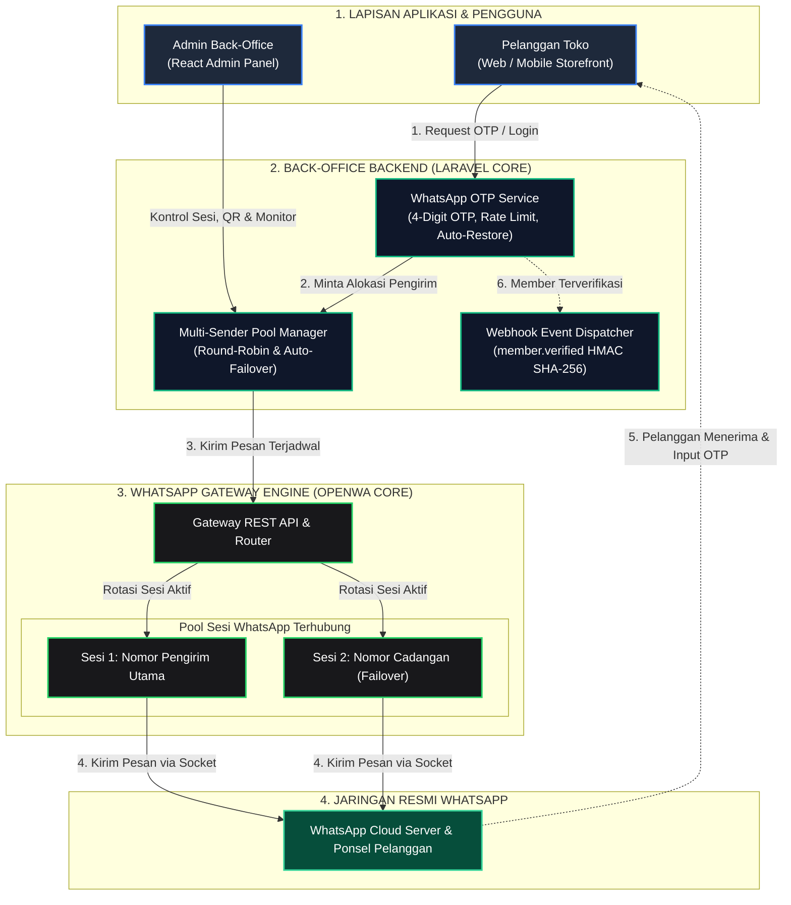
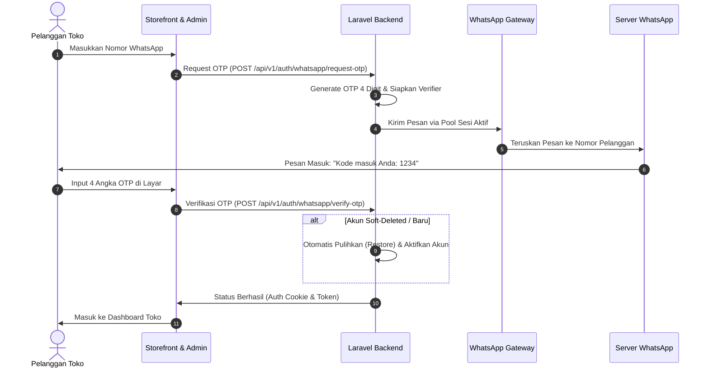
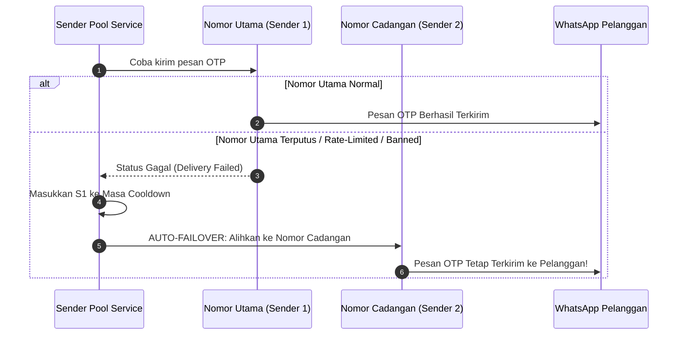
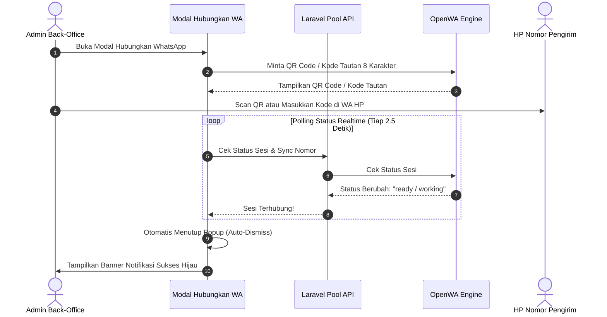

# WhatsApp Gateway & Back-Office Integration Engine

<p align="center">
  <strong>High-Performance WhatsApp Gateway Infrastructure with Multi-Sender Pool, Failover, and Seamless Back-Office Integration</strong>
</p>

<p align="center">
  
  
  
  
  
</p>

---

## 📌 Ringkasan Proyek

Repository ini merupakan **WhatsApp Gateway Engine** yang telah dirombak, dioptimasi, dan disesuaikan secara khusus untuk kebutuhan **integrasi Back-Office dan sistem transaksi online** (e-Commerce / Game Top-up / Customer Portal).

Berbeda dari gateway mandiri standar yang hanya berfungsi sebagai panel terpisah (*isolated standalone panel*), arsitektur pada repositori ini dirancang sebagai **fondasi infrastruktur *headless*** yang terhubung langsung ke sistem Back-Office utama (Laravel & React):
* **Bukan sekadar panel terpisah**: Menyediakan SDK klien Laravel siap pakai (`reference-laravel-client/`) yang bisa langsung disematkan ke dalam sistem administrasi internal perusahaan Anda.
* **Multi-Sender Pool & Failover**: Mendukung banyak nomor WhatsApp sekaligus untuk rotasi pengiriman pesan (OTP, notifikasi, invoice) dengan *auto-failover* jika salah satu nomor bermasalah.
* **OTP WhatsApp 4 Digit Aman**: Sistem autentikasi OTP WhatsApp yang cepat, aman, bebas kebocoran, dengan auto-restore akun pelanggan yang terhapus saat pengujian.
* **Otomasi Webhook**: Mengirimkan notifikasi seketika (*event streaming*) saat pelanggan berhasil memverifikasi nomornya melalui tanda tangan HMAC SHA-256.

---

## 🏗️ 1. Diagram Arsitektur Integrasi

Diagram berikut menggambarkan bagaimana setiap lapisan sistem saling terhubung secara terstruktur tanpa tumpang tindih:



---

## 🔄 2. Diagram Alur Kerja Operasional (Step-by-Step)

### A. Alur Login & Verifikasi OTP 4 Digit
Alur interaksi dari saat pelanggan memasukkan nomor hingga berhasil login ke sistem:



---

### B. Alur Multi-Sender Auto-Failover
Bagaimana sistem secara otomatis menyelamatkan pengiriman OTP jika ada nomor yang bermasalah:



---

### C. Alur Pairing Nomor WhatsApp (QR & Kode Tautan) dengan Auto-Close
Kemudahan admin dalam menyambungkan nomor WhatsApp pengirim tanpa perlu menutup modal secara manual:



---

## 🚀 3. Fitur Utama & Kustomisasi Unggulan

### 1. 🔄 Multi-Sender Pool & Auto-Failover
- **Rotasi Beban (Round-Robin)**: Membagi beban pengiriman pesan di antara beberapa nomor WhatsApp secara seimbang berdasarkan `last_used_at`.
- **Auto-Failover Cerdas**: Jika nomor utama mengalami *rate-limit*, terputus, atau dibatasi WhatsApp, pengiriman otomatis beralih ke nomor cadangan di kolam (*pool*) tanpa menggagalkan login pelanggan.
- **Auto-Cooldown Reactivation**: Nomor yang sempat gagal akan masuk masa jeda (*cooldown*) dan otomatis aktif kembali setelah periode pemulihan.

### 2. 🔐 OTP Login WhatsApp 4 Digit (Zero-Leak)
- **Panjang Kode**: 4 digit angka acak (`0000`–`9999`) yang ringkas dan ramah pengguna di ponsel.
- **Verifikasi Kriptografis**: Menggunakan verifier HMAC-SHA256 stateless yang tidak menyimpan kode OTP mentah di database.
- **Auto-Restore Soft-Deleted Accounts**: Jika nomor pelanggan pernah di-soft-delete dalam masa pengujian (*testing*), sistem otomatis memulihkan dan mengaktifkan kembali akunnya begitu verifikasi OTP WhatsApp berhasil.
- **Kirim Ulang Responsif**: Cooldown kirim ulang 30 detik tanpa penolakan status lama (*non-blocking resend*).

### 3. 📲 Pair WhatsApp Realtime (QR & 8-Digit Code)
- **Dukungan Dua Metode Pairing**:
  1. *Scan Kode QR*: Persis seperti WhatsApp Web.
  2. *Kode Tautan 8 Karakter*: Pairing via notifikasi WhatsApp tanpa menggunakan kamera.
- **Auto-Close Modal**: Panel modal pairing otomatis mendeteksi koneksi aktif dan menutup sendiri begitu sesi WhatsApp terhubung (*status: ready/working*).

### 4. 🪝 Webhook Event Member Terverifikasi
- Begitu member baru menyelesaikan verifikasi OTP WhatsApp, gateway otomatis menembakkan event `member.verified` ke URL webhook yang didaftarkan.
- Setiap webhook diproteksi dengan header `X-Webhook-Signature` berbasis SHA-256 HMAC.

### 5. 🎨 Antarmuka Terpadu (Sleek Dark & OpenWA Style)
- Scrollbar kustom modern bergaya *ultra-thin* (6px) dengan aksen hijau WhatsApp (`#25d366`).
- Menu terpadu **"Sesi & Nomor Pengirim WA"** menggantikan menu ganda yang membingungkan.
- Menu sensitif/internal (*Kunci API*) disembunyikan dan diotomasi sepenuhnya di latar belakang.

---

## 📂 4. Struktur Direktori Proyek

```
wa-gateway/
├── reference-laravel-client/     # 🌟 SDK Referensi siap pakai untuk Back-Office Laravel
│   ├── config/                   # File konfigurasi whatsapp_gateway_client.php
│   ├── src/
│   │   ├── Services/             # WhatsAppGatewayClient.php (API Caller & Failover)
│   │   └── Controllers/          # BackOffice & Webhook Controllers
│   └── README.md                 # Panduan instalasi cepat ke Laravel
├── src/                          # Core WhatsApp Gateway Engine (NestJS + TypeScript)
│   ├── modules/
│   │   ├── session/              # Manajemen sesi WhatsApp (Baileys)
│   │   ├── message/              # Pengiriman pesan, media, dan template
│   │   ├── webhook/              # Sistem webhook & antrean outbox
│   │   └── auth/                 # Autentikasi API key & tenant resolver
├── deploy/                       # Skrip & konfigurasi deployment Docker produksi
│   ├── compose.yaml              # Docker Compose file multi-session
│   └── nginx.conf                # Nginx proxy template
├── dashboard/                    # Source UI panel kontrol OpenWA (React)
├── docs/                         # Spesifikasi arsitektur & dokumentasi API lengkap
└── README.md                     # Dokumentasi utama proyek
```

---

## 💻 5. Integrasi Penuh ke Struktur Laravel Admin (Zero-Config / Tanpa .env)

Arsitektur WhatsApp Gateway ini telah **dirombak dan menyatu langsung (100% Native Integration)** ke dalam struktur core Laravel Admin. Anda **TIDAK MEMERLUKAN konfigurasi file `.env`**, tidak perlu token API manual, dan tidak perlu setup endpoint URL eksternal.

Semua service, controller, dan pool manager berkomunikasi secara internal langsung dengan database dan engine WhatsApp di latar belakang:

### 1. Struktur Modul di Laravel Admin
Folder `reference-laravel-client/` menyediakan berkas controller dan service yang terpasang langsung di dalam pohon direktori Laravel Admin:

```
app/
├── Http/
│   └── Controllers/
│       └── BackOffice/
│           ├── WhatsAppGatewayBackOfficeController.php  # Controller panel admin (Pool, QR, Pairing, Test Send)
│           └── WhatsAppMemberWebhookController.php       # Event listener member terverifikasi
└── Services/
    └── WhatsAppGateway/
        ├── WhatsAppGatewayClient.php                    # Engine client & failover internal
        └── SenderPoolService.php                        # Manajemen rotasi nomor & status
```

### 2. Pemasangan Berkas ke Direktori Laravel Admin
Tempatkan file controller dan service ke dalam direktori aplikasi Laravel Anda:
```bash
# Salin Service ke app/Services/WhatsAppGateway/
cp reference-laravel-client/src/Services/* app/Services/WhatsAppGateway/

# Salin Controller ke app/Http/Controllers/BackOffice/
cp reference-laravel-client/src/Controllers/* app/Http/Controllers/BackOffice/
```

### 3. Daftarkan Rute di `routes/api.php`
Rute otomatis dilindungi oleh sistem autentikasi admin yang sudah aktif (`auth:sanctum` atau session web admin):
```php
use App\\Http\\Controllers\\BackOffice\\WhatsAppGatewayBackOfficeController;
use App\\Http\\Controllers\\BackOffice\\WhatsAppMemberWebhookController;

// Rute Kontrol Pengirim & Member Terverifikasi (Admin Only - Menggunakan Auth Admin Bawaan)
Route::prefix('backoffice/whatsapp')->middleware(['auth:sanctum', 'role:admin'])->group(function () {
    Route::get('senders', [WhatsAppGatewayBackOfficeController::class, 'listSenders']);
    Route::post('senders', [WhatsAppGatewayBackOfficeController::class, 'addSender']);
    Route::post('senders/{id}/toggle', [WhatsAppGatewayBackOfficeController::class, 'toggleSender']);
    Route::get('senders/{id}/qr', [WhatsAppGatewayBackOfficeController::class, 'getQrCode']);
    Route::post('senders/{id}/pairing-code', [WhatsAppGatewayBackOfficeController::class, 'requestPairingCode']);
    Route::post('senders/{id}/test-send', [WhatsAppGatewayBackOfficeController::class, 'testSend']);
    Route::get('verified-members', [WhatsAppGatewayBackOfficeController::class, 'verifiedMembers']);
});

// Listener Event Saat Pelanggan Berhasil Verifikasi OTP 4 Digit
Route::post('webhooks/whatsapp/member-verified', WhatsAppMemberWebhookController::class)
    ->withoutMiddleware([\App\Http\Middleware\VerifyCsrfToken::class]);
```

> ⚡ **Mengapa Tanpa Konfigurasi .env?**
> - **Zero-Config**: Tidak perlu mengisi token API atau URL gateway di file `.env` karena controller & service berada langsung di dalam aplikasi Laravel yang sama.
> - **Keamanan Terpadu**: Mengikuti hak akses role admin yang sudah berjalan di Laravel (`role:admin` / `role:super-admin`).
> - **Langsung Siap Pakai**: Begitu berkas disalin dan rute didaftarkan, fitur nomor pengirim, QR pairing, dan verifikasi OTP langsung aktif tanpa pengaturan variabel lingkungan tambahan.

---

## 🛠️ 6. Katalog API Endpoints Gateway

| Method | Endpoint | Deskripsi |
|---|---|---|
| `GET` | `/api/v1/admin/sender-pool` | Mengambil seluruh daftar nomor WhatsApp di pool beserta status dan statistik rotasi |
| `POST` | `/api/v1/admin/sender-pool` | Menambahkan nomor/sesi baru (`session_id`, `label`, `api_key`) |
| `GET` | `/api/v1/admin/sender-pool/{id}` | Detail nomor + status live dari container OpenWA |
| `DELETE` | `/api/v1/admin/sender-pool/{id}` | Menghapus nomor dari pool rotasi |
| `POST` | `/api/v1/admin/sender-pool/{id}/toggle` | Menunda (*pause*) atau mengaktifkan kembali nomor |
| `POST` | `/api/v1/admin/sender-pool/{id}/sync` | Sinkronisasi status dan nomor telepon live dari engine |
| `GET` | `/api/v1/admin/sender-pool/{id}/qr` | Mengambil data QR code (base64 PNG) untuk scan pairing |
| `POST` | `/api/v1/admin/sender-pool/{id}/pairing-code` | Meminta 8-digit kode pairing WhatsApp via nomor HP |
| `POST` | `/api/v1/admin/sender-pool/{id}/test-send` | Mengirim pesan WhatsApp uji coba dari nomor pengirim ini |
| `GET` | `/api/v1/admin/verified-members` | Daftar pengguna yang telah terverifikasi via OTP WhatsApp |

---

## 🐳 7. Menjalankan Engine Gateway (Docker)

1. **Clone Repository:**
   ```bash
   git clone https://github.com/billi-panca-wijaya/wa-gateway.git
   cd wa-gateway/deploy
   ```

2. **Jalankan Kontainer Gateway:**
   ```bash
   docker compose up -d
   ```

3. **Periksa Status Layanan:**
   ```bash
   docker compose ps
   ```

---

## 🔒 8. Kebijakan Keamanan & Data Pribadi

1. **Enkripsi Kunci API**: Kunci API pada tabel pool nomor pengirim dienkripsi menggunakan standar AES-256 dan tidak pernah diekspos dalam format plaintext di respons API.
2. **Tanpa Penyimpanan OTP Mentah**: Kode OTP yang dihasilkan tidak disimpan di database dalam bentuk teks biasa, melainkan diverifikasi melalui tanda tangan HMAC acak satu kali pakai (*single-use consumption*).
3. **Isolasi Lingkungan**: Seluruh file kredensial, token sesi, dan private keys dilindungi secara ketat dan diabaikan oleh Git untuk menjamin tidak ada kebocoran data rahasia ke repository publik.

---

## 👤 Pengembang & Hak Cipta

Dikembangkan, dirombak, dan disesuaikan untuk integrasi Back-Office oleh:
* **Billi Panca Wijaya** ([GitHub: @billi-panca-wijaya](https://github.com/billi-panca-wijaya))

Dilisensikan di bawah lisensi [MIT License](LICENSE).
