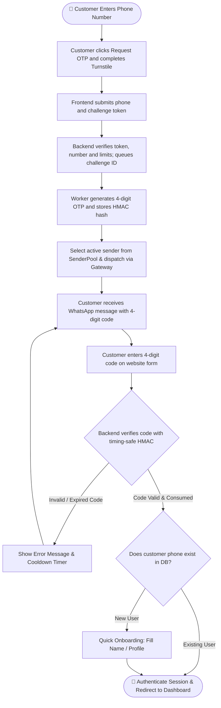

> **Queued login update:** Turnstile now runs after Request/Resend OTP is clicked. Laravel verifies it before enqueueing an ID-only Redis job. Configure the Turnstile keys, shared Redis cache, and a supervised `whatsapp-otp` worker before enabling live login. See [setup, API states, limits, and recovery](whatsapp-addon/QUEUED_LOGIN.md). Member OTP is fixed at 4 digits, 300-second validity from worker generation, and a 30-second resend cooldown. Sender pairing remains separate.

> Member website login uses exactly **4 numeric digits**, including leading zeros (for example `0123`). Sender pairing is a separate gateway flow; do not shorten its pairing code. `WA_OTP_CODE_LENGTH` is no longer used: the member OTP length is fixed in code. Rebuild frontend assets and refresh Laravel's config cache when deploying this change. Existing challenges with the previous length must expire before retrying.

# 🚀 WhatsApp API Gateway & Drop-in Laravel Add-on

[English](README.md) | [Bahasa Indonesia](README.id.md)

A complete, self-hosted **WhatsApp API Gateway** and **non-intrusive drop-in Add-on for Laravel**.
Easily add **WhatsApp OTP Customer Login** and a **Multi-Sender Device Pool Back-Office** to your **existing Laravel website** using isolated add-on files and a reviewed host integration.

---

## 📑 Table of Contents
1. [What is This & Why Use It? (Purpose)](#-1-what-is-this--why-use-it-purpose)
2. [Zero-Overwrite Guarantee](#-2-zero-overwrite-guarantee)
3. [System Workflow & Architecture](#-3-system-workflow--architecture)
4. [Customer Login Flowchart](#-4-customer-login-flowchart)
5. [What's Inside & Directory Structure](#-5-whats-inside--directory-structure)
6. [Step-by-Step Implementation Guide (How to Use)](#-6-step-by-step-implementation-guide-how-to-use)
7. [The 9-Menu Back-Office Admin Portal](#-7-the-9-menu-back-office-admin-portal)
8. [Pairing WhatsApp Sender Numbers](#-8-pairing-whatsapp-sender-numbers)
9. [VPS Deployment & Operations Guide](#-9-vps-deployment--operations-guide)

---

## 🎯 1. What is This & Why Use It? (Purpose)

### The Problem
- **Expensive Cloud APIs**: Services like Twilio or official Meta WhatsApp Business API charge steep monthly fees and per-message costs.
- **Intrusive Packages**: Most auth packages require scaffolding a brand new Laravel app from scratch or overwriting your existing controllers, user models, and routes.
- **Single Point of Failure**: Using a single WhatsApp number risks business disruption if that number gets temporarily rate-limited or disconnected.

### The Solution
This repository provides a two-part ecosystem:
1. **Self-Hosted WhatsApp Gateway Engine**: Runs via Docker (OpenWA v0.24.0) using the battle-tested Baileys engine. **Zero per-message fees**, completely self-hosted, supports multi-session socket connections.
2. **Drop-in Laravel Add-on (`whatsapp-addon/`)**: A modular package you simply copy into your existing Laravel project. It provides:
   - **Customer Login via 4-digit WhatsApp OTP**: Passwordless, frictionless login.
   - **Multi-Device Sender Pool**: Attach multiple staff/agent WhatsApp numbers. The system distributes OTP delivery via **Round-Robin** and automatically switches to another active number if one disconnects.
   - **9 Back-Office Management Menus**: Full admin UI for sender devices, logs, webhooks, templates, and verified members.

---

## 🛡️ 2. Zero-Overwrite Guarantee

**Preserve the existing Laravel website and its authentication flows.**
Core controllers and models use `WhatsApp*` names; services use the `WhatsAppOtp` namespace. Never overwrite host files. Legacy generic aliases are optional. Review the User model contract, routes, and migrations before integrating.

| Laravel Default File in Your Project | What This Add-on Uses Instead | Can It Overwrite Your File? |
| :--- | :--- | :--- |
| `app/Http/Controllers/Controller.php` | `app/Http/Controllers/WhatsAppOtpController.php` | ❌ **NEVER** |
| `app/Models/User.php` | `app/Models/WhatsAppOtpChallenge.php`, `WhatsAppSenderPool.php` | ❌ **NEVER** |
| `routes/api.php` & `routes/web.php` | `routes/whatsapp.php` | ❌ **NEVER** |
| Existing User Migrations | `database/migrations/0001_wa_users.php` (additive columns only) | ❌ **NEVER** |
| Default Frontend Layouts | `frontend/components/WhatsAppOtpForm.tsx`, `frontend/backoffice/*` | ❌ **NEVER** |

---

## 🔄 3. System Workflow & Architecture

The system connects your customer, your existing Laravel backend, the gateway engine, and WhatsApp network:

```text
┌─────────────────────────────────┐
│     Customer Web Browser        │
│  (React WhatsAppOtpForm modal)  │
└────────────────┬────────────────┘
                 │ 1. Request OTP (+628123456789)
                 ▼
┌────────────────────────────────────────────────────────┐
│             Your Existing Laravel Backend              │
│  - Generates cryptographically secure 4-digit OTP      │
│  - Stores SHA-256 HMAC hash in DB (otp_challenges)     │
│  - Selects active device from SenderPool (Round-Robin) │
└────────────────┬───────────────────────────────────────┘
                 │ 2. POST /api/sessions/{session}/messages/send-text
                 ▼
┌────────────────────────────────────────────────────────┐
│         OpenWA WhatsApp Gateway Container              │
│                 (Port: 18091)                          │
└────────────────┬───────────────────────────────────────┘
                 │ 3. Baileys Multi-Session Socket
                 ▼
┌─────────────────────────────────┐       ┌───────────────────────────────┐
│        WhatsApp Servers         │ ────> │ Customer WhatsApp Mobile App  │
│                                 │       │ (Receives 4-digit OTP code)   │
└─────────────────────────────────┘       └───────────────────────────────┘
```

---

## 📊 4. Customer Login Flowchart

Here is the straightforward, non-convoluted authentication process:



### Plain-Language Breakdown:
1. **Request OTP**: Customer inputs their mobile number on the login modal.
2. **Challenge and queue**: After the button click, Turnstile verifies the request. Laravel enqueues the challenge ID; a worker generates a 4-digit code, saves its peppered HMAC hash, and sends through an available WhatsApp sender. The form displays queued/sending status until submission or failure.
3. **Receive**: Customer receives the WhatsApp notification on their phone.
4. **Verify**: Customer types the 4 digits into the website form.
5. **Session Created**: The backend verifies the code atomically (`WHERE state = 'pending'`), marks it consumed, logs the user in via Laravel Sanctum or standard session, and redirects to the dashboard.

---

## 📁 5. What's Inside & Directory Structure

```text
wa-gateway/
├── docker-compose.yml
├── README.md / README.id.md
└── whatsapp-addon/
    ├── app/
    │   ├── Http/Controllers/
    │   │   ├── WhatsAppOtpController.php
    │   │   ├── Admin/WhatsApp*Controller.php
    │   │   └── BackOffice/WhatsAppMemberWebhookController.php
    │   ├── Jobs/WhatsAppSendOtp.php
    │   ├── Models/WhatsApp*.php
    │   ├── Providers/WhatsAppOtpServiceProvider.php
    │   └── Services/WhatsAppOtp/
    ├── config/whatsapp_otp.php
    ├── database/migrations/
    │   ├── 0001_wa_users.php
    │   ├── 0002_wa_otp.php
    │   └── 0003_wa_senders.php
    ├── routes/whatsapp.php
    ├── routes/whatsapp_otp_delivery.php
    ├── QUEUED_LOGIN.md
    ├── deploy/whatsapp-otp-worker.conf
    ├── tests/
    ├── nginx/gateway-reverse-proxy.conf
    └── frontend/
        ├── components/
        ├── contexts/AuthContext.tsx
        ├── hooks/useReveal.ts
        ├── hooks/useWhatsAppChallenge.ts
        ├── lib/axios.ts
        ├── backoffice/
        └── examples/AdminDashboardSidebarExample.tsx
```

---

## 🛠️ 6. Step-by-Step Implementation Guide (How to Use)

### Step 1: Start the WhatsApp Gateway Engine
From the repository root:
```bash
docker compose up -d
```
Verify it is running:
```bash
curl http://127.0.0.1:18091/api/health/ready
# Output: {"status":"ok", ...}
```

### Step 2: Integrate Without Overwriting Host Files
Review destination paths before copying. Copy the namespaced `app/Services/WhatsAppOtp` directory, the `WhatsApp*` controllers/models/provider, `config/whatsapp_otp.php`, and `routes/whatsapp.php` only when their destination files do not already exist. Review differences manually on upgrades. The generic model/controller aliases are for legacy compatibility and are not required by the add-on.

Do not replace `User.php`, `Controller.php`, `api.php`, or `web.php`. Copy the frontend into its own `whatsapp/` directory, keeping its internal directory structure. Do not recursively copy this entire package into an existing application with overwrite enabled.

Host prerequisites: Sanctum stateful sessions, Spatie roles, and a compatible User model/schema with `uuid`, `is_active`, `last_login_at`, soft deletes, WhatsApp fields/casts, and the `login_id` / `onboarding_required` accessors. Phone-only accounts need nullable name, email, and password. The sample migration changes name/email nullability; inspect it against the existing schema and back up the database before migration. File isolation does not make schema changes universally safe.

### Step 3: Run Database Migrations
```bash
php artisan migrate
```
This runs the 3 clean, short migrations:
1. `0001_wa_users.php` (adds `phone_e164`, `phone_verified_at` to `users`)
2. `0002_wa_otp.php` (creates `otp_challenges` and `otp_deliveries`)
3. `0003_wa_senders.php` (creates `sender_pool`)

### Step 4: Register Routes & Service Provider
In your `routes/api.php`, append:
```php
require __DIR__ . '/whatsapp.php';
```

In your `bootstrap/providers.php` (Laravel 11+) or `config/app.php` (Laravel 10), register:
```php
App\Providers\WhatsAppOtpServiceProvider::class,
```

### Step 5: Configure Environment Variables (`.env`)
Add these lines to your Laravel `.env` file:
```env
# WhatsApp Gateway Engine
OPENWA_BASE_URL=http://127.0.0.1:18091
OPENWA_SESSION_ID=otp-sender-1
OPENWA_API_KEY=

# OTP Cryptography & Rate Limits
WA_OTP_HMAC_SECRET=generate-a-random-32-char-secret-string-here
WA_OTP_TRANSPORT=openwa
WA_OTP_SEND_PER_PHONE=5
WA_OTP_SEND_WINDOW_SECONDS=900
# Member OTP TTL/cooldown are fixed at 300/30 seconds in code.
WA_OTP_MAX_ATTEMPTS=5
```

### Step 6: Customer Login Form (Frontend)
Import and place the customer login form into your authentication page:
```tsx
import WhatsAppOtpForm from './whatsapp/components/WhatsAppOtpForm';
import { WhatsAppAuthProvider } from './whatsapp/contexts/AuthContext';

// Render inside the host BrowserRouter. Refresh the host session after login.
export default function LoginPage({ refreshSession }: { refreshSession: () => Promise<void> }) {
    return (
        <div className="login-container">
            <h2>Sign In with WhatsApp</h2>
            <WhatsAppAuthProvider checkAuth={refreshSession}>
                <WhatsAppOtpForm />
            </WhatsAppAuthProvider>
        </div>
    );
}
```

---

## 🖥️ 7. The 9-Menu Back-Office Admin Portal

To give your operations and support staff complete control over WhatsApp sessions, copy the layout from `frontend/examples/AdminDashboardSidebarExample.tsx`.

The 9 Menus:
1. **WhatsApp Sessions & Senders** (Native Panel: QR pairing & multi-device rotation)
2. **Verified Members** (Native Panel: Table of customers verified via WhatsApp)
3. **Dashboard** (Embedded Gateway Console: Sockets, memory, overview)
4. **Chats** (Embedded Gateway Console: Live chat history and message viewing)
5. **Webhooks** (Embedded Gateway Console: Outgoing webhook subscriptions)
6. **Templates** (Embedded Gateway Console: Message template editor)
7. **Message Tester** (Embedded Gateway Console: Interactive message sandbox)
8. **Plugins** (Embedded Gateway Console: Extension manager)
9. **Logs** (Embedded Gateway Console: Gateway operational event logs)

---

## 📱 8. Pairing WhatsApp Sender Numbers

You can pair sender numbers in two ways from the **WhatsApp Sessions & Senders** panel:
1. **QR Code Pairing**: Click "Link / Start Session", open WhatsApp on your phone → Linked Devices → Scan the QR code on screen.
2. **Pairing Code (No Camera)**: Enter the sender's phone number → Click "Request 8-character Pairing Code" → Enter the code inside WhatsApp notification on your phone.

Once paired, the status turns to **`WORKING`** or **`READY`**, and outgoing OTPs will rotate through this number!

---

## 🌐 9. VPS Deployment & Operations Guide

### How to SSH into the Production VPS
```bash
ssh root@84.247.148.115
```
- **IP Address:** `84.247.148.115` (User: `root`)
- **Authentication:** SSH Key (auto-login configured).

### Project Paths on VPS:
- `/www/docker/wa-login-web`: The Laravel 13 API + React 19 testbed application (Port `18090`).
- `/www/docker/wa-gateway`: The OpenWA Gateway Engine (Port `18091`) and documentation.

### Quick Operations Cheat Sheet on VPS:
```bash
# 1. Check all container status:
docker ps | grep -E "wa-"

# 2. Run Health Checks:
curl -fsS http://127.0.0.1:18090/api/v1/health && echo ""
curl -fsS http://127.0.0.1:18091/api/health/ready && echo ""

# 3. View Real-time Logs:
docker logs -f --tail 100 wa-login-web-app-1
docker logs -f --tail 100 wa-gateway-openwa

# 4. Check Database Migrations in Container:
cd /www/docker/wa-login-web
docker compose -f deploy/compose.yaml --env-file deploy/.env exec -T app php artisan migrate:status

# 5. Access PostgreSQL CLI:
docker exec -it wa-login-web-postgres-1 psql -U wa_login -d wa_login
```

---
*Maintained for clean, non-intrusive enterprise Laravel integration.*

### Integration boundaries

Register `routes/whatsapp.php` once under `/api` with the API middleware; the provider registers services and separately loads `routes/whatsapp_otp_delivery.php` for challenge configuration/status. Copy that file and `app/Jobs/WhatsAppSendOtp.php` on upgrades. Enable Sanctum stateful API middleware and the Spatie `role` alias in the host. Public member endpoints are `/api/v1/auth/whatsapp/{request-otp,verify-otp,resend-otp}`. The frontend also expects the host CSRF/session, onboarding, and dashboard flows.

Sender pools and verified member lists are scoped to the authenticated admin's tenant. The embedded gateway console manages the whole engine and must only be available to trusted engine operators; it is not a tenant-isolated console. Use separate engine deployments for independent customer operators.

The nginx file is a template: replace `${OPENWA_DASHBOARD_API_KEY}` server-side, for example with `envsubst '${OPENWA_DASHBOARD_API_KEY}'`, preserving nginx's own variables. Use the Docker resolver only inside Docker and configure upstream names for your network. Never put this key into frontend environment variables.

The Laravel verifier database stores only peppered HMAC hashes. The mock outbox holds plaintext only in local/testing. Gateway message-history retention is separate and must be configured operationally; do not claim that no other system stores message bodies. Production connectivity and real WhatsApp delivery require deployment validation.
