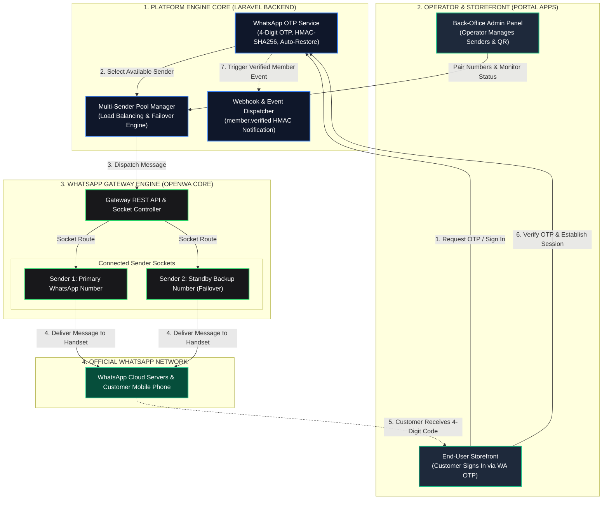
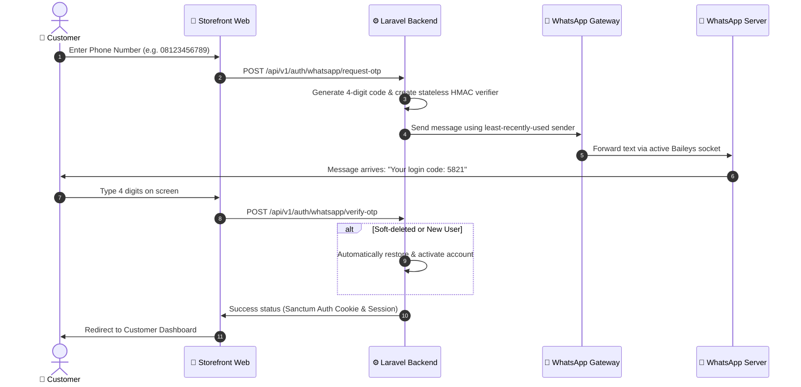
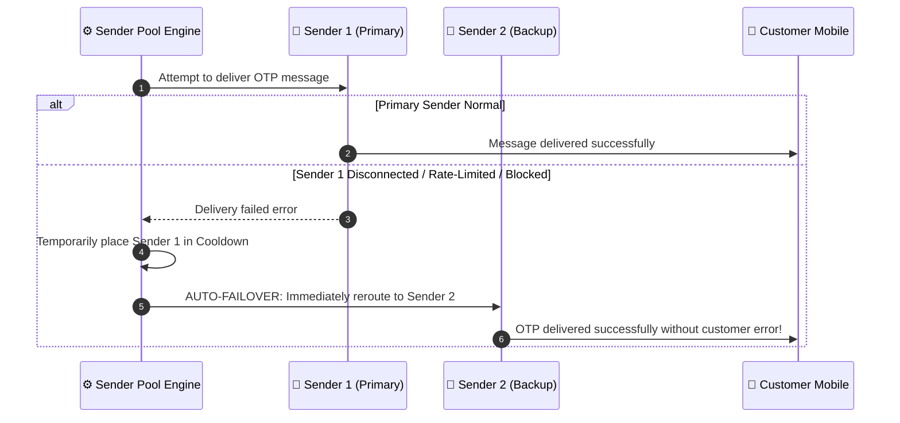
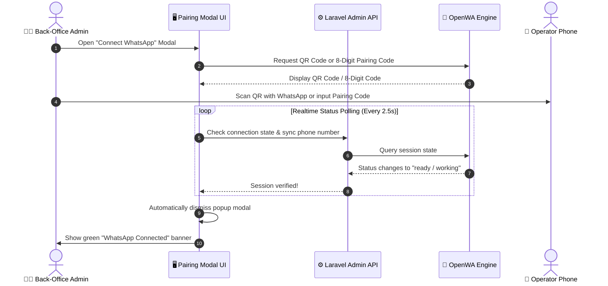

# WhatsApp Gateway & Back-Office Integration Engine

<p align="center">
  <strong>High-Performance WhatsApp Gateway Infrastructure with Multi-Sender Pool, Auto-Failover, and Zero-Config Laravel Admin Integration</strong>
</p>

<p align="center">
  <a href="README.md"><strong>English</strong></a> •
  <a href="README.id.md"><strong>Bahasa Indonesia</strong></a>
</p>

<p align="center">
  
  
  
  
  
</p>

---

## 📌 Project Overview

This repository provides an enterprise-grade **WhatsApp Gateway Engine** specifically refactored, optimized, and unified for **Back-Office and online transaction integration** (Member Authentication, OTP, Order Notifications, and Customer Portals).

Unlike isolated standalone panels that operate as disconnected services, this project is engineered as an **integrated headless infrastructure** designed to blend directly into your Laravel Admin architecture:
* **Zero-Config Native Integration**: Controller and service modules (`reference-laravel-client/`) reside directly inside your Laravel codebase. No external `.env` API tokens or public gateway URLs required.
* **Multi-Sender Pool & Auto-Failover**: Connect multiple WhatsApp numbers concurrently. The engine rotates dispatches (Round-Robin) and instantly fails over to backup senders if one number experiences rate limits or network disconnections.
* **4-Digit Zero-Leak WhatsApp OTP**: Fast, frictionless 4-digit numeric verification with stateless HMAC-SHA256 verifiers (no plaintext OTP stored in database) and automatic recovery for soft-deleted accounts.
* **Realtime Pairing with Auto-Dismiss Modal**: Connect WhatsApp numbers via standard QR Code scanning or 8-digit linking codes. The UI automatically senses when the phone connects (`ready/working`) and dismisses the popup instantly.

---

## 🏗️ 1. Architecture & Entity Ecosystem

Understanding how the platform engine, operators, and end-users interact:



---

## 🔄 2. Clear Operational Workflows (Step-by-Step)

### A. 4-Digit OTP Login & Verification Flow
How customers sign in swiftly without remembering complex passwords:



---

### B. Multi-Sender Auto-Failover Flow (Anti-Downtime)
How transactions are protected when a WhatsApp number encounters issues:



---

### C. WhatsApp Pairing Flow with Auto-Dismiss Modal
Effortless phone connection for operators without manual refresh:



---

## ⚡ 3. Key Features & Capabilities

### 1. 🔄 Multi-Sender Pool & Failover
* **Round-Robin Load Balancing**: Balances traffic across all active senders based on `last_used_at` to prevent account flagging.
* **Intelligent Auto-Failover**: If a sender fails, the dispatch pipeline automatically fails over to the next standby sender in the pool without dropping the user's request.
* **Self-Healing Cooldown**: Senders with transient errors are suspended for a cooldown window and automatically reactivated.

### 2. 🔢 4-Digit Frictionless OTP
* **Format**: 4 random numeric digits (`0000`–`9999`) optimized for mobile input.
* **Zero-Leak Security**: Code is verified via an ephemeral HMAC-SHA256 signature; raw OTPs are never stored in plaintext in the database.
* **Auto-Restore Soft-Deleted Accounts**: Automatically restores soft-deleted test or inactive accounts upon successful phone verification.
* **Smart Rate Limiting**: 30-second resend cooldown with server-side enforcement.

### 3. 📲 Dual Pairing Options
* **QR Code Scan**: Standard scan flow identical to WhatsApp Web.
* **8-Digit Pairing Code**: Link using phone number notifications without needing a camera.
* **Auto-Dismiss UI**: The pairing modal automatically detects connected status and closes itself.

### 4. 🎨 Modern Dark OpenWA Dashboard
* Built with a sleek dark aesthetic, WhatsApp Green (`#25d366`) accents, and ultra-thin custom scrollbars.
* Unified into **"WhatsApp Sessions & Senders"**, keeping sensitive infrastructure settings hidden in the background.

---

## 📂 4. Directory Structure

```
wa-gateway/
├── reference-laravel-client/     # 🌟 Ready-to-use Laravel Admin client module
│   ├── src/
│   │   ├── Services/             # WhatsAppGatewayClient.php (Internal Caller & Failover)
│   │   └── Controllers/          # BackOffice & Webhook Controllers
│   └── README.md                 # Laravel client quickstart
├── src/                          # Core WhatsApp Gateway Engine (NestJS + TypeScript)
│   ├── modules/
│   │   ├── session/              # WhatsApp session lifecycle (Baileys)
│   │   ├── message/              # Text, media, and template dispatching
│   │   ├── webhook/              # Webhook processing & outbox queue
│   │   └── auth/                 # API key authentication & tenant routing
├── deploy/                       # Production Docker deployment
│   ├── compose.yaml              # Docker Compose multi-session stack
│   └── nginx.conf                # Nginx proxy configuration
├── dashboard/                    # React control panel source
├── docs/                         # Architecture documentation & API references
└── README.md                     # Main documentation (English)
```

---

## 💻 5. Native Laravel Integration (Zero-Config / No .env Tokens)

The WhatsApp Gateway is designed for **Zero-Config Native Integration** directly within your Laravel backend. You **DO NOT NEED** extra `.env` tokens, manual API keys, or external gateway URLs.

### 1. Module Placement in Laravel
Place the reference files into your Laravel application tree:
```
app/
├── Http/
│   └── Controllers/
│       └── BackOffice/
│           ├── WhatsAppGatewayBackOfficeController.php  # Admin panel controller
│           └── WhatsAppMemberWebhookController.php       # Verified member event listener
└── Services/
    └── WhatsAppGateway/
        ├── WhatsAppGatewayClient.php                    # Internal caller & failover service
        └── SenderPoolService.php                        # Pool rotation and status service
```

### 2. Copy Module Files
```bash
# Copy Services to app/Services/WhatsAppGateway/
cp reference-laravel-client/src/Services/* app/Services/WhatsAppGateway/

# Copy Controllers to app/Http/Controllers/BackOffice/
cp reference-laravel-client/src/Controllers/* app/Http/Controllers/BackOffice/
```

### 3. Register Routes in `routes/api.php`
Leverage your existing Laravel Sanctum session authentication:
```php
use App\Http\Controllers\BackOffice\WhatsAppGatewayBackOfficeController;
use App\Http\Controllers\BackOffice\WhatsAppMemberWebhookController;

// Back-Office Sender Management (Admin Only)
Route::prefix('backoffice/whatsapp')->middleware(['auth:sanctum', 'role:admin'])->group(function () {
    Route::get('senders', [WhatsAppGatewayBackOfficeController::class, 'listSenders']);
    Route::post('senders', [WhatsAppGatewayBackOfficeController::class, 'addSender']);
    Route::post('senders/{id}/toggle', [WhatsAppGatewayBackOfficeController::class, 'toggleSender']);
    Route::get('senders/{id}/qr', [WhatsAppGatewayBackOfficeController::class, 'getQrCode']);
    Route::post('senders/{id}/pairing-code', [WhatsAppGatewayBackOfficeController::class, 'requestPairingCode']);
    Route::post('senders/{id}/test-send', [WhatsAppGatewayBackOfficeController::class, 'testSend']);
    Route::get('verified-members', [WhatsAppGatewayBackOfficeController::class, 'verifiedMembers']);
});

// Realtime Event Listener for Verified Members
Route::post('webhooks/whatsapp/member-verified', WhatsAppMemberWebhookController::class)
    ->withoutMiddleware([\App\Http\Middleware\VerifyCsrfToken::class]);
```

---

## 🛠️ 6. API Endpoint Catalog

| Method | Endpoint | Description |
|---|---|---|
| `GET` | `/api/v1/admin/sender-pool` | Retrieve all WhatsApp senders with rotation metrics and states |
| `POST` | `/api/v1/admin/sender-pool` | Register a new sender session (`session_id`, `label`) |
| `GET` | `/api/v1/admin/sender-pool/{id}` | Sender detail with live socket state from engine |
| `DELETE` | `/api/v1/admin/sender-pool/{id}` | Remove a sender from rotation |
| `POST` | `/api/v1/admin/sender-pool/{id}/toggle` | Pause or resume a sender from rotation |
| `POST` | `/api/v1/admin/sender-pool/{id}/sync` | Synchronize live phone number and connection status |
| `GET` | `/api/v1/admin/sender-pool/{id}/qr` | Fetch base64 PNG QR code for pairing |
| `POST` | `/api/v1/admin/sender-pool/{id}/pairing-code` | Request 8-digit pairing code for a mobile number |
| `POST` | `/api/v1/admin/sender-pool/{id}/test-send` | Dispatch a test message from this specific sender |
| `GET` | `/api/v1/admin/verified-members` | Paginated directory of verified WhatsApp members |

---

## 🐳 7. Running the Gateway Engine (Docker)

1. **Clone the Repository:**
   ```bash
   git clone https://github.com/billi-panca-wijaya/wa-gateway.git
   cd wa-gateway/deploy
   ```

2. **Launch Gateway Containers:**
   ```bash
   docker compose up -d
   ```

3. **Verify Service Health:**
   ```bash
   docker compose ps
   ```

---

## 🔒 8. Security & Data Protection

1. **Encrypted Credentials**: API keys stored in the sender pool table are encrypted using AES-256 (`Crypt::encryptString`) and never returned in plaintext API responses.
2. **Stateless HMAC Verifiers**: OTP codes are verified through one-time HMAC-SHA256 digests and are never stored in plaintext database fields.
3. **Internal Network Isolation**: The engine communicates locally inside the Docker bridge network (`http://openwa:2785`), inaccessible from the public internet.

---

## 👤 Author & License

Developed and refactored by:
* **Billi Panca Wijaya** ([GitHub: @billi-panca-wijaya](https://github.com/billi-panca-wijaya))

Licensed under the [MIT License](LICENSE).
