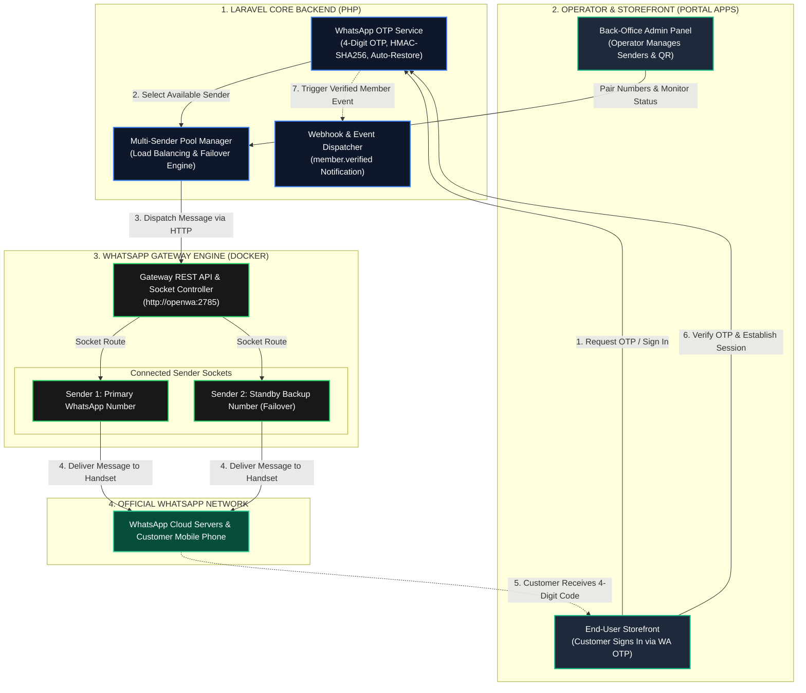
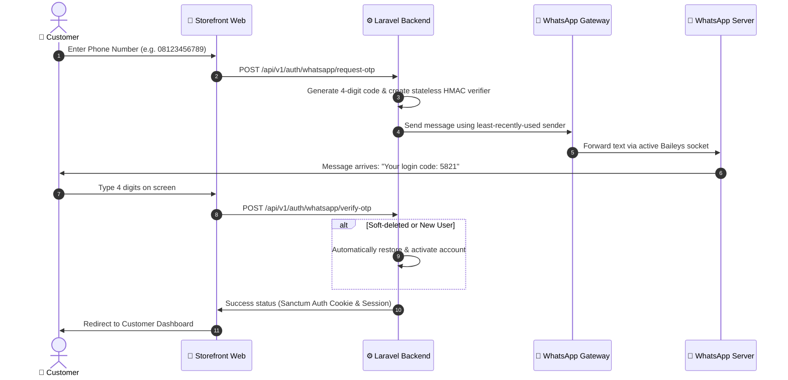
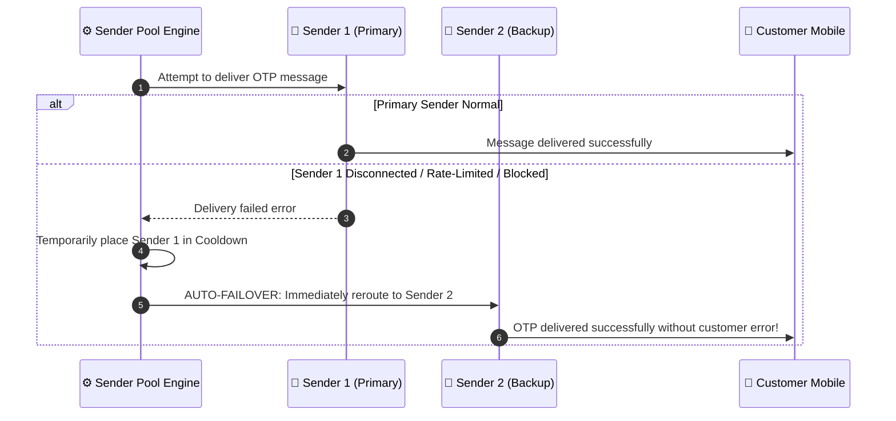
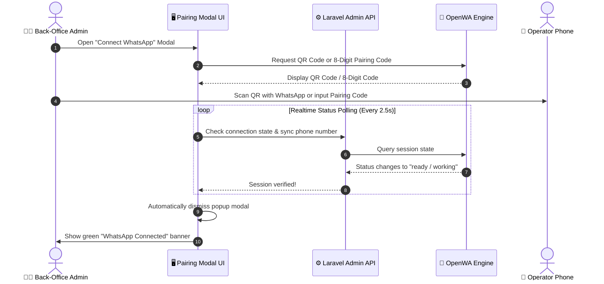

# WhatsApp Gateway & Back-Office Integration Engine

<p align="center">
  <strong>Lightweight WhatsApp Gateway Infrastructure with Multi-Sender Pool, Auto-Failover, and Zero-Config Laravel Admin Integration</strong>
</p>

<p align="center">
  <a href="README.md"><strong>English</strong></a> •
  <a href="README.id.md"><strong>Bahasa Indonesia</strong></a>
</p>

<p align="center">
  
  
  
  
</p>

---

## 📌 Project Overview

This repository provides an enterprise-ready **WhatsApp Gateway Engine & Laravel Integration Package** specifically optimized for **Back-Office operations and transactional workflows** (Member Authentication, 4-Digit OTP, Order Notifications, and Customer Portals).

Unlike bloated monolithic stacks that require compiling JavaScript or maintaining heavy build tools, this project has been streamlined into two clean components:
1. **Zero-Config Docker Engine** (`docker-compose.yml`): A single, lightweight container running the headless WhatsApp socket engine (Baileys) via prebuilt image. No local Node.js compilation required.
2. **Native Laravel Package** (`reference-laravel-client/`): Complete, drop-in Laravel services, controllers, migrations, and routes. No extra `.env` API tokens or external URLs needed.

---

## 🏗️ 1. Architecture & Entity Ecosystem

Understanding how the platform engine, operators, and end-users interact:



---

## 🔄 2. Operational Workflows (Step-by-Step)

### A. 4-Digit OTP Login & Verification Flow
How customers sign in swiftly without remembering complex passwords:



---

### B. Multi-Sender Auto-Failover Flow (Anti-Downtime)
How transactions are protected when a WhatsApp number encounters issues:



---

### C. WhatsApp Pairing Flow with Auto-Dismiss Modal
Effortless phone connection for operators without manual refresh:



---

## ⚡ 3. Key Features & Capabilities

### 1. 🔄 Multi-Sender Pool & Failover
* **Round-Robin Load Balancing**: Balances traffic across all active senders based on `last_used_at` to prevent account flagging.
* **Intelligent Auto-Failover**: If a sender fails, the dispatch pipeline automatically fails over to the next standby sender in the pool without dropping the user's request.
* **Self-Healing Cooldown**: Senders with transient errors are suspended for a cooldown window and automatically reactivated.

### 2. 🔢 4-Digit Frictionless OTP
* **Format**: 4 random numeric digits (`0000`–`9999`) optimized for mobile input.
* **Zero-Leak Security**: Code is verified via an ephemeral HMAC-SHA256 signature; raw OTPs are never stored in plaintext in the database.
* **Auto-Restore Soft-Deleted Accounts**: Automatically restores soft-deleted test or inactive accounts upon successful phone verification.
* **Smart Rate Limiting**: 30-second resend cooldown with server-side enforcement.

### 3. 📲 Dual Pairing Options
* **QR Code Scan**: Standard scan flow identical to WhatsApp Web.
* **8-Digit Pairing Code**: Link using phone number notifications without needing a camera.
* **Auto-Dismiss UI**: The pairing modal automatically detects connected status and closes itself.

---

## 📂 4. Clean Directory Structure

```
wa-gateway/
├── docker-compose.yml            # 🐳 Zero-config Docker stack to run WhatsApp Engine
├── reference-laravel-client/     # 🌟 Complete Laravel Integration Package
│   ├── config/
│   │   └── whatsapp_otp.php      # Laravel configuration
│   ├── database/migrations/      # Database migrations (sender_pool & otp_challenges)
│   ├── src/
│   │   ├── Controllers/          # WhatsAppOtpController, SenderPoolController, etc.
│   │   └── Services/WhatsAppOtp/ # OtpService, SenderPoolService, PooledTransport, etc.
│   └── README.md                 # Laravel installation guide
├── README.md                     # Main documentation (English)
├── README.id.md                  # Main documentation (Bahasa Indonesia)
└── LICENSE                       # MIT License
```

---

## 💻 5. Native Laravel Integration (Zero-Config / No .env Tokens)

The WhatsApp Gateway is designed for **Zero-Config Native Integration** directly within your Laravel backend. You **DO NOT NEED** extra `.env` tokens, manual API keys, or external gateway URLs.

### 1. Copy Package Files to Laravel
```bash
# 1. Copy Config
cp reference-laravel-client/config/whatsapp_otp.php config/

# 2. Copy Database Migrations
cp reference-laravel-client/database/migrations/* database/migrations/

# 3. Copy Services
cp -r reference-laravel-client/src/Services/WhatsAppOtp app/Services/

# 4. Copy Controllers
cp reference-laravel-client/src/Controllers/WhatsAppOtpController.php app/Http/Controllers/Api/
cp reference-laravel-client/src/Controllers/SenderPoolController.php app/Http/Controllers/Api/Admin/
cp reference-laravel-client/src/Controllers/VerifiedMembersController.php app/Http/Controllers/Api/Admin/
cp reference-laravel-client/src/Controllers/WhatsAppMemberWebhookController.php app/Http/Controllers/Api/
```

### 2. Run Database Migrations
```bash
php artisan migrate
```

### 3. Register Routes in `routes/api.php`
```php
use App\Http\Controllers\Api\WhatsAppOtpController;
use App\Http\Controllers\Api\Admin\SenderPoolController;
use App\Http\Controllers\Api\Admin\VerifiedMembersController;
use App\Http\Controllers\Api\WhatsAppMemberWebhookController;

// 1. Customer OTP Endpoints
Route::prefix('auth/whatsapp')->middleware('throttle:60,1')->group(function () {
    Route::post('request-otp', [WhatsAppOtpController::class, 'requestOtp']);
    Route::post('verify-otp', [WhatsAppOtpController::class, 'verifyOtp']);
    Route::post('resend-otp', [WhatsAppOtpController::class, 'resendOtp']);
});

// 2. Admin Back-Office Senders Management
Route::prefix('admin/sender-pool')
    ->middleware(['auth:sanctum', 'role:super-admin|admin'])
    ->controller(SenderPoolController::class)
    ->group(function () {
        Route::get('/', 'index');
        Route::post('/', 'store');
        Route::get('{id}', 'show');
        Route::post('{id}/toggle', 'toggle');
        Route::post('{id}/sync', 'sync');
        Route::get('{id}/qr', 'qr');
        Route::post('{id}/pairing-code', 'pairingCode');
        Route::post('{id}/test-send', 'testSend');
        Route::delete('{id}', 'destroy');
    });

// 3. Verified Members Directory
Route::prefix('admin/verified-members')
    ->middleware(['auth:sanctum', 'role:super-admin|admin'])
    ->controller(VerifiedMembersController::class)
    ->group(function () {
        Route::get('/', 'index');
        Route::get('{id}', 'show');
    });

// 4. Realtime Webhook Listener for Verified Members
Route::post('webhooks/whatsapp/member-verified', WhatsAppMemberWebhookController::class)
    ->withoutMiddleware([\App\Http\Middleware\VerifyCsrfToken::class]);
```

---

## 🐳 6. Running the WhatsApp Engine (Docker)

To launch the background WhatsApp Baileys socket engine, simply run:

```bash
docker compose up -d
```

* That's it! No `.env` setup or Node.js compilation required.
* The container will automatically start and expose the private WhatsApp socket interface at `http://localhost:18091` (and `http://openwa:2785` in the Docker bridge network).

---

## 🔒 7. Security & Data Protection

1. **Encrypted Credentials**: API keys stored in the sender pool table are encrypted using AES-256 (`Crypt::encryptString`) and never returned in plaintext API responses.
2. **Stateless HMAC Verifiers**: OTP codes are verified through one-time HMAC-SHA256 digests and are never stored in plaintext database fields.
3. **Internal Network Isolation**: The engine communicates locally inside the Docker bridge network (`http://openwa:2785`), inaccessible from the public internet.

---

## 👤 Author & License

Developed and refactored by:
* **Billi Panca Wijaya** ([GitHub: @billi-panca-wijaya](https://github.com/billi-panca-wijaya))

Licensed under the [MIT License](LICENSE).
