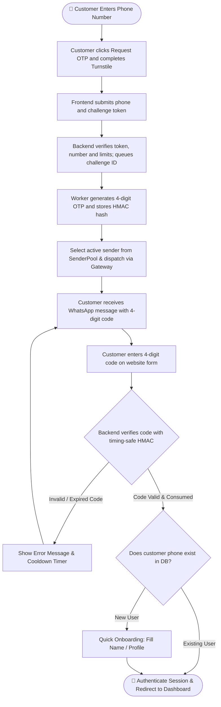

> **System Architecture & PRD:** For deep technical architecture, complete sequence diagrams, full API schemas, verifier cryptography, and lifecycle flows, see [WA_LOGIN_SYSTEM.md](WA_LOGIN_SYSTEM.md) and [QUEUED_LOGIN.md](docs/QUEUED_LOGIN.md).

# 🚀 Enterprise WhatsApp Gateway & Laravel Package (Spatie-Style)

[English](README.md) | [Bahasa Indonesia](README.id.md)

A production-ready, self-hosted **WhatsApp API Gateway** and **Spatie-style Laravel Package**. Easily add **WhatsApp OTP Customer Login (4-digit)**, **Multi-Sender Device Pool Rotation**, and an **Operations Back-Office** to your **existing Laravel website** using standard Composer conventions, package auto-discovery, publishable assets, and zero-overwrite safety.

---

## 📑 Table of Contents
1. [What is This & Why Use It? (Purpose)](#-1-what-is-this--why-use-it-purpose)
2. [Zero-Overwrite Guarantee & Spatie Design](#-2-zero-overwrite-guarantee--spatie-design)
3. [System Architecture & Database Topology](#-3-system-architecture--database-topology)
   - [WhatsApp Gateway Engine (OpenWA Docker)](#a-whatsapp-gateway-engine-openwa-docker)
   - [Backend Database Roles (PostgreSQL, MySQL, MongoDB, Redis)](#b-backend-database-roles-postgresql-mysql-mongodb-redis)
4. [Customer Login Flowchart & Lifecycle](#-4-customer-login-flowchart--lifecycle)
5. [What's Inside & Directory Structure](#-5-whats-inside--directory-structure)
6. [Step-by-Step Installation & Quickstart](#-6-step-by-step-installation--quickstart)
   - [Step 1: Start Gateway Engine](#step-1-start-the-whatsapp-gateway-engine)
   - [Step 2: Install Package via Composer](#step-2-install-package-via-composer)
   - [Step 3: Run Interactive Package Installer](#step-3-run-package-installer)
   - [Step 4: Add Trait to User Model](#step-4-add-trait-to-user-model)
   - [Step 5: Database Setup (SQL vs MongoDB)](#step-5-database-setup-sql-vs-mongodb)
   - [Step 6: Configure Environment (.env)](#step-6-configure-environment-variables-env)
7. [Programmatic Usage & Facade API](#-7-programmatic-usage--facade-api)
8. [Cloudflare Turnstile Bot Defense Setup](#-8-cloudflare-turnstile-bot-defense-setup)
9. [Asynchronous Redis Queue & Supervisor](#-9-asynchronous-redis-queue--supervisor)
10. [The 9-Menu Back-Office Admin Portal](#-10-the-9-menu-back-office-admin-portal)
11. [Pairing WhatsApp Sender Numbers](#-11-pairing-whatsapp-sender-numbers)
12. [Production Deployment & Operations Guide](#-12-production-deployment--operations-guide)

---

## 🎯 1. What is This & Why Use It? (Purpose)

### The Problem
- **Expensive Cloud APIs**: Services like Twilio or official Meta WhatsApp Business API charge steep monthly fees and per-message costs.
- **Messy Copy-Paste Add-ons**: Copying files manually into `app/` pollutes host codebases, triggers namespace collisions, and breaks when upgrading.
- **Single Point of Failure**: Relying on a single WhatsApp number risks business disruption if that number gets temporarily rate-limited or disconnected.
- **Bot Abuse & OTP Pumping**: Public login endpoints are frequently targeted by spam bots, resulting in queue congestion and unnecessary outbound traffic.

### The Solution
This repository provides a two-part ecosystem:
1. **Self-Hosted WhatsApp Gateway Engine**: Runs via Docker (OpenWA) using the battle-tested Baileys engine. **Zero per-message fees**, completely self-hosted, supports multi-session socket connections on port `18091`.
2. **Spatie-Style Laravel Package (`billi-panca-wijaya/laravel-whatsapp-gateway`)**:
   - **Composer Auto-Discovery**: Installs cleanly via Composer; registers its service provider and facade automatically.
   - **Customer Login via 4-digit WhatsApp OTP**: Passwordless, frictionless login with leading-zero preservation.
   - **Cloudflare Turnstile Protection**: Prevents automated bot submission with managed challenge validation.
   - **Asynchronous Redis Queue**: Decouples API responses from WhatsApp network latency for instant user feedback (<50ms).
   - **Multi-Device Sender Pool**: Attach multiple staff/agent WhatsApp numbers. The system distributes OTP delivery via **Round-Robin** and automatically switches to another active number if one disconnects.
   - **Publishable Resources**: Config, migrations, and React UI components published cleanly via Artisan.

---

## 🛡️ 2. Zero-Overwrite Guarantee & Spatie Design

**Preserve your existing Laravel application without overwriting a single file.**  
Following the philosophy of Spatie's open-source packages (e.g. `spatie/laravel-permission`), all code lives under the vendor namespace `BilliPancaWijaya\WhatsAppGateway\` and integrates via contracts and traits.

| Host Application Asset | Package Implementation | Overwrite Risk |
| :--- | :--- | :---: |
| `app/Models/User.php` | `HasWhatsAppLogin` Trait (`use HasWhatsAppLogin;`) | ❌ **NEVER** |
| `config/` | Published as `config/whatsapp-gateway.php` | ❌ **NEVER** |
| `database/migrations/` | Published defensive migrations checking column existence | ❌ **NEVER** |
| `routes/api.php` | Registered automatically by ServiceProvider under configurable prefix | ❌ **NEVER** |
| `app/Http/Controllers/` | Dedicated namespaced controllers in `src/Http/Controllers/` | ❌ **NEVER** |

---

## 🔄 3. System Architecture & Database Topology

### A. WhatsApp Gateway Engine (OpenWA Docker)
The WhatsApp Gateway is a standalone, containerized microservice (`wa-gateway-openwa`, Port `18091`). It is **completely database-agnostic**:
- It stores its own internal socket session keys inside the Docker volume (`openwa-data`).
- It does **not** connect directly to your PostgreSQL, MySQL, or MongoDB database.
- It communicates strictly via standard **HTTP REST API** (outbound: your backend sends messages) and **Webhooks** (inbound: status callbacks & incoming messages).

```text
┌────────────────────────────────────────────────────────────────────────┐
│                        YOUR LARAVEL BACKEND                            │
│                                                                        │
│   ┌──────────────┐       ┌──────────────┐       ┌──────────────────┐   │
│   │  PostgreSQL  │       │    Redis     │       │     MongoDB      │   │
│   │   / MySQL    │  OR   │   (Queue     │  OR   │   (User Docs     │   │
│   │ (Relational) │       │   & Cache)   │       │   & Chat Logs)   │   │
│   └──────▲───────┘       └──────▲───────┘       └────────▲─────────┘   │
│          │                      │                        │             │
│          └──────────────────────┼────────────────────────┘             │
│                                 │                                      │
│                      Laravel Application Logic                         │
│               (WhatsAppGateway Facade / Controllers)                   │
└─────────────────────────────────┬──────────────────────────────────────┘
                                  │
                  1. Send Messages (HTTP POST JSON)
                  2. Webhook Events (HTTP POST JSON)
                                  │
                                  ▼
┌────────────────────────────────────────────────────────────────────────┐
│             WhatsApp Gateway Container (wa-gateway-openwa)             │
│                       Port 18091 (Internal/LAN)                        │
└─────────────────────────────────┬──────────────────────────────────────┘
                                  │
                         WebSocket (Baileys)
                                  │
                                  ▼
                     ┌─────────────────────────┐
                     │ WhatsApp Global Network │
                     └─────────────────────────┘
```

### B. Backend Database Roles (PostgreSQL, MySQL, MongoDB, Redis)

| Database | Supported? | Recommended Role in System |
| :--- | :---: | :--- |
| **PostgreSQL / MySQL** | ✅ Native | **Primary Auth Database**: Stores user accounts, additive phone verification columns, hashed OTP verifiers, and sender device pool records. |
| **MongoDB** | ✅ Supported | **NoSQL Document Database**: Supported via `mongodb/laravel-mongodb`. Stores users and OTP challenges as BSON documents. Configurable via `user_model` in `config/whatsapp-gateway.php`. |
| **Redis** | ✅ Required in Production | **Asynchronous Queue & Cache**: Acts as the high-speed in-memory broker for the `whatsapp-otp` queue, atomic locks (`Cache::lock`), and rate-limit counters. It does not replace your primary database. |

---

## 📊 4. Customer Login Flowchart & Lifecycle



---

## 📁 5. What's Inside & Directory Structure

```text
wa-gateway/
├── composer.json                       # PSR-4 Autoloading + Laravel Auto-Discovery
├── phpunit.xml.dist                    # PHPUnit testing configuration
├── docker-compose.yml                  # Standalone OpenWA Gateway Engine container
├── .env.example                        # Unified environment variables template
├── LICENSE                             # MIT License
├── README.md / README.id.md            # Bilingual documentation (English & Indonesian)
├── WA_LOGIN_SYSTEM.md                  # Comprehensive Technical PRD & Architecture Spec
│
├── config/
│   └── whatsapp-gateway.php            # Publishable configuration (`whatsapp-gateway-config`)
│
├── database/
│   └── migrations/                     # Publishable defensive migrations
│       ├── 0001_create_whatsapp_user_columns.php
│       ├── 0002_create_whatsapp_otp_tables.php
│       └── 0003_create_whatsapp_sender_pools_table.php
│
├── routes/
│   └── api.php                         # Unified API, Admin, and Webhook routes
│
├── resources/
│   └── frontend/                       # React UI components & Back-Office micro-frontend
│
├── deploy/
│   ├── gateway-reverse-proxy.conf      # Nginx reverse proxy configuration
│   └── whatsapp-otp-worker.conf        # Supervisor worker template
│
├── src/                                # PSR-4 Source (`BilliPancaWijaya\WhatsAppGateway\`)
│   ├── WhatsAppGateway.php             # Main package manager & facade accessor
│   ├── WhatsAppGatewayServiceProvider.php # Auto-discovered Service Provider
│   ├── Facades/
│   │   └── WhatsAppGateway.php         # Developer-facing Facade
│   ├── Commands/
│   │   ├── InstallWhatsAppGatewayCommand.php # `php artisan whatsapp-gateway:install`
│   │   ├── CheckGatewayStatusCommand.php     # `php artisan whatsapp-gateway:status`
│   │   └── PruneOtpChallengesCommand.php     # `php artisan whatsapp-gateway:prune`
│   ├── Exceptions/
│   │   └── OtpException.php            # Domain exceptions with HTTP rendering
│   ├── Http/Controllers/
│   │   ├── WhatsAppOtpController.php
│   │   ├── Admin/WhatsAppGatewayController.php
│   │   ├── Admin/WhatsAppSenderPoolController.php
│   │   ├── Admin/WhatsAppVerifiedMembersController.php
│   │   └── BackOffice/WhatsAppMemberWebhookController.php
│   ├── Jobs/
│   │   └── WhatsAppSendOtp.php         # Asynchronous queued OTP job
│   ├── Models/
│   │   ├── WhatsAppOtpChallenge.php
│   │   ├── WhatsAppOtpDelivery.php
│   │   └── WhatsAppSenderPool.php
│   ├── Services/
│   │   ├── OtpService.php              # Core OTP issuance and verification
│   │   ├── SenderPoolService.php       # Multi-session rotation and auto-failover
│   │   ├── OpenWaSessionClient.php     # OpenWA REST client
│   │   ├── PhoneNumber.php             # E.164 normalization & phone masking
│   │   ├── TenantResolver.php          # Multi-tenant resolution
│   │   ├── WhatsAppBotChallenge.php    # Cloudflare Turnstile verification
│   │   └── Transport/                  # Transport drivers (Pooled, OpenWA, Mock)
│   └── Traits/
│       └── HasWhatsAppLogin.php        # User model integration trait
│
└── tests/                              # Unit & Feature Test Suite
    ├── TestCase.php                    # Orchestra Testbench setup
    └── Feature/WhatsAppOtpTest.php
```

---

## 🛠️ 6. Step-by-Step Installation & Quickstart

### Step 1: Start the WhatsApp Gateway Engine
From this repository directory:
```bash
docker compose up -d
```
Verify the gateway container is running on port `18091`:
```bash
curl http://127.0.0.1:18091/api/health/ready
# Output: {"status":"ok", ...}
```

### Step 2: Install Package via Composer
In your Laravel application's `composer.json`, add the repository:
```json
"repositories": [
    {
        "type": "vcs",
        "url": "https://github.com/billi-panca-wijaya/wa-gateway.git"
    }
]
```
Then install the package:
```bash
composer require billi-panca-wijaya/laravel-whatsapp-gateway:dev-main
```
*(When installed locally as a path repository, set `"type": "path", "url": "../wa-gateway"`).*

Laravel's Package Auto-Discovery will automatically register `WhatsAppGatewayServiceProvider` and the `WhatsAppGateway` facade.

### Step 3: Run Package Installer
Run the interactive artisan installer:
```bash
php artisan whatsapp-gateway:install
```
This automatically publishes `config/whatsapp-gateway.php`, publishes the migrations, and prompts to migrate your database.

*Or manually publish tags:*
```bash
php artisan vendor:publish --tag="whatsapp-gateway-config"
php artisan vendor:publish --tag="whatsapp-gateway-migrations"
php artisan vendor:publish --tag="whatsapp-gateway-frontend"
```

### Step 4: Add Trait to User Model
Open your host User model (e.g. `app/Models/User.php`) and add the `HasWhatsAppLogin` trait:

```php
namespace App\Models;

use BilliPancaWijaya\WhatsAppGateway\Traits\HasWhatsAppLogin;
use Illuminate\Foundation\Auth\User as Authenticatable;

class User extends Authenticatable
{
    use HasWhatsAppLogin;

    // ... your existing methods and properties are preserved
}
```

### Step 5: Database Setup (SQL vs MongoDB)

#### Option 5A: PostgreSQL / MySQL
Run the published migrations:
```bash
php artisan migrate
```
This safely applies:
1. `0001_create_whatsapp_user_columns.php` (adds `tenant_key`, `phone_e164`, `phone_verified_at`, etc.)
2. `0002_create_whatsapp_otp_tables.php` (creates `otp_challenges` and `otp_deliveries`)
3. `0003_create_whatsapp_sender_pools_table.php` (creates `sender_pool`)

#### Option 5B: MongoDB
If using MongoDB (`mongodb/laravel-mongodb`):
1. In `config/whatsapp-gateway.php`, configure `user_model` to point to your Mongo User model.
2. In your MongoDB User model, use `HasWhatsAppLogin`.
3. Add a unique index on `phone_e164` in MongoDB.

### Step 6: Configure Environment Variables (`.env`)
Add these lines to your Laravel `.env` file:
```dotenv
# WhatsApp Gateway Engine (OpenWA Container)
OPENWA_BASE_URL=http://127.0.0.1:18091
OPENWA_SESSION_ID=default
OPENWA_API_KEY=

# OTP Cryptography & Pepper Secret (Required in production)
WA_OTP_HMAC_SECRET=generate-a-random-64-character-hex-secret-here
WA_OTP_TRANSPORT=openwa
WA_OTP_DEFAULT_REGION=ID

# Cloudflare Turnstile Bot Protection
WA_OTP_TURNSTILE_ENABLED=true
WA_OTP_TURNSTILE_SITE_KEY=<your-turnstile-site-key>
WA_OTP_TURNSTILE_SECRET_KEY=<your-turnstile-secret-key>
WA_OTP_TURNSTILE_HOSTNAMES=your-domain.com,login.your-domain.com,localhost,127.0.0.1

# Asynchronous Redis Queue for OTP
QUEUE_CONNECTION=redis
CACHE_STORE=redis
WA_OTP_QUEUE_ENABLED=true
WA_OTP_QUEUE_CONNECTION=redis
WA_OTP_QUEUE_NAME=whatsapp-otp
REDIS_QUEUE_RETRY_AFTER=90

# Rate Limits (900s window)
WA_OTP_SEND_PER_PHONE=5
WA_OTP_SEND_PER_IP=20
WA_OTP_SEND_SYSTEM=2000
WA_OTP_SEND_GLOBAL=500
WA_OTP_SEND_WINDOW_SECONDS=900
WA_OTP_VERIFY_PER_IP=60
WA_OTP_VERIFY_WINDOW_SECONDS=900
WA_OTP_MAX_ATTEMPTS=5
```

---

## 💻 7. Programmatic Usage & Facade API

You can use the package programmatically anywhere in your Laravel codebase:

```php
use BilliPancaWijaya\WhatsAppGateway\Facades\WhatsAppGateway;

// 1. Request an OTP for a user
$challenge = WhatsAppGateway::requestOtp('+6281234567890');
// Returns: ['challenge_id' => '...', 'state' => 'queued', 'masked_phone' => '+6281****7890', ...]

// 2. Verify an OTP code entered by the user
$result = WhatsAppGateway::verifyOtp($challenge['challenge_id'], '1234');
// Returns: ['user' => $userInstance, 'created' => true/false]

// 3. Resend an OTP code
$resend = WhatsAppGateway::resendOtp($challenge['challenge_id']);

// 4. Send a custom text message via the sender pool
$delivery = WhatsAppGateway::sendMessage('+6281234567890', 'Hello from my Laravel App!');
```

---

## 🛡️ 8. Cloudflare Turnstile Bot Defense Setup

Cloudflare Turnstile stops bots and OTP pumping attacks without frustrating real users with visual puzzles.

### Setup Instructions:
1. Go to [Cloudflare Dashboard](https://dash.cloudflare.com) → **Turnstile**.
2. Click **Add widget**:
   - **Widget Name**: e.g., `WhatsApp OTP Login`
   - **Widget Mode**: **Managed** (Recommended)
3. **Configure Domains**: Enter your production domain (e.g. `your-domain.com`), plus `localhost` and `127.0.0.1` for testing.
4. **Obtain Keys**:
   - Copy **Site Key** into `WA_OTP_TURNSTILE_SITE_KEY`.
   - Copy **Secret Key** into `WA_OTP_TURNSTILE_SECRET_KEY`.
5. **Clear Config Cache**:
   ```bash
   php artisan config:clear
   php artisan config:cache
   ```

---

## ⚡ 9. Asynchronous Redis Queue & Supervisor

In production, OTP delivery is handled asynchronously by Redis to ensure sub-50ms HTTP response times.

### Supervisor Configuration
Create `/etc/supervisor/conf.d/whatsapp-otp-worker.conf` (template in `deploy/whatsapp-otp-worker.conf`):
```ini
[program:whatsapp-otp-worker]
process_name=%(program_name)s_%(process_num)02d
command=php /var/www/html/artisan queue:work redis --queue=whatsapp-otp --sleep=1 --tries=20 --timeout=60 --max-time=3600
autostart=true
autorestart=true
user=www-data
numprocs=2
redirect_stderr=true
stdout_logfile=/var/log/supervisor/whatsapp-otp.log
stopwaitsecs=90
```

Start workers:
```bash
supervisorctl reread
supervisorctl update
supervisorctl start whatsapp-otp-worker:*
```

---

## 🖥️ 10. The 9-Menu Back-Office Admin Portal

The published frontend (`resources/frontend/`) includes components for operations and support staff:

1. **WhatsApp Sessions & Senders** (Native Panel: QR pairing & multi-device rotation)
2. **Verified Members** (Native Panel: Table of customers verified via WhatsApp)
3. **Dashboard** (Embedded Gateway Console: Sockets, memory, overview)
4. **Chats** (Embedded Gateway Console: Live chat history and message viewing)
5. **Webhooks** (Embedded Gateway Console: Outgoing webhook subscriptions)
6. **Templates** (Embedded Gateway Console: Message template editor)
7. **Message Tester** (Embedded Gateway Console: Interactive message sandbox)
8. **Plugins** (Embedded Gateway Console: Extension manager)
9. **Logs** (Embedded Gateway Console: Gateway operational event logs)

---

## 📱 11. Pairing WhatsApp Sender Numbers

Pair sender numbers in two ways from the **WhatsApp Sessions & Senders** panel:
1. **QR Code Pairing**: Click "Link / Start Session", open WhatsApp on your phone → Linked Devices → Scan the QR code on screen.
2. **Pairing Code (No Camera)**: Enter the sender's phone number → Click "Request 8-character Pairing Code" → Enter the code inside the WhatsApp notification on your phone.

Once paired, the status changes to **`WORKING`** or **`READY`**, and outgoing OTPs will automatically rotate through this number!

---

## 🌐 12. Production Deployment & Operations Guide

### Helpful Artisan Commands:
```bash
# Check connectivity to Gateway:
php artisan whatsapp-gateway:status

# Prune old expired challenges older than 30 days:
php artisan whatsapp-gateway:prune

# Publish updated configuration:
php artisan vendor:publish --tag="whatsapp-gateway-config" --force
```

### Managing the WhatsApp Gateway Container:
```bash
# Start Gateway in background:
docker compose up -d

# Check Gateway Health (Port 18091):
curl -fsS http://127.0.0.1:18091/api/health/ready && echo ""

# View Gateway Container Logs:
docker logs -f --tail 100 wa-gateway-openwa

# Restart Gateway:
docker compose restart
```

---

*Maintained for clean, robust enterprise Laravel integration following Spatie open-source standards.*
