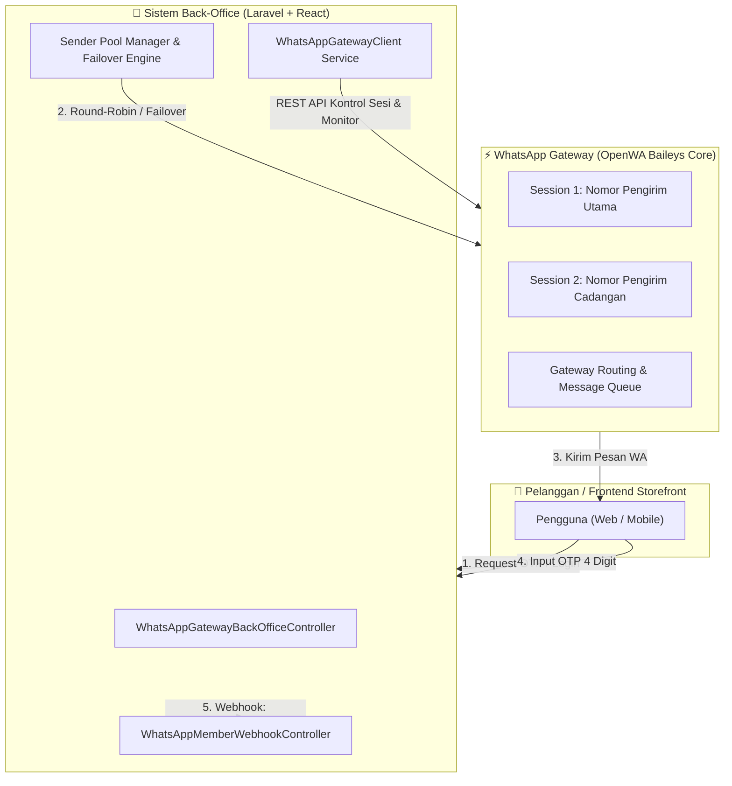

# WhatsApp Gateway & Back-Office Integration Engine

<p align="center">
  <strong>High-Performance WhatsApp Gateway Infrastructure with Multi-Sender Pool, Failover, and Seamless Back-Office Integration</strong>
</p>

<p align="center">
  
  
  
  
  
</p>

---

## 📌 Ringkasan Proyek

Repository ini merupakan **WhatsApp Gateway Engine** yang telah dirombak, dioptimasi, dan disesuaikan secara khusus untuk kebutuhan **integrasi Back-Office dan sistem transaksi online** (e-Commerce / Game Top-up / Customer Portal).

Berbeda dari gateway mandiri standar yang hanya berfungsi sebagai panel terpisah (*isolated standalone panel*), arsitektur pada repositori ini dirancang sebagai **fondasi infrastruktur *headless*** yang terhubung langsung ke sistem Back-Office utama (Laravel & React):
* **Bukan sekadar panel terpisah**: Menyediakan SDK klien Laravel siap pakai (`reference-laravel-client/`) yang bisa langsung disematkan ke dalam sistem administrasi internal perusahaan Anda.
* **Multi-Sender Pool & Failover**: Mendukung banyak nomor WhatsApp sekaligus untuk rotasi pengiriman pesan (OTP, notifikasi, invoice) dengan *auto-failover* jika salah satu nomor bermasalah.
* **OTP WhatsApp 4 Digit Aman**: Sistem autentikasi OTP WhatsApp yang cepat, aman, bebas kebocoran, dengan auto-restore akun pelanggan yang terhapus saat pengujian.
* **Otomasi Webhook**: Mengirimkan notifikasi seketika (*event streaming*) saat pelanggan berhasil memverifikasi nomornya melalui tanda tangan HMAC SHA-256.

---

## 🏗️ Arsitektur Integrasi Back-Office



---

## 🚀 Fitur Utama & Kustomisasi

### 1. 🔄 Multi-Sender Pool & Auto-Failover
- **Rotasi Beban (Round-Robin)**: Membagi beban pengiriman pesan di antara beberapa nomor WhatsApp secara seimbang berdasarkan `last_used_at`.
- **Auto-Failover Cerdas**: Jika nomor utama mengalami *rate-limit*, terputus, atau dibatasi WhatsApp, pengiriman otomatis beralih ke nomor cadangan di kolam (*pool*) tanpa menggagalkan login pelanggan.
- **Auto-Cooldown Reactivation**: Nomor yang sempat gagal akan masuk masa jeda (*cooldown*) dan otomatis aktif kembali setelah periode pemulihan.

### 2. 🔐 OTP Login WhatsApp 4 Digit (Zero-Leak)
- **Panjang Kode**: 4 digit angka acak (`0000`–`9999`) yang ringkas dan ramah pengguna di ponsel.
- **Verifikasi Kriptografis**: Menggunakan verifier HMAC-SHA256 stateless yang tidak menyimpan kode OTP mentah di database.
- **Auto-Restore Soft-Deleted Accounts**: Jika nomor pelanggan pernah di-soft-delete dalam masa pengujian (*testing*), sistem otomatis memulihkan dan mengaktifkan kembali akunnya begitu verifikasi OTP WhatsApp berhasil.
- **Kirim Ulang Responsif**: Cooldown kirim ulang 30 detik tanpa penolakan status lama (*non-blocking resend*).

### 3. 📲 Pair WhatsApp Realtime (QR & 8-Digit Code)
- **Dukungan Dua Metode Pairing**:
  1. *Scan Kode QR*: Persis seperti WhatsApp Web.
  2. *Kode Tautan 8 Karakter*: Pairing via notifikasi WhatsApp tanpa menggunakan kamera.
- **Auto-Close Modal**: Panel modal pairing otomatis mendeteksi koneksi aktif dan menutup sendiri begitu sesi WhatsApp terhubung (*status: ready/working*).

### 4. 🪝 Webhook Event Member Terverifikasi
- Begitu member baru menyelesaikan verifikasi OTP WhatsApp, gateway otomatis menembakkan event `member.verified` ke URL webhook yang didaftarkan.
- Setiap webhook diproteksi dengan header `X-Webhook-Signature` berbasis SHA-256 HMAC.

### 5. 🎨 Antarmuka Terpadu (Sleek Dark & OpenWA Style)
- Scrollbar kustom modern bergaya *ultra-thin* (6px) dengan aksen hijau WhatsApp (`#25d366`).
- Menu terpadu **"Sesi & Nomor Pengirim WA"** menggantikan menu ganda yang membingungkan.
- Menu sensitif/internal (*Kunci API*) disembunyikan dan diotomasi sepenuhnya di latar belakang.

---

## 📂 Struktur Direktori Proyek

```
wa-gateway/
├── reference-laravel-client/     # 🌟 SDK Referensi siap pakai untuk Back-Office Laravel
│   ├── config/                   # File konfigurasi whatsapp_gateway_client.php
│   ├── src/
│   │   ├── Services/             # WhatsAppGatewayClient.php (API Caller & Failover)
│   │   └── Controllers/          # BackOffice & Webhook Controllers
│   └── README.md                 # Panduan instalasi cepat ke Laravel
├── src/                          # Core WhatsApp Gateway Engine (NestJS + TypeScript)
│   ├── modules/
│   │   ├── session/              # Manajemen sesi WhatsApp (Baileys)
│   │   ├── message/              # Pengiriman pesan, media, dan template
│   │   ├── webhook/              # Sistem webhook & antrean outbox
│   │   └── auth/                 # Autentikasi API key & tenant resolver
├── deploy/                       # Skrip & konfigurasi deployment Docker produksi
│   ├── compose.yaml              # Docker Compose file terisolasi
│   ├── .env.example              # Template environment variable
│   └── nginx.conf                # Nginx proxy template
├── dashboard/                    # Source UI panel kontrol OpenWA (React)
├── docs/                         # Spesifikasi arsitektur & dokumentasi API lengkap
├── API_CONTRACT.prd              # Kontrak endpoint REST API gateway
├── DEPLOYMENT.prd                # Panduan deployment VPS
├── HANDOFF.prd                   # Dokumen riwayat transisi & arsitektur sistem
└── README.md                     # Dokumentasi utama proyek
```

---

## 💻 Panduan Integrasi ke Back-Office Laravel

Folder `reference-laravel-client/` telah disediakan agar tim developer back-office dapat langsung menyalin kode ke project Laravel yang ada:

### 1. Salin File ke Laravel Anda
```bash
# Salin Service ke app/Services/WhatsAppGateway/
cp reference-laravel-client/src/Services/* app/Services/WhatsAppGateway/

# Salin Controller ke app/Http/Controllers/BackOffice/
cp reference-laravel-client/src/Controllers/* app/Http/Controllers/BackOffice/

# Salin Config ke config/
cp reference-laravel-client/config/whatsapp_gateway_client.php config/
```

### 2. Tambahkan Konfigurasi di `.env` Back-Office
```env
WA_GATEWAY_API_URL="http://127.0.0.1:18090"
WA_GATEWAY_API_TOKEN="token-admin-anda"
WA_GATEWAY_WEBHOOK_SECRET="kunci-rahasia-hmac-webhook"
WA_GATEWAY_TIMEOUT=15
```

### 3. Daftarkan Rute di `routes/api.php`
```php
use App\Http\Controllers\BackOffice\WhatsAppGatewayBackOfficeController;
use App\Http\Controllers\BackOffice\WhatsAppMemberWebhookController;

// Rute Kontrol Pengirim & Member Terverifikasi (Admin Only)
Route::prefix('backoffice/whatsapp')->middleware(['auth:sanctum', 'role:admin'])->group(function () {
    Route::get('senders', [WhatsAppGatewayBackOfficeController::class, 'listSenders']);
    Route::post('senders', [WhatsAppGatewayBackOfficeController::class, 'addSender']);
    Route::post('senders/{id}/toggle', [WhatsAppGatewayBackOfficeController::class, 'toggleSender']);
    Route::get('senders/{id}/qr', [WhatsAppGatewayBackOfficeController::class, 'getQrCode']);
    Route::post('senders/{id}/pairing-code', [WhatsAppGatewayBackOfficeController::class, 'requestPairingCode']);
    Route::post('senders/{id}/test-send', [WhatsAppGatewayBackOfficeController::class, 'testSend']);
    Route::get('verified-members', [WhatsAppGatewayBackOfficeController::class, 'verifiedMembers']);
});

// Listener Webhook Saat Pelanggan Verifikasi OTP
Route::post('webhooks/whatsapp/member-verified', WhatsAppMemberWebhookController::class)
    ->withoutMiddleware([\App\Http\Middleware\VerifyCsrfToken::class]);
```

---

## 🛠️ Katalog API Endpoints Gateway

| Method | Endpoint | Deskripsi |
|---|---|---|
| `GET` | `/api/v1/admin/sender-pool` | Mengambil seluruh daftar nomor WhatsApp di pool beserta status dan statistik rotasi |
| `POST` | `/api/v1/admin/sender-pool` | Menambahkan nomor/sesi baru (`session_id`, `label`, `api_key`) |
| `GET` | `/api/v1/admin/sender-pool/{id}` | Detail nomor + status live dari container OpenWA |
| `DELETE` | `/api/v1/admin/sender-pool/{id}` | Menghapus nomor dari pool rotasi |
| `POST` | `/api/v1/admin/sender-pool/{id}/toggle` | Menunda (*pause*) atau mengaktifkan kembali nomor |
| `POST` | `/api/v1/admin/sender-pool/{id}/sync` | Sinkronisasi status dan nomor telepon live dari engine |
| `GET` | `/api/v1/admin/sender-pool/{id}/qr` | Mengambil data QR code (base64 PNG) untuk scan pairing |
| `POST` | `/api/v1/admin/sender-pool/{id}/pairing-code` | Meminta 8-digit kode pairing WhatsApp via nomor HP |
| `POST` | `/api/v1/admin/sender-pool/{id}/test-send` | Mengirim pesan WhatsApp uji coba dari nomor pengirim ini |
| `GET` | `/api/v1/admin/verified-members` | Daftar pengguna yang telah terverifikasi via OTP WhatsApp |

---

## 🐳 Menjalankan dengan Docker

1. **Clone Repository:**
   ```bash
   git clone https://github.com/billi-panca-wijaya/wa-gateway.git
   cd wa-gateway
   ```

2. **Siapkan Konfigurasi Lingkungan:**
   ```bash
   cp deploy/.env.example deploy/.env
   # Sesuaikan API_MASTER_KEY dan kredensial di deploy/.env
   ```

3. **Jalankan Kontainer Gateway:**
   ```bash
   cd deploy
   docker compose up -d
   ```

4. **Periksa Kesehatan Layanan:**
   ```bash
   curl -fsS http://127.0.0.1:18091/api/health/ready
   ```

---

## 🔒 Kebijakan Keamanan & Data Pribadi

1. **Enkripsi Kunci API**: Kunci API pada tabel pool nomor pengirim dienkripsi menggunakan standar AES-256 dan tidak pernah diekspos dalam format plaintext di respons API.
2. **Tanpa Penyimpanan OTP Mentah**: Kode OTP yang dihasilkan tidak disimpan di database dalam bentuk teks biasa, melainkan diverifikasi melalui tanda tangan HMAC acak satu kali pakai (*single-use consumption*).
3. **Isolasi Lingkungan**: Seluruh file kredensial (`.env`, session tokens, dan private keys) diabaikan secara ketat oleh Git untuk menjamin tidak ada kebocoran rahasia ke repository publik.

---

## 👤 Pengembang & Hak Cipta

Dikembangkan, dirombak, dan disesuaikan untuk integrasi Back-Office oleh:
* **Billi Panca Wijaya** ([GitHub: @billi-panca-wijaya](https://github.com/billi-panca-wijaya))

Dilisensikan di bawah lisensi [MIT License](LICENSE).
