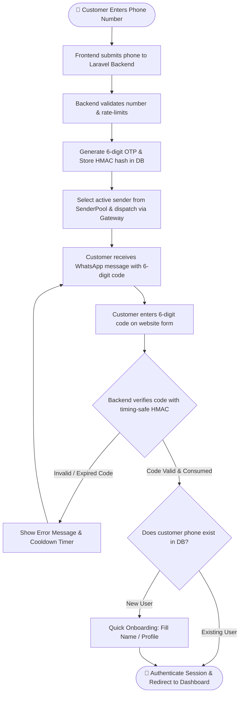

# 🚀 WhatsApp API Gateway & Drop-in Laravel Add-on

[English](README.md) | [Bahasa Indonesia](README.id.md)

A complete, self-hosted **WhatsApp API Gateway** and **non-intrusive drop-in Add-on for Laravel**.
Easily add **WhatsApp OTP Customer Login** and a **Multi-Sender Device Pool Back-Office** to your **existing Laravel website** in under 5 minutes — with a **100% Zero-Overwrite Guarantee**.

---

## 📑 Table of Contents
1. [What is This & Why Use It? (Purpose)](#-1-what-is-this--why-use-it-purpose)
2. [Zero-Overwrite Guarantee](#-2-zero-overwrite-guarantee)
3. [System Workflow & Architecture](#-3-system-workflow--architecture)
4. [Customer Login Flowchart](#-4-customer-login-flowchart)
5. [What's Inside & Directory Structure](#-5-whats-inside--directory-structure)
6. [Step-by-Step Implementation Guide (How to Use)](#-6-step-by-step-implementation-guide-how-to-use)
7. [The 9-Menu Back-Office Admin Portal](#-7-the-9-menu-back-office-admin-portal)
8. [Pairing WhatsApp Sender Numbers](#-8-pairing-whatsapp-sender-numbers)
9. [VPS Deployment & Operations Guide](#-9-vps-deployment--operations-guide)

---

## 🎯 1. What is This & Why Use It? (Purpose)

### The Problem
- **Expensive Cloud APIs**: Services like Twilio or official Meta WhatsApp Business API charge steep monthly fees and per-message costs.
- **Intrusive Packages**: Most auth packages require scaffolding a brand new Laravel app from scratch or overwriting your existing controllers, user models, and routes.
- **Single Point of Failure**: Using a single WhatsApp number risks business disruption if that number gets temporarily rate-limited or disconnected.

### The Solution
This repository provides a two-part ecosystem:
1. **Self-Hosted WhatsApp Gateway Engine**: Runs via Docker (OpenWA v0.24.0) using the battle-tested Baileys engine. **Zero per-message fees**, completely self-hosted, supports multi-session socket connections.
2. **Drop-in Laravel Add-on (`whatsapp-addon/`)**: A modular package you simply copy into your existing Laravel project. It provides:
   - **Customer Login via 6-digit WhatsApp OTP**: Passwordless, frictionless login.
   - **Multi-Device Sender Pool**: Attach multiple staff/agent WhatsApp numbers. The system distributes OTP delivery via **Round-Robin** and automatically switches to another active number if one disconnects.
   - **9 Back-Office Management Menus**: Full admin UI for sender devices, logs, webhooks, templates, and verified members.

---

## 🛡️ 2. Zero-Overwrite Guarantee

**Your existing Laravel website stays 100% intact.**
Every file and folder in this add-on has unique prefixes (`WhatsApp`, `whatsapp_`, `0001_wa_`) and dedicated namespaces. **It will NEVER overwrite, modify, or delete any default Laravel file.**

| Laravel Default File in Your Project | What This Add-on Uses Instead | Can It Overwrite Your File? |
| :--- | :--- | :--- |
| `app/Http/Controllers/Controller.php` | `app/Http/Controllers/WhatsAppOtpController.php` | ❌ **NEVER** |
| `app/Models/User.php` | `app/Models/WhatsAppOtpChallenge.php`, `WhatsAppSenderPool.php` | ❌ **NEVER** |
| `routes/api.php` & `routes/web.php` | `routes/whatsapp.php` | ❌ **NEVER** |
| `config/app.php` & `config/auth.php` | `config/whatsapp_gateway.php`, `config/whatsapp_otp.php` | ❌ **NEVER** |
| Existing User Migrations | `database/migrations/0001_wa_users.php` (additive columns only) | ❌ **NEVER** |
| Default Frontend Layouts | `frontend/components/WhatsAppOtpForm.tsx`, `frontend/backoffice/*` | ❌ **NEVER** |

---

## 🔄 3. System Workflow & Architecture

The system connects your customer, your existing Laravel backend, the gateway engine, and WhatsApp network:

```text
┌─────────────────────────────────┐
│     Customer Web Browser        │
│  (React WhatsAppOtpForm modal)  │
└────────────────┬────────────────┘
                 │ 1. Request OTP (+628123456789)
                 ▼
┌────────────────────────────────────────────────────────┐
│             Your Existing Laravel Backend              │
│  - Generates cryptographically secure 6-digit OTP      │
│  - Stores SHA-256 HMAC hash in DB (otp_challenges)     │
│  - Selects active device from SenderPool (Round-Robin) │
└────────────────┬───────────────────────────────────────┘
                 │ 2. POST /api/sessions/{session}/messages/send
                 ▼
┌────────────────────────────────────────────────────────┐
│         OpenWA WhatsApp Gateway Container              │
│                 (Port: 18091)                          │
└────────────────┬───────────────────────────────────────┘
                 │ 3. Baileys Multi-Session Socket
                 ▼
┌─────────────────────────────────┐       ┌───────────────────────────────┐
│        WhatsApp Servers         │ ────> │ Customer WhatsApp Mobile App  │
│                                 │       │ (Receives 6-digit OTP code)   │
└─────────────────────────────────┘       └───────────────────────────────┘
```

---

## 📊 4. Customer Login Flowchart

Here is the straightforward, non-convoluted authentication process:



### Plain-Language Breakdown:
1. **Request OTP**: Customer inputs their mobile number on the login modal.
2. **Dispatch**: The backend generates a 6-digit code, saves only its peppered HMAC hash in `otp_challenges`, and dispatches the message via an active WhatsApp sender.
3. **Receive**: Customer receives the WhatsApp notification on their phone.
4. **Verify**: Customer types the 6 digits into the website form.
5. **Session Created**: The backend verifies the code atomically (`WHERE state = 'pending'`), marks it consumed, logs the user in via Laravel Sanctum or standard session, and redirects to the dashboard.

---

## 📁 5. What's Inside & Directory Structure

```text
wa-gateway/
├── docker-compose.yml              # Engine: Starts OpenWA v0.24.0 on port 18091
├── README.md                       # Master English Documentation
├── README.id.md                    # Master Indonesian Documentation
│
└── whatsapp-addon/                 # DROP-IN PACKAGE FOR YOUR LARAVEL APP
    ├── app/
    │   ├── Http/Controllers/
    │   │   ├── WhatsAppOtpController.php                  # Public customer OTP endpoints
    │   │   ├── Admin/
    │   │   │   ├── WhatsAppGatewayController.php          # Gateway session control
    │   │   │   ├── WhatsAppSenderPoolController.php       # Multi-sender CRUD & pairing
    │   │   │   └── WhatsAppVerifiedMembersController.php  # Verified customer listing
    │   │   └── BackOffice/
    │   │       └── WhatsAppMemberWebhookController.php    # Optional member webhook receiver
    ├── Models/
    │   ├── WhatsAppOtpChallenge.php                   # OTP challenge model
    │   ├── WhatsAppOtpDelivery.php                    # Delivery audit log model
    │   └── WhatsAppSenderPool.php                     # Sender device pool model
    ├── Providers/
    │   └── WhatsAppOtpServiceProvider.php             # Service container bindings
    └── Services/
        ├── WhatsAppGatewayClient.php                  # Gateway HTTP API client
        └── WhatsAppOtp/                               # Core OTP logic, rate limiter, HMAC
            ├── OpenWaSessionClient.php
            ├── OtpException.php
            ├── OtpService.php
            ├── PhoneNumber.php
            ├── SenderPoolService.php
            ├── TenantResolver.php
            └── Transport/                             # OpenWA, Mock, and Pooled transports
    ├── config/
    │   ├── whatsapp_gateway.php                           # Gateway connection & API key settings
    │   └── whatsapp_otp.php                               # OTP length, cooldown, and pool rules
    ├── database/migrations/
    │   ├── 0001_wa_users.php                              # Adds phone_e164 to users table
    │   ├── 0002_wa_otp.php                                # Creates otp_challenges & otp_deliveries
    │   └── 0003_wa_senders.php                            # Creates sender_pool multi-device table
    ├── routes/
    │   └── whatsapp.php                                   # Isolated route definitions
    └── frontend/
        ├── components/
        │   ├── WhatsAppOtpForm.tsx                        # Customer login modal component
        │   ├── WhatsAppSenderPoolPanel.tsx                # Admin device management panel
        │   └── WhatsAppVerifiedMembersPanel.tsx           # Verified customer list table
        ├── backoffice/                                    # 9-menu embedded micro-frontend console
        └── examples/
            └── AdminDashboardSidebarExample.tsx           # Full sidebar integration example
```

---

## 🛠️ 6. Step-by-Step Implementation Guide (How to Use)

### Step 1: Start the WhatsApp Gateway Engine
From the repository root:
```bash
docker compose up -d
```
Verify it is running:
```bash
curl http://127.0.0.1:18091/api/health/ready
# Output: {"status":"ok", ...}
```

### Step 2: Copy Add-on Files to Your Laravel Application
Copy the contents of `whatsapp-addon/` into your existing Laravel project root:
```bash
# Linux / macOS
cp -r whatsapp-addon/* /path/to/your-laravel-project/

# Windows PowerShell
Copy-Item -Path "whatsapp-addon/*" -Destination "C:\path\to\your-laravel-project" -Recurse -Force
```
*Because every filename is unique, this merges safely into your directories without overwriting anything.*

### Step 3: Run Database Migrations
```bash
php artisan migrate
```
This runs the 3 clean, short migrations:
1. `0001_wa_users.php` (adds `phone_e164`, `phone_verified_at` to `users`)
2. `0002_wa_otp.php` (creates `otp_challenges` and `otp_deliveries`)
3. `0003_wa_senders.php` (creates `sender_pool`)

### Step 4: Register Routes & Service Provider
In your `routes/api.php`, append:
```php
require __DIR__ . '/whatsapp.php';
```

In your `bootstrap/providers.php` (Laravel 11+) or `config/app.php` (Laravel 10), register:
```php
App\Providers\WhatsAppOtpServiceProvider::class,
```

### Step 5: Configure Environment Variables (`.env`)
Add these lines to your Laravel `.env` file:
```env
# WhatsApp Gateway Engine
OPENWA_BASE_URL=http://127.0.0.1:18091
OPENWA_DEFAULT_SESSION=otp-sender-1
OPENWA_API_KEY=

# OTP Cryptography & Rate Limits
WA_OTP_HMAC_SECRET=generate-a-random-32-char-secret-string-here
WA_OTP_TRANSPORT=openwa
WA_OTP_RATE_LIMIT_PER_MINUTE=5
WA_OTP_COOLDOWN_SECONDS=60
WA_OTP_EXPIRATION_MINUTES=5
```

### Step 6: Customer Login Form (Frontend)
Import and place the customer login form into your authentication page:
```tsx
import WhatsAppOtpForm from './components/WhatsAppOtpForm';

export default function LoginPage() {
    return (
        <div className="login-container">
            <h2>Sign In with WhatsApp</h2>
            <WhatsAppOtpForm />
        </div>
    );
}
```

---

## 🖥️ 7. The 9-Menu Back-Office Admin Portal

To give your operations and support staff complete control over WhatsApp sessions, copy the layout from `frontend/examples/AdminDashboardSidebarExample.tsx`.

The 9 Menus:
1. **WhatsApp Sessions & Senders** (Native Panel: QR pairing & multi-device rotation)
2. **Verified Members** (Native Panel: Table of customers verified via WhatsApp)
3. **Dashboard** (Embedded Gateway Console: Sockets, memory, overview)
4. **Chats** (Embedded Gateway Console: Live chat history and message viewing)
5. **Webhooks** (Embedded Gateway Console: Outgoing webhook subscriptions)
6. **Templates** (Embedded Gateway Console: Message template editor)
7. **Message Tester** (Embedded Gateway Console: Interactive message sandbox)
8. **Plugins** (Embedded Gateway Console: Extension manager)
9. **Logs** (Embedded Gateway Console: Gateway operational event logs)

---

## 📱 8. Pairing WhatsApp Sender Numbers

You can pair sender numbers in two ways from the **WhatsApp Sessions & Senders** panel:
1. **QR Code Pairing**: Click "Link / Start Session", open WhatsApp on your phone → Linked Devices → Scan the QR code on screen.
2. **Pairing Code (No Camera)**: Enter the sender's phone number → Click "Request 8-character Pairing Code" → Enter the code inside WhatsApp notification on your phone.

Once paired, the status turns to **`WORKING`** or **`READY`**, and outgoing OTPs will rotate through this number!

---

## 🌐 9. VPS Deployment & Operations Guide

### How to SSH into the Production VPS
```bash
ssh root@84.247.148.115
```
- **IP Address:** `84.247.148.115` (User: `root`)
- **Authentication:** SSH Key (auto-login configured).

### Project Paths on VPS:
- `/www/docker/wa-login-web`: The Laravel 12 API + React 19 testbed application (Port `18090`).
- `/www/docker/wa-gateway`: The OpenWA Gateway Engine (Port `18091`) and documentation.

### Quick Operations Cheat Sheet on VPS:
```bash
# 1. Check all container status:
docker ps | grep -E "wa-"

# 2. Run Health Checks:
curl -fsS http://127.0.0.1:18090/api/v1/health && echo ""
curl -fsS http://127.0.0.1:18091/api/health/ready && echo ""

# 3. View Real-time Logs:
docker logs -f --tail 100 wa-login-web-app-1
docker logs -f --tail 100 wa-gateway-openwa

# 4. Check Database Migrations in Container:
cd /www/docker/wa-login-web
docker compose -f deploy/compose.yaml --env-file deploy/.env exec -T app php artisan migrate:status

# 5. Access PostgreSQL CLI:
docker exec -it wa-login-web-postgres-1 psql -U wa_login -d wa_login
```

---
*Maintained for clean, non-intrusive enterprise Laravel integration.*
