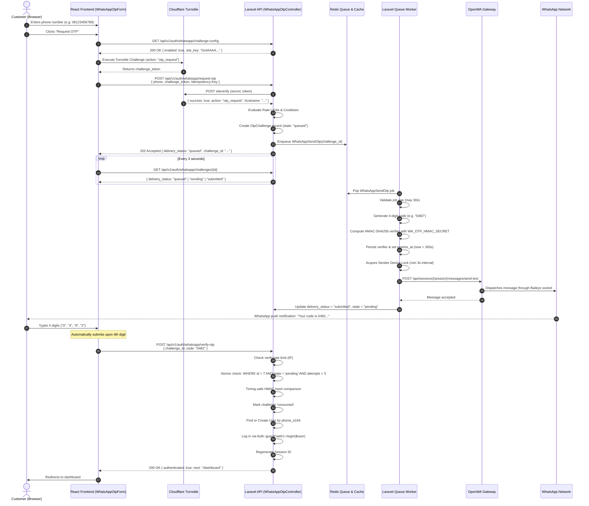

# 🔐 WhatsApp OTP Authentication & Gateway System Architecture

> **Complete Technical Specification, Lifecycle Flow, and Developer Integration Manual**  
> *Target Audience: Frontend Engineers, Backend Engineers, DevOps, and System Architects.*

---

## 📑 Table of Contents

1. [Executive Summary & Purpose](#1-executive-summary--purpose)
2. [High-Level Architecture & Component Topology](#2-high-level-architecture--component-topology)
3. [End-to-End Authentication Lifecycle (Step-by-Step)](#3-end-to-end-authentication-lifecycle-step-by-step)
4. [Security, Cryptography & Verifier Model](#4-security-cryptography--verifier-model)
5. [Cloudflare Turnstile Bot Defense Integration](#5-cloudflare-turnstile-bot-defense-integration)
6. [Asynchronous Redis Queue & Delivery States](#6-asynchronous-redis-queue--delivery-states)
7. [Multi-Device Sender Pool & Intelligent Failover](#7-multi-device-sender-pool--intelligent-failover)
8. [Zero-Overwrite Guarantee for Laravel](#8-zero-overwrite-guarantee-for-laravel)
9. [Complete API Reference & Data Contracts](#9-complete-api-reference--data-contracts)
10. [Full Environment Variables Reference (`.env`)](#10-full-environment-variables-reference-env)
11. [Frontend SPA Integration Guide (React)](#11-frontend-spa-integration-guide-react)
12. [Back-Office Management Portal (9-Menu Suite)](#12-back-office-management-portal-9-menu-suite)
13. [Production Deployment, Queue Supervision & Operations](#13-production-deployment-queue-supervision--operations)
14. [Observability, Audit Logs & Outgoing Webhooks](#14-observability-audit-logs--outgoing-webhooks)
15. [Troubleshooting Guide & Failure Modes](#15-troubleshooting-guide--failure-modes)

---

## 1. Executive Summary & Purpose

### The Business Challenge
- **High SMS/Cloud API Costs**: Traditional OTP providers (Twilio, Firebase SMS, Meta WhatsApp Cloud API) charge recurring fees per message, creating unpredictable monthly operational expenses.
- **Intrusive Scaffolding**: Standard authentication packages frequently overwrite core application files (`User.php`, `Controller.php`, `routes/api.php`), making them dangerous to install into existing, mature Laravel applications.
- **Single Point of Failure**: Relying on a single WhatsApp number risks severe business disruption if that sender encounters account warnings, rate limits, or connectivity loss.
- **Bot Vulnerability**: Public phone authentication endpoints are prime targets for SMS/OTP pumping attacks, causing queue exhaustion and reputation degradation.

### The Solution
This repository delivers an enterprise-grade, self-hosted, two-tier ecosystem:
1. **WhatsApp Gateway Engine**: A standalone, containerized microservice running [OpenWA](https://github.com/open-wa/wa-automate-nodejs) powered by the battle-tested Baileys engine. Supports multi-session WebSocket connectivity, QR/pairing-code linkage, and direct messaging without per-message platform fees.
2. **Drop-in Laravel Add-on (`whatsapp-addon/`)**: An isolated, additive Laravel package providing passwordless 4-digit WhatsApp OTP login, multi-sender round-robin rotation, Cloudflare Turnstile verification, and a 9-menu operations back-office.

---

## 2. High-Level Architecture & Component Topology

```text
┌────────────────────────────────────────────────────────────────────────┐
│                          End-User Browser                              │
│  ┌────────────────────────┐         ┌──────────────────────────────┐  │
│  │   WhatsAppOtpForm      │ <-----> │ Cloudflare Turnstile Widget  │  │
│  │   (React 19 SPA)       │         │ (Invisible / Managed Mode)   │  │
│  └───────────┬────────────┘         └──────────────┬───────────────┘  │
└──────────────┼─────────────────────────────────────┼──────────────────┘
               │ 1. HTTPS POST /request-otp          │ Verify Token
               │ (phone + challenge_token)           ▼
┌──────────────▼────────────────────────────────────────────────────────┐
│                        Laravel 11+ Host App                           │
│  ┌────────────────────────┐         ┌──────────────────────────────┐  │
│  │ WhatsAppOtpController  │ ------> │ WhatsAppBotChallenge         │  │
│  └───────────┬────────────┘         │ (Verify against Cloudflare)  │  │
│              │                      └──────────────────────────────┘  │
│              ▼                                                        │
│  ┌────────────────────────┐         ┌──────────────────────────────┐  │
│  │ OtpService             │ ------> │ RateLimiter & Admission      │  │
│  │ (Admission & DB Record)│         │ (Phone, IP, Tenant, Global)  │  │
│  └───────────┬────────────┘         └──────────────────────────────┘  │
│              │                                                        │
│              ▼                                                        │
│     Dispatch Job (Challenge ID only)                                  │
│              │                                                        │
│              ▼                                                        │
│       ┌──────────────┐                                                │
│       │ Redis Queue  │                                                │
│       │ (whatsapp-otp)                                                │
│       └──────┬───────┘                                                │
└──────────────┼────────────────────────────────────────────────────────┘
               │ Dequeue Job
               ▼
┌────────────────────────────────────────────────────────────────────────┐
│                     Supervised Worker Instance                         │
│  ┌────────────────────────┐         ┌──────────────────────────────┐  │
│  │ WhatsAppSendOtp Job    │ ------> │ Generate 4-digit code        │  │
│  │                        │         │ Calculate HMAC-SHA256 verifier│ │
│  └───────────┬────────────┘         └──────────────┬───────────────┘  │
│              │                                     ▼                  │
│              │                          Save Verifier in DB           │
│              ▼                                                        │
│  ┌────────────────────────┐                                           │
│  │ OpenWaTransport        │                                           │
│  │ (Round-Robin Pool)     │                                           │
│  └───────────┬────────────┘                                           │
└──────────────┼────────────────────────────────────────────────────────┘
               │ 2. HTTP POST /api/sessions/{session}/messages/send-text
               ▼
┌────────────────────────────────────────────────────────────────────────┐
│                     OpenWA Gateway Container                          │
│               Port 18091 (Internal Docker / Localhost)                │
│                                                                        │
│   Active Session 1          Active Session 2         Active Session 3  │
│   [+62 811-XXXX-001]       [+62 812-XXXX-002]       [+62 813-XXXX-003] │
└───────────────────────┬────────────────────────────────────────────────┘
                        │ Multi-Session WebSocket
                        ▼
            ┌───────────────────────┐
            │   WhatsApp Servers    │
            └───────────┬───────────┘
                        │
                        ▼
            ┌───────────────────────┐
            │ Customer Mobile Phone │
            │ (Receives 4-digit OTP)│
            └───────────────────────┘
```

---

## 3. End-to-End Authentication Lifecycle (Step-by-Step)



---

## 4. Security, Cryptography & Verifier Model

### Zero-Plaintext Code Storage
1. **Plaintext Never Stored**: Neither the database nor the Redis queue ever holds the plaintext OTP code.
2. **Ephemeral Generation**: The 4-digit code is generated exclusively inside worker memory at dispatch time.
3. **Cryptographic Pepper (HMAC-SHA256)**: The verifier string is calculated as:
   $$\text{verifier} = \text{HMAC-SHA256}(\text{challenge\_id} \parallel \text{tenant\_key} \parallel \text{phone\_e164} \parallel \text{purpose} \parallel \text{code}, \text{WA\_OTP\_HMAC\_SECRET})$$
4. **Timing-Safe Comparison**: Verification utilizes PHP's `hash_equals()` to prevent timing attack vulnerabilities.
5. **Fixed 4-Digit Numeric Contract**:
   - Matches standard customer expectations for frictionless mobile login.
   - Preserves leading zeros (e.g., `0123` is valid and never truncated to `123`).
   - Verified via strict regex `/^\d{4}$/D`.

### Attack Mitigation & Rate Limits
| Scope | Default Limit | Window | Action on Violation |
| :--- | :--- | :--- | :--- |
| **Per Phone Number** | 5 requests | 900 seconds (15 min) | HTTP 429 `RATE_LIMITED` |
| **Per Client IP (Send)** | 20 requests | 900 seconds (15 min) | HTTP 429 `RATE_LIMITED` |
| **Per Client IP (Verify)**| 60 attempts | 900 seconds (15 min) | HTTP 429 `RATE_LIMITED` |
| **Per Tenant (Send)** | 500 requests | 900 seconds (15 min) | HTTP 429 `RATE_LIMITED` |
| **System-wide (Send)** | 2,000 requests| 900 seconds (15 min) | HTTP 429 `RATE_LIMITED` |
| **Failed Attempts / Code**| 5 attempts | Within 300s TTL | Locks challenge (`attempts_exceeded`) |
| **Resend Cooldown** | 30 seconds | Per challenge | HTTP 429 `RESEND_COOLDOWN` |

---

## 5. Cloudflare Turnstile Bot Defense Integration

### Verification Flow
1. **Lazy Execution**: The Cloudflare Turnstile widget does **not** run automatically on page load. It renders and executes **only after** the user clicks "Request OTP" or "Resend OTP", saving resource overhead.
2. **Action Binding**:
   - Initial request binds action: `otp_request`.
   - Resend request binds action: `otp_resend`.
   - The backend validates that `$response->json('action') === $action`.
3. **Hostname Validation**:
   - The siteverify response must match one of the allowed hosts configured in `WA_OTP_TURNSTILE_HOSTNAMES`.
   - Prevents attackers from using tokens obtained from other Turnstile widgets.
4. **Idempotent Replay Cache**:
   - A verified Turnstile token is cached in Redis with key `wa-otp:bot:<token-hash>`.
   - If a network interruption occurs, the exact HTTP request (matching Session ID, Host, Action, Phone, and `Idempotency-Key`) may be safely replayed for up to 300 seconds without triggering a new Turnstile challenge.
   - Reusing the token for a different action or phone number is strictly forbidden (`BOT_CHECK_FAILED`).

---

## 6. Asynchronous Redis Queue & Delivery States

### Why Asynchronous Delivery?
WhatsApp socket communication involves variable latency (typically 500ms - 2500ms). Executing this synchronously within an HTTP request causes connection pool exhaustion, slow user response times, and poor UX. By offloading to Redis:
- HTTP requests respond immediately in **< 50ms** with HTTP 202 (`queued`).
- Back-pressure is absorbed by Redis workers.

### Delivery State Transitions
```text
  [queued] ──(Worker dequeues)──> [sending] ──(Gateway accepts)──> [submitted]
     │                               │                                   │
     │ (>30s queue wait)             │ (>35s worker failure)             │ (Customer enters code)
     ▼                               ▼                                   ▼
  [failed]                        [unknown]                          [consumed]
```

- **`queued`**: Accepted by API, waiting for an available background worker.
- **`sending`**: Worker has acquired a sender slot and is transmitting to the OpenWA gateway.
- **`submitted`**: Successfully delivered to the WhatsApp gateway engine.
- **`unknown`**: Gateway request timed out or worker crashed during transmission. The system **never** automatically resends an `unknown` challenge to avoid spamming the customer with duplicate codes.
- **`failed`**: Delivery failed definitively (e.g. invalid WhatsApp number or unlinked sender).

---

## 7. Multi-Device Sender Pool & Intelligent Failover

### Round-Robin Multi-Device Routing
To avoid relying on a single WhatsApp number, the add-on supports pooling multiple sender numbers via the `sender_pool` table:

```text
Incoming OTP Request
         │
         ▼
┌──────────────────┐
│  Sender Resolver │ ─── Checks: status = 'READY', interval >= 3s, not suspended
└────────┬─────────┘
         │
         ├──> Device A (+62 811-1111) [Last sent: 5s ago]  --> SELECTED
         ├──> Device B (+62 812-2222) [Last sent: 1s ago]  --> SKIPPED (Throttle)
         └──> Device C (+62 813-3333) [Status: 'STOPPED']   --> SKIPPED (Offline)
```

### Key Sender Pool Features
1. **Minimum Interval Throttle**: Enforces a minimum interval (default: 3 seconds) between dispatches per device to protect numbers from WhatsApp automated spam heuristics.
2. **Auto-Suspension on Failure**: If a sender fails multiple times consecutively (`WA_OTP_POOL_FAILOVER_RETRIES`), it is automatically suspended for a cooldown period (default: 30 minutes) to avoid repeated delivery failures.
3. **Graceful Failover**: When a chosen device fails to send, the worker automatically re-routes the message to the next available ready device in the pool.

---

## 8. Zero-Overwrite Guarantee for Laravel

### Non-Intrusive Design Principles
The add-on is designed to drop into any existing Laravel 10, 11, or 12 project without modifying existing models, controllers, or database migrations:

```text
Existing Laravel App                WhatsApp Add-on (Drop-in)
────────────────────                ─────────────────────────
app/Models/User.php         <─── NO OVERWRITE ───>  database/migrations/0001_wa_users.php (Additive columns only)
app/Http/Controllers/      <─── NO OVERWRITE ───>  app/Http/Controllers/WhatsAppOtpController.php
routes/api.php              <─── NO OVERWRITE ───>  routes/whatsapp.php (Included via require)
config/app.php              <─── NO OVERWRITE ───>  config/whatsapp_otp.php (Isolated config file)
```

### Safe User Schema Additions
The migration `0001_wa_users.php` only adds optional, nullable columns to your existing `users` table:
- `phone_e164` (string, unique, nullable)
- `phone_verified_at` (timestamp, nullable)

Your application's existing authentication (email/password, OAuth, socialite) continues to function completely unaltered.

---

## 9. Complete API Reference & Data Contracts

All endpoints return standard JSON responses and support `Accept: application/json`.

### 1. Retrieve Challenge Configuration
- **Method**: `GET`
- **Path**: `/api/v1/auth/whatsapp/challenge-config`
- **Auth**: None (Public)
- **Response `200 OK`**:
```json
{
  "enabled": true,
  "site_key": "0x4AAAAAA...your-site-key"
}
```

---

### 2. Request OTP Code
- **Method**: `POST`
- **Path**: `/api/v1/auth/whatsapp/request-otp`
- **Headers**:
  - `Idempotency-Key`: UUIDv4 string (recommended)
- **Request Body**:
```json
{
  "phone": "08123456789",
  "challenge_token": "0.4h_a1...<turnstile_token>",
  "purpose": "login"
}
```
- **Response `202 Accepted` (Queued Mode)**:
```json
{
  "challenge_id": "7c9f8b1a2e3d4c5b6a7f8e9d0c1b2a3f4e5d6c7b",
  "masked_phone": "+62 812 •••• 6789",
  "expires_at": null,
  "expires_in": null,
  "state": "queued",
  "server_time": "2026-10-31T14:30:00+00:00",
  "resend_available_at": "2026-10-31T14:30:30+00:00",
  "resend_after": 30,
  "delivery_status": "queued"
}
```

---

### 3. Poll Challenge Delivery Status
- **Method**: `GET`
- **Path**: `/api/v1/auth/whatsapp/challenges/{id}`
- **Auth**: Stateful session (must have requested the challenge)
- **Response `200 OK`**:
```json
{
  "challenge_id": "7c9f8b1a2e3d4c5b6a7f8e9d0c1b2a3f4e5d6c7b",
  "masked_phone": "+62 812 •••• 6789",
  "expires_at": "2026-10-31T14:35:00+00:00",
  "expires_in": 295,
  "state": "pending",
  "server_time": "2026-10-31T14:30:05+00:00",
  "resend_available_at": "2026-10-31T14:30:30+00:00",
  "resend_after": 25,
  "delivery_status": "submitted"
}
```

---

### 4. Resend OTP Code
- **Method**: `POST`
- **Path**: `/api/v1/auth/whatsapp/resend-otp`
- **Headers**:
  - `Idempotency-Key`: UUIDv4 string
- **Request Body**:
```json
{
  "challenge_id": "7c9f8b1a2e3d4c5b6a7f8e9d0c1b2a3f4e5d6c7b",
  "challenge_token": "0.4h_a2...<new_turnstile_token>"
}
```
- **Response `202 Accepted`**:
Returns a new challenge payload. The previous challenge is automatically marked `superseded`.

---

### 5. Verify OTP & Authenticate
- **Method**: `POST`
- **Path**: `/api/v1/auth/whatsapp/verify-otp`
- **Request Body**:
```json
{
  "challenge_id": "7c9f8b1a2e3d4c5b6a7f8e9d0c1b2a3f4e5d6c7b",
  "code": "0482"
}
```
- **Response `200 OK`**:
```json
{
  "authenticated": true,
  "user": {
    "id": "9d8e7f6a-5b4c-3d2e-1f0a-9b8c7d6e5f4a",
    "name": "Customer Name",
    "phone": "+628123456789"
  },
  "onboarding_required": false,
  "next": "/dashboard"
}
```

---

### Error Response Codes Table
| HTTP Code | Error Code (`code`) | Reason & Recovery |
| :--- | :--- | :--- |
| `400` | `STATEFUL_ORIGIN_REQUIRED` | Request missing session cookie or CSRF header. |
| `401` | `OTP_INVALID` | Code did not match HMAC verifier. Decrements attempts. |
| `409` | `CHALLENGE_SUPERSEDED` | User submitted code from an older, replaced request. |
| `409` | `REQUEST_IN_PROGRESS` | Parallel request in progress for the same token. |
| `422` | `BOT_CHECK_FAILED` | Turnstile token invalid, expired, or hostname mismatch. |
| `422` | `OTP_EXPIRED` | 300-second TTL elapsed before code was verified. |
| `422` | `OTP_ATTEMPTS_EXCEEDED` | 5 failed attempts reached; challenge is locked. |
| `429` | `RATE_LIMITED` | Rate limit window exceeded. Contains `retry_after`. |
| `429` | `RESEND_COOLDOWN` | Attempted resend before 30-second cooldown expired. |
| `503` | `BOT_CHECK_UNAVAILABLE` | Turnstile keys missing or Cloudflare unreachable. |
| `503` | `TRANSPORT_UNAVAILABLE` | No active WhatsApp sender devices available. |

---

## 10. Full Environment Variables Reference (`.env`)

```dotenv
# ==============================================================================
# 1. WHATSAPP GATEWAY ENGINE (OpenWA)
# ==============================================================================
OPENWA_BASE_URL=http://127.0.0.1:18091
OPENWA_SESSION_ID=otp-sender-1
OPENWA_API_KEY=
OPENWA_DASHBOARD_API_KEY=your-secure-admin-api-key
OPENWA_CONNECT_TIMEOUT=3
OPENWA_TIMEOUT=15

# ==============================================================================
# 2. CRYPTOGRAPHY & SECURITY (CRITICAL)
# ==============================================================================
# Independent random 64-char hex string used for HMAC-SHA256 verifier calculations.
# NEVER share or commit this key.
WA_OTP_HMAC_SECRET=your-random-64-character-hex-string-secret-here

# openwa (Production) | mock (Local automated testing only)
WA_OTP_TRANSPORT=openwa
WA_OTP_DEFAULT_REGION=ID

# ==============================================================================
# 3. CLOUDFLARE TURNSTILE BOT PROTECTION
# ==============================================================================
WA_OTP_TURNSTILE_ENABLED=true
WA_OTP_TURNSTILE_SITE_KEY=0x4AAAAAA...your-public-site-key
WA_OTP_TURNSTILE_SECRET_KEY=0x4AAAAAA...your-server-secret-key
WA_OTP_TURNSTILE_HOSTNAMES=your-domain.com,login.your-domain.com,localhost,127.0.0.1

# ==============================================================================
# 4. ASYNCHRONOUS REDIS QUEUE
# ==============================================================================
WA_OTP_QUEUE_ENABLED=true
WA_OTP_QUEUE_CONNECTION=redis
WA_OTP_QUEUE_NAME=whatsapp-otp
WA_OTP_QUEUE_MAX_WAIT_SECONDS=30
WA_OTP_QUEUE_MAX_PENDING=1000
REDIS_QUEUE_RETRY_AFTER=90

# ==============================================================================
# 5. MULTI-SENDER POOL & RATE LIMITS
# ==============================================================================
WA_OTP_POOL_ENABLED=true
WA_OTP_POOL_FAILOVER_RETRIES=3
WA_OTP_POOL_AUTO_SUSPEND=true
WA_OTP_POOL_SUSPEND_COOLDOWN_MINUTES=30
WA_OTP_SENDER_LIMITS_ENABLED=true
WA_OTP_SENDER_MIN_INTERVAL_SECONDS=3

# Rate Limits (900s window)
WA_OTP_SEND_PER_PHONE=5
WA_OTP_SEND_PER_IP=20
WA_OTP_SEND_SYSTEM=2000
WA_OTP_SEND_GLOBAL=500
WA_OTP_SEND_WINDOW_SECONDS=900
WA_OTP_VERIFY_PER_IP=60
WA_OTP_VERIFY_WINDOW_SECONDS=900
WA_OTP_MAX_ATTEMPTS=5

# ==============================================================================
# 6. MESSAGE TEMPLATE & RETENTION
# ==============================================================================
WA_OTP_MESSAGE_TEMPLATE="Your :app sign-in code is :code. Expires in :minutes minutes. Do not share this code."
WA_OTP_RETENTION_DAYS=30

# ==============================================================================
# 7. OUTGOING WEBHOOKS (Optional)
# ==============================================================================
WA_OTP_VERIFIED_MEMBER_WEBHOOK_URL=https://api.your-crm.com/webhooks/whatsapp-verified
WA_OTP_WEBHOOK_SECRET=your-webhook-hmac-secret
```

---

## 11. Frontend SPA Integration Guide (React)

### Installation
Copy `whatsapp-addon/frontend/` into your React project (e.g. `src/features/whatsapp/`).

### Component Usage Example
```tsx
import React from 'react';
import WhatsAppOtpForm from '@/features/whatsapp/components/WhatsAppOtpForm';
import { WhatsAppAuthProvider } from '@/features/whatsapp/contexts/AuthContext';
import { useAuth } from '@/contexts/AuthContext';

export default function LoginModal({ isOpen, onClose }: { isOpen: boolean; onClose: () => void }) {
    const { refreshUserSession } = useAuth();

    if (!isOpen) return null;

    return (
        <div className="modal-backdrop">
            <div className="modal-card">
                <h2>Sign in with WhatsApp</h2>
                <WhatsAppAuthProvider checkAuth={refreshUserSession}>
                    <WhatsAppOtpForm onDone={onClose} />
                </WhatsAppAuthProvider>
            </div>
        </div>
    );
}
```

### Key Frontend Behaviors
1. **Auto-Submit**: When the 4th digit is typed, verification fires automatically without needing to press Enter.
2. **Session Storage Continuity**: Active challenges are tracked in `sessionStorage` so refreshing the browser retains the countdown timer and masked phone number.
3. **Turnstile Injection**: The Cloudflare script is loaded dynamically on-demand; no heavy scripts bloat the initial page load.

---

## 12. Back-Office Management Portal (9-Menu Suite)

The package provides a comprehensive operations portal for support and IT operations staff:

| Menu | Type | Description |
| :--- | :--- | :--- |
| **1. Sessions & Senders** | Native React | Manage sender numbers, view signal/battery, generate QR/pairing codes, rotate sessions. |
| **2. Verified Members** | Native React | Filter and inspect users authenticated via WhatsApp, view verification timestamps. |
| **3. Engine Dashboard** | Embedded Gateway | Monitor real-time memory usage, active socket connections, and gateway engine stats. |
| **4. Live Chats** | Embedded Gateway | View recent conversations and delivery statuses for customer support diagnosis. |
| **5. Webhook Manager** | Embedded Gateway | Register external webhook URLs for message events and delivery receipts. |
| **6. Templates Editor** | Embedded Gateway | Manage predefined interactive and text response templates. |
| **7. Message Sandbox** | Embedded Gateway | Send ad-hoc test messages to test specific device connectivity. |
| **8. Plugins** | Embedded Gateway | Extend gateway capabilities with community plugins. |
| **9. Engine Logs** | Embedded Gateway | Stream raw operational logs from the Baileys engine. |

*Menus 3–9 are seamlessly embedded using secure reverse-proxy subrequests (`/gateway-api/`) authenticated via Laravel Sanctum admin roles.*

---

## 13. Production Deployment, Queue Supervision & Operations

### Step 1: Start OpenWA Gateway via Docker
On your server or VPS:
```bash
docker compose up -d
```
Verify the gateway health:
```bash
curl -fsS http://127.0.0.1:18091/api/health/ready
# Expected: {"status":"ok", ...}
```

### Step 2: Configure Supervisor for Queue Workers
Create `/etc/supervisor/conf.d/whatsapp-otp-worker.conf`:
```ini
[program:whatsapp-otp-worker]
process_name=%(program_name)s_%(process_num)02d
command=php /var/www/html/artisan queue:work redis --queue=whatsapp-otp --sleep=1 --tries=20 --timeout=60 --max-time=3600
autostart=true
autorestart=true
user=www-data
numprocs=2
redirect_stderr=true
stdout_logfile=/var/log/supervisor/whatsapp-otp.log
stopwaitsecs=90
```

Load and start the worker:
```bash
supervisorctl reread
supervisorctl update
supervisorctl start whatsapp-otp-worker:*
```

### Step 3: Deployment Pipeline Script
Whenever deploying code or environment updates:
```bash
# 1. Update files
git pull origin main

# 2. Run migrations
php artisan migrate --force

# 3. Refresh Laravel Configuration Cache
php artisan config:clear
php artisan config:cache
php artisan route:cache

# 4. Gracefully restart workers (they finish in-flight jobs before restarting)
php artisan queue:restart
```

---

## 14. Observability, Audit Logs & Outgoing Webhooks

### Audit Logging
All authentication lifecycle events are logged to Laravel's logging pipeline with masked phone numbers:
```json
{"event":"wa_otp.request","tenant":"default","phone":"+62 812 •••• 6789","outcome":"queued","correlation_id":"req-abc-123"}
{"event":"wa_otp.verify","tenant":"default","phone":"+62 812 •••• 6789","outcome":"success","correlation_id":"req-abc-456"}
```

### Outgoing Verified Member Webhook
When a customer verifies their phone, an HTTP POST is dispatched to `WA_OTP_VERIFIED_MEMBER_WEBHOOK_URL` with an HMAC signature header:
- **Header**: `X-Webhook-Signature: <sha256_hash>`
- **Payload**:
```json
{
  "event": "member.verified",
  "user_id": "9d8e7f6a-5b4c-3d2e-1f0a-9b8c7d6e5f4a",
  "phone": "+628123456789",
  "phone_verified_at": "2026-10-31T14:30:15+00:00",
  "timestamp": "2026-10-31T14:30:15+00:00"
}
```

---

## 15. Troubleshooting Guide & Failure Modes

### 1. "Verification is temporarily unavailable"
- **Cause**: `WA_OTP_TURNSTILE_SITE_KEY` or `WA_OTP_TURNSTILE_SECRET_KEY` is empty in `.env`.
- **Solution**: Follow Cloudflare Turnstile setup, populate both keys, and run `php artisan config:cache`.

### 2. "Verification failed. Please try again." (422)
- **Cause**: Domain mismatch in Turnstile.
- **Solution**: Check that the current domain (e.g. `your-domain.com`) is present in both Cloudflare Dashboard widget domains and `WA_OTP_TURNSTILE_HOSTNAMES`.

### 3. OTP Code Never Arrives on Phone
- **Diagnostic Steps**:
  1. Check worker logs: `docker logs wa-login-web-otp-worker-1` or `supervisorctl tail -f whatsapp-otp-worker`.
  2. Verify sender status: Visit Back-Office -> **WhatsApp Sessions & Senders**. Confirm at least one device displays status **`READY`** or **`WORKING`**.
  3. Inspect pending jobs: Run `php artisan queue:monitor redis:whatsapp-otp`.

### 4. "Session expired. Refresh the page and try again." (419)
- **Cause**: Missing or stale CSRF cookie (`/sanctum/csrf-cookie`).
- **Solution**: Ensure your frontend Axios instance has `withCredentials: true` and `withXSRFToken: true`.

---

*Maintained for clean, non-intrusive enterprise Laravel integration.*
