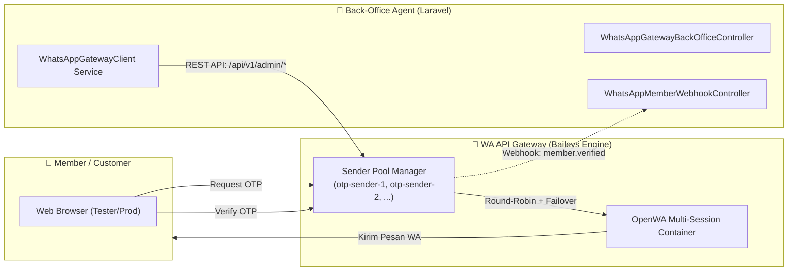

# Reference Laravel Client: WhatsApp Gateway & Back-Office Integration

Paket referensi ini dibuat untuk tim Back-Office Agent (berbasis Laravel) agar dapat langsung di-copy & paste ke dalam codebase Back-Office Laravel.

> 💡 **CATATAN PENTING**:
> Jika aplikasi Anda sudah berjalan satu server / satu stack Docker dengan Gateway (seperti pada web utama Anda), Anda **tidak perlu token manual** ini karena semua sudah tersambung otomatis secara internal.
> 
> Panduan di bawah ini **khusus untuk aplikasi Back-Office / Server LAIN yang berdiri sendiri** (terpisah server) dan ingin menembak WhatsApp Gateway melalui REST API internet.

---

## 1. Arsitektur Komunikasi



---

## 2. Cara Pemasangan di Back-Office Laravel

1. **Salin Folder `src` & `config`:**
   - Salin isi `src/Services/` ke `app/Services/WhatsAppGateway/`
   - Salin isi `src/Controllers/` ke `app/Http/Controllers/BackOffice/`
   - Salin `config/whatsapp_gateway_client.php` ke folder `config/`

2. **Tambahkan Environment Variable di `.env` Back-Office:**
   ```env
   WA_GATEWAY_API_URL="https://api.yourdomain.com"
   WA_GATEWAY_API_TOKEN="sanctum-token-admin-atau-super-admin"
   WA_GATEWAY_WEBHOOK_SECRET="kunci-rahasia-hmac-webhook"
   WA_GATEWAY_TIMEOUT=15
   ```

3. **Daftarkan Route di `routes/api.php` Back-Office:**
   ```php
   use App\Http\Controllers\BackOffice\WhatsAppGatewayBackOfficeController;
   use App\Http\Controllers\BackOffice\WhatsAppMemberWebhookController;

   // 1. Endpoint Manajemen Gateway & Member Terverifikasi (Admin Only)
   Route::prefix('backoffice/whatsapp')->middleware(['auth:sanctum', 'role:admin'])->group(function () {
       Route::get('senders', [WhatsAppGatewayBackOfficeController::class, 'listSenders']);
       Route::post('senders', [WhatsAppGatewayBackOfficeController::class, 'addSender']);
       Route::post('senders/{id}/toggle', [WhatsAppGatewayBackOfficeController::class, 'toggleSender']);
       Route::get('senders/{id}/qr', [WhatsAppGatewayBackOfficeController::class, 'getQrCode']);
       Route::post('senders/{id}/pairing-code', [WhatsAppGatewayBackOfficeController::class, 'requestPairingCode']);
       Route::post('senders/{id}/test-send', [WhatsAppGatewayBackOfficeController::class, 'testSend']);
       Route::get('verified-members', [WhatsAppGatewayBackOfficeController::class, 'verifiedMembers']);
   });

   // 2. Webhook Listener saat Member Terverifikasi OTP
   Route::post('webhooks/whatsapp/member-verified', WhatsAppMemberWebhookController::class)
       ->withoutMiddleware([\App\Http\Middleware\VerifyCsrfToken::class]);
   ```

---

## 3. Katalog API Endpoints yang Disediakan Gateway

Semua endpoint di bawah ini diakses dengan header:
- `Authorization: Bearer <API_TOKEN>`
- `Accept: application/json`

### A. Sender Pool (Manajemen Banyak Nomor Pengirim)
| Method | Endpoint | Deskripsi |
|---|---|---|
| `GET` | `/api/v1/admin/sender-pool` | Mengambil seluruh daftar nomor WhatsApp di pool beserta status dan statistik rotasi |
| `POST` | `/api/v1/admin/sender-pool` | Menambahkan nomor/sesi baru (`session_id`, `label`, optional `api_key`) |
| `GET` | `/api/v1/admin/sender-pool/{id}` | Detail nomor + status live dari OpenWA container |
| `PUT` | `/api/v1/admin/sender-pool/{id}` | Update label atau API key nomor |
| `DELETE` | `/api/v1/admin/sender-pool/{id}` | Menghapus nomor dari pool rotasi |
| `POST` | `/api/v1/admin/sender-pool/{id}/toggle` | Menangguhkan (pause) atau mengaktifkan kembali nomor |
| `POST` | `/api/v1/admin/sender-pool/{id}/sync` | Sinkronisasi nomor WhatsApp & status dari gateway |
| `GET` | `/api/v1/admin/sender-pool/{id}/qr` | Mengambil data QR code (base64 PNG) untuk scan pairing |
| `POST` | `/api/v1/admin/sender-pool/{id}/pairing-code` | Meminta 8-digit kode pairing WhatsApp via nomor HP |
| `POST` | `/api/v1/admin/sender-pool/{id}/test-send` | Mengirim pesan WhatsApp uji coba dari nomor pengirim ini |

### B. Member Terverifikasi (Verified Members)
| Method | Endpoint | Deskripsi |
|---|---|---|
| `GET` | `/api/v1/admin/verified-members` | Daftar pengguna yang telah lolos verifikasi OTP WhatsApp (paginasi, pencarian nomor, filter tanggal, dan statistik hari ini/7 hari terakhir) |
| `GET` | `/api/v1/admin/verified-members/{id}` | Detail lengkap satu pengguna terverifikasi |

### C. Webhook Otomatis (`member.verified`)
Jika di `.env` web pengirim dikonfigurasi `WA_OTP_VERIFIED_MEMBER_WEBHOOK_URL`, maka setiap kali member baru sukses memverifikasi OTP untuk pertama kali, Gateway akan otomatis mengirimkan HTTP POST:

**Payload:**
```json
{
  "event": "member.verified",
  "user_id": 142,
  "uuid": "9c1b3f72-8821-4f81-a960-93a9c7b91234",
  "tenant_key": "default",
  "phone_e164": "+6281234567890",
  "phone_verified_at": "2026-10-14T08:30:00+00:00",
  "timestamp": "2026-10-14T08:30:01+00:00"
}
```
**Header:**
- `X-Webhook-Signature`: SHA256 HMAC dari JSON body menggunakan `WA_OTP_WEBHOOK_SECRET`.

---

## 4. Keamanan & Best Practice
1. **API Key Terenkripsi:** Pada tabel `sender_pool`, API key disimpan terenkripsi menggunakan AES-256 (`Crypt::encryptString`) dan tidak pernah dikembalikan dalam format plaintext di respons API.
2. **Auto-Failover:** Jika salah satu nomor pengirim mengalami rate-limit atau koneksi putus saat mengirimkan OTP, Gateway secara otomatis mengalihkan pengiriman ke nomor berikutnya di pool tanpa membuat login member gagal.
3. **Pemisahan Menu Infra:** Konfigurasi DevOps server (Redis, DB, Engine internals) disembunyikan dari antarmuka operasional back-office agar akun agent fokus hanya pada nomor dan member.
