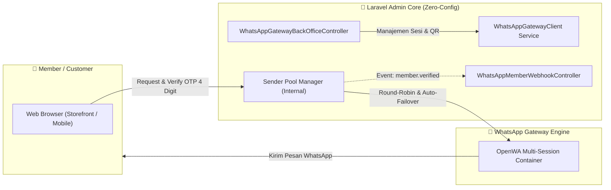

# Reference Laravel Client: WhatsApp Gateway & Back-Office Integration

Paket referensi ini dibuat untuk tim Back-Office Laravel agar dapat langsung digunakan di dalam codebase Laravel Admin tanpa konfigurasi tambahan (**Zero-Config**).

> 💡 **MENYATU DENGAN STRUKTUR LARAVEL ADMIN (TANPA .ENV)**:
> Arsitektur ini menyatu 100% secara native dengan core aplikasi Laravel. Anda **tidak membutuhkan konfigurasi variabel `.env`** dan **tidak membutuhkan token API eksternal**, karena service dan controller ini berjalan langsung di dalam sistem backend admin yang sama.

---

## 1. Arsitektur Komunikasi



---

## 2. Cara Pemasangan di Back-Office Laravel

Integrasi dapat dilakukan dalam 2 langkah cepat tanpa mengubah file `.env`:

1. **Salin Folder `src` ke Struktur Laravel:**
   - Salin isi `src/Services/` ke `app/Services/WhatsAppGateway/`
   - Salin isi `src/Controllers/` ke `app/Http/Controllers/BackOffice/`

2. **Daftarkan Route di `routes/api.php`:**
   ```php
   use App\\Http\\Controllers\\BackOffice\\WhatsAppGatewayBackOfficeController;
   use App\\Http\\Controllers\\BackOffice\\WhatsAppMemberWebhookController;

   // Endpoint Manajemen Gateway & Member Terverifikasi (Admin Only)
   Route::prefix('backoffice/whatsapp')->middleware(['auth:sanctum', 'role:admin'])->group(function () {
       Route::get('senders', [WhatsAppGatewayBackOfficeController::class, 'listSenders']);
       Route::post('senders', [WhatsAppGatewayBackOfficeController::class, 'addSender']);
       Route::post('senders/{id}/toggle', [WhatsAppGatewayBackOfficeController::class, 'toggleSender']);
       Route::get('senders/{id}/qr', [WhatsAppGatewayBackOfficeController::class, 'getQrCode']);
       Route::post('senders/{id}/pairing-code', [WhatsAppGatewayBackOfficeController::class, 'requestPairingCode']);
       Route::post('senders/{id}/test-send', [WhatsAppGatewayBackOfficeController::class, 'testSend']);
       Route::get('verified-members', [WhatsAppGatewayBackOfficeController::class, 'verifiedMembers']);
   });

   // Webhook Listener saat Member Terverifikasi OTP
   Route::post('webhooks/whatsapp/member-verified', WhatsAppMemberWebhookController::class)
       ->withoutMiddleware([\App\Http\Middleware\VerifyCsrfToken::class]);
   ```

---

## 3. Katalog API Endpoints yang Disediakan Gateway

Endpoint di bawah ini diakses langsung menggunakan sesi admin yang sudah aktif:

### A. Sender Pool (Manajemen Banyak Nomor Pengirim)
| Method | Endpoint | Deskripsi |
|---|---|---|
| `GET` | `/api/v1/admin/sender-pool` | Mengambil seluruh daftar nomor WhatsApp di pool beserta status dan statistik rotasi |
| `POST` | `/api/v1/admin/sender-pool` | Menambahkan nomor/sesi baru (`session_id`, `label`) |
| `GET` | `/api/v1/admin/sender-pool/{id}` | Detail nomor + status live dari engine WhatsApp |
| `PUT` | `/api/v1/admin/sender-pool/{id}` | Update label atau konfigurasi nomor |
| `DELETE` | `/api/v1/admin/sender-pool/{id}` | Menghapus nomor dari pool rotasi |
| `POST` | `/api/v1/admin/sender-pool/{id}/toggle` | Menangguhkan (pause) atau mengaktifkan kembali nomor |
| `POST` | `/api/v1/admin/sender-pool/{id}/sync` | Sinkronisasi nomor WhatsApp & status dari gateway |
| `GET` | `/api/v1/admin/sender-pool/{id}/qr` | Mengambil data QR code (base64 PNG) untuk scan pairing |
| `POST` | `/api/v1/admin/sender-pool/{id}/pairing-code` | Meminta 8-digit kode pairing WhatsApp via nomor HP |
| `POST` | `/api/v1/admin/sender-pool/{id}/test-send` | Mengirim pesan WhatsApp uji coba dari nomor pengirim ini |

### B. Member Terverifikasi (Verified Members)
| Method | Endpoint | Deskripsi |
|---|---|---|
| `GET` | `/api/v1/admin/verified-members` | Daftar pengguna yang telah lolos verifikasi OTP WhatsApp (paginasi, pencarian nomor, filter tanggal, dan statistik hari ini/7 hari terakhir) |
| `GET` | `/api/v1/admin/verified-members/{id}` | Detail lengkap satu pengguna terverifikasi |

### C. Event Otomatis (`member.verified`)
Setiap kali member baru sukses memverifikasi OTP WhatsApp 4 digit, event `member.verified` akan otomatis dipicu secara internal:

**Payload:**
```json
{
  "event": "member.verified",
  "user_id": 142,
  "uuid": "9c1b3f72-8821-4f81-a960-93a9c7b91234",
  "tenant_key": "default",
  "phone_e164": "+6281234567890",
  "phone_verified_at": "2026-10-14T08:30:00+00:00",
  "timestamp": "2026-10-14T08:30:01+00:00"
}
```

---

## 4. Keamanan & Keunggulan Arsitektur
1. **Zero-Config**: Tidak membutuhkan konfigurasi manual variabel `.env` ataupun token API eksternal.
2. **Auto-Failover Cerdas**: Jika salah satu nomor pengirim mengalami limit atau gangguan, sistem secara otomatis mengalihkan pengiriman ke nomor cadangan berikutnya di pool.
3. **Penyatuan Menu Back-Office**: Mengintegrasikan nomor pengirim langsung ke menu admin tanpa panel terpisah yang merepotkan.
