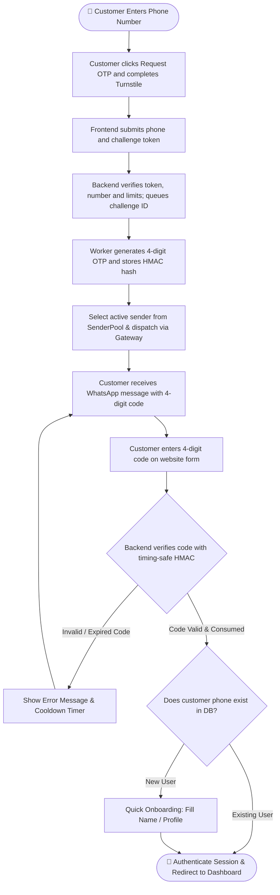

> **System Architecture & PRD:** For deep technical architecture, complete sequence diagrams, full API schemas, verifier cryptography, and lifecycle flows, see [WA_LOGIN_SYSTEM.md](WA_LOGIN_SYSTEM.md) and [QUEUED_LOGIN.md](QUEUED_LOGIN.md).

# 🚀 WhatsApp API Gateway & Drop-in Laravel Add-on

[English](README.md) | [Bahasa Indonesia](README.id.md)

A production-ready, self-hosted **WhatsApp API Gateway** and **non-intrusive drop-in Add-on for Laravel**. Easily add **WhatsApp OTP Customer Login (4-digit)** and a **Multi-Sender Device Pool Back-Office** to your **existing Laravel website** using isolated add-on files and a reviewed host integration.

---

## 📑 Table of Contents
1. [What is This & Why Use It? (Purpose)](#-1-what-is-this--why-use-it-purpose)
2. [Zero-Overwrite Guarantee](#-2-zero-overwrite-guarantee)
3. [System Workflow & Architecture](#-3-system-workflow--architecture)
4. [Customer Login Flowchart](#-4-customer-login-flowchart)
5. [What's Inside & Directory Structure](#-5-whats-inside--directory-structure)
6. [Step-by-Step Implementation Guide (How to Use)](#-6-step-by-step-implementation-guide-how-to-use)
7. [Cloudflare Turnstile Bot Defense Setup](#-7-cloudflare-turnstile-bot-defense-setup)
8. [Asynchronous Redis Queue & Supervisor](#-8-asynchronous-redis-queue--supervisor)
9. [The 9-Menu Back-Office Admin Portal](#-9-the-9-menu-back-office-admin-portal)
10. [Pairing WhatsApp Sender Numbers](#-10-pairing-whatsapp-sender-numbers)
11. [VPS Deployment & Operations Guide](#-11-vps-deployment--operations-guide)
12. [Integration Boundaries & Security](#-12-integration-boundaries--security)

---

## 🎯 1. What is This & Why Use It? (Purpose)

### The Problem
- **Expensive Cloud APIs**: Services like Twilio or official Meta WhatsApp Business API charge steep monthly fees and per-message costs.
- **Intrusive Packages**: Most auth packages require scaffolding a brand new Laravel app from scratch or overwriting your existing controllers, user models, and routes.
- **Single Point of Failure**: Using a single WhatsApp number risks business disruption if that number gets temporarily rate-limited or disconnected.
- **Bot Abuse & OTP Pumping**: Public login endpoints are frequently targeted by spam bots, resulting in queue congestion and unnecessary outbound traffic.

### The Solution
This repository provides a two-part ecosystem:
1. **Self-Hosted WhatsApp Gateway Engine**: Runs via Docker (OpenWA) using the battle-tested Baileys engine. **Zero per-message fees**, completely self-hosted, supports multi-session socket connections.
2. **Drop-in Laravel Add-on (`whatsapp-addon/`)**: A modular package you simply copy into your existing Laravel project. It provides:
   - **Customer Login via 4-digit WhatsApp OTP**: Passwordless, frictionless login with leading-zero preservation.
   - **Cloudflare Turnstile Protection**: Prevents automated bot submission with managed challenge validation.
   - **Asynchronous Redis Queue**: Decouples API responses from WhatsApp network latency for instant user feedback.
   - **Multi-Device Sender Pool**: Attach multiple staff/agent WhatsApp numbers. The system distributes OTP delivery via **Round-Robin** and automatically switches to another active number if one disconnects.
   - **9 Back-Office Management Menus**: Full admin UI for sender devices, logs, webhooks, templates, and verified members.

---

## 🛡️ 2. Zero-Overwrite Guarantee

**Preserve the existing Laravel website and its authentication flows.**  
Core controllers and models use `WhatsApp*` names; services use the `WhatsAppOtp` namespace. Never overwrite host files. Review the User model contract, routes, and migrations before integrating.

| Laravel Default File in Your Project | What This Add-on Uses Instead | Can It Overwrite Your File? |
| :--- | :--- | :--- |
| `app/Http/Controllers/Controller.php` | `app/Http/Controllers/WhatsAppOtpController.php` | ❌ **NEVER** |
| `app/Models/User.php` | `app/Models/WhatsAppOtpChallenge.php`, `WhatsAppSenderPool.php` | ❌ **NEVER** |
| `routes/api.php` & `routes/web.php` | `routes/whatsapp.php` | ❌ **NEVER** |
| Existing User Migrations | `database/migrations/0001_wa_users.php` (additive columns only) | ❌ **NEVER** |
| Default Frontend Layouts | `frontend/components/WhatsAppOtpForm.tsx`, `frontend/backoffice/*` | ❌ **NEVER** |

---

## 🔄 3. System Workflow & Architecture

The system connects your customer, your existing Laravel backend, the gateway engine, and WhatsApp network:

```text
┌─────────────────────────────────┐
│     Customer Web Browser        │
│  (React WhatsAppOtpForm modal)  │
└────────────────┬────────────────┘
                 │ 1. Request OTP (e.g. 08123456789)
                 ▼
┌────────────────────────────────────────────────────────┐
│             Your Existing Laravel Backend              │
│  - Verifies Turnstile bot challenge server-side        │
│  - Enqueues challenge ID to Redis (whatsapp-otp)       │
│  - Returns HTTP 202 Accepted (<50ms response)          │
└────────────────┬───────────────────────────────────────┘
                 │ 2. Dequeued by background worker
                 ▼
┌────────────────────────────────────────────────────────┐
│             Supervised Queue Worker                    │
│  - Generates cryptographically secure 4-digit OTP      │
│  - Stores SHA-256 HMAC hash in DB (otp_challenges)     │
│  - Selects active device from SenderPool (Round-Robin) │
└────────────────┬───────────────────────────────────────┘
                 │ 3. POST /api/sessions/{session}/messages/send-text
                 ▼
┌────────────────────────────────────────────────────────┐
│         OpenWA WhatsApp Gateway Container              │
│                 (Port: 18091)                          │
└────────────────┬───────────────────────────────────────┘
                 │ 4. Baileys Multi-Session Socket
                 ▼
┌─────────────────────────────────┐       ┌───────────────────────────────┐
│        WhatsApp Servers         │ ────> │ Customer WhatsApp Mobile App  │
│                                 │       │ (Receives 4-digit OTP code)   │
└─────────────────────────────────┘       └───────────────────────────────┘
```

---

## 📊 4. Customer Login Flowchart



### Plain-Language Breakdown:
1. **Request OTP**: Customer inputs their mobile number on the login modal.
2. **Challenge & Queue**: After clicking the button, Turnstile verifies the visitor. Laravel enqueues the challenge ID; a worker generates a 4-digit code, saves its peppered HMAC hash, and sends through an available WhatsApp sender. The form displays queued/sending status until submission or failure.
3. **Receive**: Customer receives the WhatsApp notification on their phone.
4. **Verify**: Customer types the 4 digits into the website form. Verification fires automatically on the 4th digit.
5. **Session Created**: The backend verifies the code atomically (`WHERE state = 'pending'`), marks it consumed, logs the user in via Laravel Sanctum session, and redirects to the dashboard.

---

## 📁 5. What's Inside & Directory Structure

```text
whatsapp-addon/
├── app/
│   ├── Http/Controllers/
│   │   ├── WhatsAppOtpController.php
│   │   ├── Admin/WhatsApp*Controller.php
│   │   └── BackOffice/WhatsAppMemberWebhookController.php
│   ├── Jobs/WhatsAppSendOtp.php
│   ├── Models/WhatsApp*.php
│   ├── Providers/WhatsAppOtpServiceProvider.php
│   └── Services/WhatsAppOtp/
├── config/whatsapp_otp.php
├── database/migrations/
│   ├── 0001_wa_users.php
│   ├── 0002_wa_otp.php
│   └── 0003_wa_senders.php
├── routes/whatsapp.php
├── routes/whatsapp_otp_delivery.php
├── WA_LOGIN_SYSTEM.md              # Complete Architecture & Technical Specification
├── QUEUED_LOGIN.md
├── deploy/whatsapp-otp-worker.conf
├── tests/
├── nginx/gateway-reverse-proxy.conf
└── frontend/
    ├── components/
    ├── contexts/AuthContext.tsx
    ├── hooks/useReveal.ts
    ├── hooks/useWhatsAppChallenge.ts
    ├── lib/axios.ts
    ├── backoffice/
    └── examples/AdminDashboardSidebarExample.tsx
```

---

## 🛠️ 6. Step-by-Step Implementation Guide (How to Use)

### Step 1: Start the WhatsApp Gateway Engine
From the repository root:
```bash
docker compose up -d
```
Verify it is running:
```bash
curl http://127.0.0.1:18091/api/health/ready
# Output: {"status":"ok", ...}
```

### Step 2: Copy Add-on Files to Your Laravel Application
Copy the add-on files into your Laravel host application:
- `app/` -> host `app/`
- `config/` -> host `config/`
- `database/migrations/` -> host `database/migrations/`
- `routes/` -> host `routes/`

> **Note**: Never overwrite host files (`User.php`, `Controller.php`, `api.php`, `web.php`). All files in this add-on use dedicated names (`WhatsApp*`).

### Step 3: Run Database Migrations
```bash
php artisan migrate
```
This applies the 3 clean, additive migrations:
1. `0001_wa_users.php` (adds `phone_e164`, `phone_verified_at` to `users`)
2. `0002_wa_otp.php` (creates `otp_challenges` and `otp_deliveries`)
3. `0003_wa_senders.php` (creates `sender_pool`)

### Step 4: Register Routes & Service Provider
In your `routes/api.php`, append:
```php
require __DIR__ . '/whatsapp.php';
```

In your `bootstrap/providers.php` (Laravel 11+) or `config/app.php` (Laravel 10), register:
```php
App\Providers\WhatsAppOtpServiceProvider::class,
```

### Step 5: Configure Environment Variables (`.env`)
Add these lines to your host Laravel `.env` file:
```dotenv
# WhatsApp Gateway Engine
OPENWA_BASE_URL=http://127.0.0.1:18091
OPENWA_SESSION_ID=otp-sender-1
OPENWA_API_KEY=

# OTP Cryptography & Pepper Secret
WA_OTP_HMAC_SECRET=generate-a-random-64-character-hex-secret-here
WA_OTP_TRANSPORT=openwa
WA_OTP_DEFAULT_REGION=ID

# Cloudflare Turnstile Bot Protection (Required in Production)
WA_OTP_TURNSTILE_ENABLED=true
WA_OTP_TURNSTILE_SITE_KEY=<your-turnstile-site-key>
WA_OTP_TURNSTILE_SECRET_KEY=<your-turnstile-secret-key>
WA_OTP_TURNSTILE_HOSTNAMES=your-domain.com,login.your-domain.com,localhost,127.0.0.1

# Asynchronous Redis Queue for OTP
WA_OTP_QUEUE_ENABLED=true
WA_OTP_QUEUE_CONNECTION=redis
WA_OTP_QUEUE_NAME=whatsapp-otp
REDIS_QUEUE_RETRY_AFTER=90

# Rate Limits (900s window)
WA_OTP_SEND_PER_PHONE=5
WA_OTP_SEND_PER_IP=20
WA_OTP_SEND_SYSTEM=2000
WA_OTP_SEND_GLOBAL=500
WA_OTP_SEND_WINDOW_SECONDS=900
WA_OTP_VERIFY_PER_IP=60
WA_OTP_VERIFY_WINDOW_SECONDS=900
WA_OTP_MAX_ATTEMPTS=5
```

---

## 🛡️ 7. Cloudflare Turnstile Bot Defense Setup

Cloudflare Turnstile stops bots and OTP pumping attacks without frustrating real users with visual puzzles.

### Setup Instructions:
1. **Open Cloudflare Dashboard**: Go to [Cloudflare Dashboard](https://dash.cloudflare.com) and click **Turnstile** in the navigation bar.
2. **Add Widget**: Click **Add site / Add widget**.
   - **Widget Name**: e.g., `WhatsApp OTP Login`
   - **Widget Mode**: **Managed** (Recommended)
3. **Configure Domains**: Enter your production domain (e.g. `your-domain.com`), plus `localhost` and `127.0.0.1` for local development.
4. **Obtain Keys**:
   - **Site Key**: Copy into `WA_OTP_TURNSTILE_SITE_KEY`.
   - **Secret Key**: Copy into `WA_OTP_TURNSTILE_SECRET_KEY`. *(If lost, click "Rotate Secret Key" to generate a new one).*
5. **Apply & Refresh Cache**:
   ```bash
   php artisan config:clear
   php artisan config:cache
   ```

---

## ⚡ 8. Asynchronous Redis Queue & Supervisor

In production, OTP delivery is handled asynchronously by Redis to ensure sub-50ms HTTP response times.

### Supervisor Configuration
Create `/etc/supervisor/conf.d/whatsapp-otp-worker.conf`:
```ini
[program:whatsapp-otp-worker]
process_name=%(program_name)s_%(process_num)02d
command=php /var/www/html/artisan queue:work redis --queue=whatsapp-otp --sleep=1 --tries=20 --timeout=60 --max-time=3600
autostart=true
autorestart=true
user=www-data
numprocs=2
redirect_stderr=true
stdout_logfile=/var/log/supervisor/whatsapp-otp.log
stopwaitsecs=90
```

Start the workers:
```bash
supervisorctl reread
supervisorctl update
supervisorctl start whatsapp-otp-worker:*
```

---

## 🖥️ 9. The 9-Menu Back-Office Admin Portal

To give operations and support staff complete control over WhatsApp sessions, copy the layout from `frontend/examples/AdminDashboardSidebarExample.tsx`.

The 9 Menus:
1. **WhatsApp Sessions & Senders** (Native Panel: QR pairing & multi-device rotation)
2. **Verified Members** (Native Panel: Table of customers verified via WhatsApp)
3. **Dashboard** (Embedded Gateway Console: Sockets, memory, overview)
4. **Chats** (Embedded Gateway Console: Live chat history and message viewing)
5. **Webhooks** (Embedded Gateway Console: Outgoing webhook subscriptions)
6. **Templates** (Embedded Gateway Console: Message template editor)
7. **Message Tester** (Embedded Gateway Console: Interactive message sandbox)
8. **Plugins** (Embedded Gateway Console: Extension manager)
9. **Logs** (Embedded Gateway Console: Gateway operational event logs)

---

## 📱 10. Pairing WhatsApp Sender Numbers

You can pair sender numbers in two ways from the **WhatsApp Sessions & Senders** panel:
1. **QR Code Pairing**: Click "Link / Start Session", open WhatsApp on your phone → Linked Devices → Scan the QR code on screen.
2. **Pairing Code (No Camera)**: Enter the sender's phone number → Click "Request 8-character Pairing Code" → Enter the code inside the WhatsApp notification on your phone.

Once paired, the status changes to **`WORKING`** or **`READY`**, and outgoing OTPs will rotate through this number!

---

## 🌐 11. VPS Deployment & Operations Guide

### How to SSH into Your VPS
```bash
ssh user@<your-vps-ip>
```

### Quick Operations Cheat Sheet:
```bash
# 1. Check all container status:
docker ps --format "table {{.Names}}\t{{.Status}}\t{{.Ports}}"

# 2. Run Health Checks:
curl -fsS http://127.0.0.1:18090/api/v1/health && echo ""
curl -fsS http://127.0.0.1:18091/api/health/ready && echo ""

# 3. View Real-time Worker Logs:
docker logs -f --tail 100 wa-login-web-otp-worker-1

# 4. Refresh Configuration After .env Updates:
php artisan config:clear && php artisan config:cache
php artisan queue:restart
```

---

## 🔒 12. Integration Boundaries & Security

- Register `routes/whatsapp.php` once under `/api` with the API middleware; the provider registers services and separately loads `routes/whatsapp_otp_delivery.php` for challenge configuration/status.
- Enable Sanctum stateful API middleware and the Spatie `role` alias in the host.
- Sender pools and verified member lists are scoped to the authenticated admin's tenant.
- The Laravel verifier database stores only peppered HMAC hashes. The mock outbox holds plaintext only in local/testing.
- For complete architecture diagrams, database schema fields, and failure recovery states, read [WA_LOGIN_SYSTEM.md](WA_LOGIN_SYSTEM.md).

---

*Maintained for clean, non-intrusive enterprise Laravel integration.*
